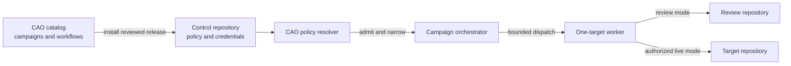
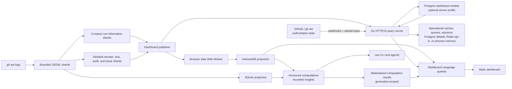

# Architecture

Central Agentic Ops (CAO) governs agentic workflows and runs them from a
central GitHub repository against an explicitly bounded repository fleet. This
repository is both the public campaign catalog and a source-managed control plane
used to develop and exercise campaigns and standalone workflows.

This document is a map of the stable system boundaries and source tree. The
normative contracts live under `specs/`; operator-facing explanations live
under `docs/`.

## System context

CAO separates the decision to run an operation from the mechanism that executes
it:

- **Catalog:** publishes versioned operation campaigns.
- **Control repository:** owns rollout policy, credentials, installed
  workflows, and workflow runs.
- **Target repository:** supplies source data and may receive a declared safe
  output. It does not run control-plane workflows.
- **GitHub Agentic Workflows (gh-aw):** compiles workflow sources and owns
  execution capabilities, limits, authentication, and safe-output mechanics.

The effective authority of a run is the intersection of reviewed CAO policy,
the dispatch request, worker ceilings, credential reach, and capabilities
compiled by gh-aw. No one input can widen another.

## Runtime flows

### Authority envelopes and operating patterns

CAO's authority kernel (`.github/workflows/shared/authority.mjs`) is independent
of workflow roles and orchestration topology. It resolves mode/target ceilings,
checks scope and validates versioned scoped grants. It performs no discovery,
GitHub requests, credential acquisition or workflow dispatch. Existing campaign
and standalone policy adapters use this same resolver while preserving their
legacy output contracts. Campaigns remain first-class, opinionated operating
patterns, not prerequisites for operation execution.

`operations.mjs` provides the direct-operation policy and gh-aw integration
adapter. An exact workflow slug under `control-plane.operations` can import
`shared/operation.md` and request an explicit target or JSON target set without
campaigns, workers, inventory cells or rollout configuration. Identity conflicts
with existing campaign/worker/standalone declarations reject. Multiple targets
are review-only with a common destination; live requires one `target_repo` and
target-bound compiled safe outputs.

The direct operation request, verified execution context and resolved envelope
are distinct contracts. Version 1 binds each scoped target/mode/destination
grant to the control repository, exact policy SHA, workflow reference, run and
attempt. Requests cannot provide verified context or execution capabilities.
The adapter re-resolves exact-revision policy and compares the admitted handoff
before preparing candidates; redirected, archived, disabled or incompletely
observed repositories block execution. Review destination privacy and scope
checks remain independent of target allowlists.

Required enforcement controls are versioned and fail closed when unsupported.
The envelope is neither a credential nor standalone proof of provenance.
Narrowing comparisons require independently verified inputs and cannot grant
delegation. Direct delegation, pooled allowances, runtime-loaded plugins and
additional execution backends are unsupported. Native gh-aw authorization,
credential reach, tools and safe outputs remain cumulative constraints.
See `docs/authority-envelopes.md` for the contracts and authoring example.

### Operation execution

1. A schedule or manual dispatch starts an orchestrator in the control
   repository.
2. `.github/workflows/shared/control.md` and its Node.js support modules load
   `.github/workflows/cao.json` at the exact workflow revision and resolve an
   effective run envelope.
3. The orchestrator discovers, filters, ranks, and selects repositories within
   that envelope.
4. It dispatches one worker run for each selected repository.
5. Each worker revalidates the envelope, analyzes only its dispatched target,
   and emits only safe outputs declared by its compiled workflow.

Orchestrators decide rollout and selection; workers are independent,
single-target enforcement points.

A standalone agentic workflow may instead import shared control with
`role: standalone` and its exact `workflow` slug. It declares no campaign or
worker and needs no campaign record. `control-plane.workflows.<workflow>` owns
its enablement, mode, optional `max-mode` ceiling, target modes, repository cap,
and rollout percentage. Admission verifies that identity against the actual
compiled workflow reference, loads policy at the exact workflow SHA, and checks
API capacity through the same admission path as campaigns. Precompute reuses
bounded inventory, deterministic cells and batches, excludes archived/disabled
repositories, and admits a deterministic subset capped by repository count and
rollout percentage. Each admitted repository carries its own effective mode and
output destination. The workflow performs its mission directly on that set;
it cannot discover extra targets or dispatch more work. No orchestrator or
downstream workflow inventory is required. Missing inventory evidence fails
closed. Credential reach and safe-output capabilities remain declared by gh-aw;
CAO does not expand them for fleet execution.
Bare setup rejects policies with declared standalone workflows or direct
operations before changing scope or authentication, just as it rejects declared
operational campaigns.

A local debugger may manually launch one worker in request-only `debug` mode.
Admission verifies a human `workflow_dispatch` sender with current write access
to the control repository, retains policy scope, enablement, and limits, and
rejects dispatcher-envelope inputs. The target and proposed-output repository
must match; precompute records the debugger actor and empty dispatcher
correlation. Shared control forces gh-aw safe-output staging and suppresses
automatic activation/failure issues. Debug grants no live authority and cannot
be persisted in policy or selected by an orchestrator. GitHub cannot attest
local CLI origin; repository-memory staging remains owned by gh-aw.

### Activity, computations, and dashboard data

CAO Activity is a separate evidence pipeline. It supports observability but
grants no rollout or write authority.

Activity collects a bounded snapshot once and publishes immutable cache
artifacts. SQLite and IndexedDB are independently rebuildable projections of
the authoritative inputs. It deterministically separates compact, immutable run
information from detailed run-linked records so the browser data worker loads every run
before continuing with event shards. Raw Activity JSONL remains available only
inside the Activity cache for audits and projection rebuilds. The deployed
dashboard artifact contains the SQLite projection, inventory, and compacted
normalized run and record JSONL; browser ingestion fails closed rather than
falling back to raw Activity JSONL. Static-browser download, normalization, persistence, and queries run in a
dedicated Web Worker. The optional Go server profile ingests the same deployed
dashboard artifact into Postgres, keeps database credentials server-side,
compiles hosted Dashboard Language queries to parameterized SQL in the
request's repeatable-read transaction, and returns
only canonical or explicitly registered bounded runtime-source query payloads
to the browser. Operational state is accessed through typed contracts in
`server/internal/operational/`, with PostgreSQL as the default adapter and a bounded,
volatile memory adapter for an explicitly acknowledged single-process server.
The PostgreSQL operational adapter implements durable
deployment-scoped services in separate `cao_operational_*` tables. Operational
adapters never store dashboard entities or execute dashboard queries.

The independent `statistical-runs` query projection selects a deterministic,
seven-day, date/outcome-stratified sample from the current canonical snapshot.
Selection belongs to the data worker and server storage boundary, before
consumer predicates, with separate backend capacities and explicit frame/weight
metadata. It does not change exact sources, retention, or Operational Value.
The Models & Agents composition chart describes sampled observations rather
than population shares; its cost/token summaries continue using exact retained
runs. PostgreSQL atomically persists complete sampled bundles, typed frame and
membership metadata, source quality, and structural parents at canonical snapshot
publication; statistical dependencies read those private, non-partitioned copies
without changing exact dependencies. Incremental revisions mark the frozen source
stale, never mutate sampled evidence or weights; only a complete publication
rebuilds the seven-day frame. Admission limits reject an entire statistical
snapshot rather than truncate bundles. SQLite and browser sampling remain query
projections. Hot eviction and daily aggregates from the three-tier proposal remain
separate work; persistence cannot recover evidence missing at admission or reduce
canonical storage/downloads.

The Go server is the unified local and hosted dashboard serving runtime.
`npm run dev` and `npm run dashboard:local` build the site and invoke `serve`
against a verified cached SQLite snapshot; `serve-hosted` retains the reviewed
PostgreSQL/OAuth host. Explicit `serve-pages` serves a prepared static Pages
artifact unchanged, including repository base paths, so the browser exercises
IndexedDB rather than the hosted HTTP backend. The local Pages preparation
script runs production Activity normalization/SQLite ingestion and Dashboard
building from an existing snapshot or explicitly labelled synthetic evidence;
it does not simulate GitHub collection, Actions permissions or artifact transport.
There is no standalone Node dashboard CLI, admin server or process replacement.
The Copilot canvas also uses Go `serve`: `dashboard/canvas-go-host.mjs` launches
the bundled server module or an explicitly selected compatible executable.
Go owns the capability-protected browser origin, assets, verified canonical
SQLite queries, diagnostics, read-only repository memory and revision events.
Canvas startup requires a checksum-verified published SQLite snapshot; there is
no Node query backend, logical-source HTTP transport or browser ingestion
fallback. Published inventory quality may accompany the snapshot as metadata
only; missing quality remains unknown, never inferred complete from row counts.
`dashboard/canvas-server.mjs` is a private loopback-only integration adapter
for JSON composition/live reload, authoring callbacks, bounded local-user
GitHub reads and trusted command callbacks. Go proxies only those integration
routes on the same public origin. Installed plugins carry the server sources
and native query module; they never build or import executable workspace code.
The adapter owns the Go child's stdin lifetime, stops it before removing staged
assets, and cleans up failed startup. Canvas command execution requires paired
trusted execution and approval callbacks; read-only authoring starts no command queue.
Trusted canvas CLI actions use a separate, single-owner
operational SQLite queue in `.cao/cli-actions.sqlite`, never browser IndexedDB
or the disposable dashboard projection. Capability-protected local endpoints
admit only declared, validated actions with the existing trusted approval
boundary. One existing CLI executor runs approved FIFO work independently of
browser connections, with bounded concurrency, a fifteen-minute execution
deadline, explicit cancellation, persistent ordered output and manual retries
as new entries. Terminal history follows UTC seven-day retention windows;
active work must not expire. Unclean shutdowns fail closed when subprocess
termination cannot be verified: interrupted entries fail without automatic
retry, and only explicit local operator acknowledgement after reconciliation
resumes queued work. The local quota helper reuses the Go
`githubquota` service against authoritative observations from the execution
credential context; unavailable evidence fails closed. Queue operations and
reactive runtime-source queries cross the browser data worker. Dashboard
Language owns command selection, filtering and view composition, while terminal
components only present output and interactions. Published dashboards initialize
no queue, perform no queue requests and gain no execution authority.
The focused `CLICommandQueues` / `CLICommandQueue` operational service contracts
also provide PostgreSQL-backed command storage through `OperationalServices.CLICommands`.
This is separate from the collection task queue and does not enable hosted
command execution or replace the local SQLite executor. PostgreSQL stores
queue policy, command history and ordered output in namespace-isolated
`cao_operational_cli_*` tables under protected-state budgets. Database-time leases
and monotonic ownership fences reject stale writers; lease loss retains
uncertain execution claims and blocks new starts until explicit operator
reconciliation. Cancellation and deadlines do not release an execution slot
before subprocess settlement. Bounded maintenance removes only fully expired
terminal UTC weeks and their output. Memory and Redis do not advertise this
restart-durable capability.
The HTTP and MCP query boundary uses a disposable cache-aside layer for
expensive queries with compact output. SHA-256 query identities include the
definitions, parameters, pagination, schema, and current authorization class,
not ingestion revisions for ordinary queries. Value-evidence-dependent queries
also key by the current canonical revision so publication is visible when
subscriptions refresh. Each entry has a fixed five-minute lifetime; ingestion
and data egress do not renew it. Redis-side atomic expiry and
oldest-first eviction bound both allocator-reported result/index memory and
entry count without changing global Redis eviction policy or touching sessions
and queues. Cached payloads retain their original evidence revision and
evaluation time; cache hits report no fresh query-plan work.
All Redis server profiles also have a configurable whole-node Redis memory-pressure
budget, defaulting to 200,000,000 bytes and capped at 80% of provider-reported
`maxmemory`. Providers supporting scripted memory introspection use atomic
query-result, marketplace, and repository-memory admission and reserve outgoing
allocation before serving cache hits. Providers prohibiting that introspection
explicitly disable disposable-cache admission and serving rather than spend
independently sampled headroom; protected storage stays enabled. Startup and
cancellation-scoped 30-second maintenance use provider-compatible pressure
measurement and one namespace-scoped cursor pass to reclaim only disposable
caches. Final pressure reporting always refreshes the memory evidence.
Sessions, queues, quota state, revocation retries, and other namespaces remain
protected. Unreclaimable operational pressure fails startup or is reported by
running maintenance; cache writes decline admission rather than widening the
budget or changing Redis configuration. The budget is not a process-RSS or
persistence-disk cap and cannot bound protected-state growth by cache eviction.
Its local mode remains loopback-only. Its ordinary host-neutral mode uses
GitHub OAuth and explicit organization or team authorization, verifies and
deduplicates GitHub webhooks, and atomically replaces the current Postgres
sources and state. `server/spec/storage.tsp` owns the fresh-only physical
Postgres contract. Its emitter generates the standalone
`server/internal/postgresx/schema.sql` and matching Go column bindings.
Canonical collections map one-to-one to entity tables containing only
query-consumed fields and identity/storage keys. Scalars use native SQL types;
required structured fields use entity-owned relational child values, not
JSON, JSONB, or serialized row documents. Scalar entity rows are never duplicated
in generic source storage. Compact presence bits preserve missing versus null.
Operational Value evidence retains one bounded current packet per target
repository, workflow and frozen contribution metric/version. Its acquired
contract, output, acceptance, lineage, independent snapshot, quality and
coverage facts are typed relational children, replaced atomically with their
packet and retained independently of seven-day Run detail. The single
`operational-value-evidence` logical source only normalizes those facts.
Retained source identity materializes observed Repository and Workflow parents,
never registration or activation; packet cutoff/capture provenance supplies
source metadata without asserting complete coverage or current freshness.
Counts, comparisons, movement and report presentation remain declarative
queries; importing evidence grants no target authority and navigation never
acquires evidence.
Separate `workflowValueCollections` records retain reviewed registrations and
bounded collection decisions through the same producer, normalization and
browser/SQLite/PostgreSQL paths. Decisions do not advance actual-attempt,
accepted-capture or evidence-cutoff clocks. Declarative Value queries expose
enabled, disabled and unconfigured health before a first report; stale/conflicting
decisions and regressed attempt history fail closed.
Explicit `gh cao value publish` writes one validated original packet through
administrator-only `POST /api/v1/value` into PostgreSQL. The namespace writer
lock serializes publication with snapshot replacement; typed ownership metadata
preserves the packet, fact children and required observed parents across
replacement, without another canonical copy. Exact retries preserve the revision;
older/conflicting captures, frozen-contract drift and immutable-history rewrites
fail. Hosted publication requires fresh administrator OAuth assurance and CSRF;
loopback PostgreSQL uses its existing bearer capability. SQLite and static Pages
have no direct-publication endpoint. Upload never executes or registers code.
Recurring acquisition requires reviewed registration for an exact repository and
workflow under `control-plane.campaigns.activity.workflow-values`. After the
frozen function and bounded collector pass verification, the skill stages that
registration automatically with `value enable --if-absent`, preserving existing
registrations and explicit `enabled: false` disables. Mere function presence
never grants execution authority. Reviewed local
collectors and policy deploy together. Existing Activity and hosted collection
cycles invoke due collectors only within effective collection scope, using the
frozen cadence and ordinary scoped read credentials. They preserve immutable
proof and original evidence clocks; failed refreshes retain the previous capture
without reporting a fresh success or zero. Disabling collection retains history.
No dashboard navigation, report upload or workflow discovery creates an opt-in,
and no per-workflow schedule or model call is introduced.
Owner-run bootstrap initializes this schema and its UTC daily partitions; runtime
opens and validates provisioned state without DDL. Daily owner-run maintenance
keeps historical, current, and 28 upcoming days provisioned, expiring only
complete days at each configured retention cutoff. Weekly layouts require a
fresh canonical schema rebuilt from authoritative inputs without removing
operational audit/queue state. A fixed schema-qualified
ANALYZE capability preserves ingestion statistics without runtime ownership.
Bootstrap performs no legacy conversion or
backward-compatible import. There are no persistent Postgres generations.
The additive daily run-count projection, compact contribution receipts, and
state in `specs/dashboard-data.md` §72.2 are the only persisted derived-projection
exception; other daily metrics and computation results remain request-scoped.
Redis remains reconstructable
operational state, not an entity
authority. The same server binary provides a read-only diagnostic check-up
that inspects the runtime, Redis operations, Postgres canonical state and
integrity, query definitions, and the optional collection profile. It
produces stable check identifiers as text or versioned JSON, never contacts
GitHub or mutates either store, and requires deep mode to read every source.

Server construction independently resolves an app server target module and an
operational backend (and, for Redis, a declarative provider module), then composes their provider-agnostic
capabilities before configuring authentication or ingestion. Target modules own
authentication, listener ownership, HTTPS, and trusted-proxy requirements.
Redis modules own environment mappings, session semantics, process namespace
isolation, replica constraints, and collection support. Local, host-neutral
container, Azure Functions, and Upstash are compositions rather than provider
checks in shared request handling.
Startup rejects configurations or services that do not satisfy the selected
per-feature coordination scope and restart-persistence capabilities. Business
services receive narrow cache, OAuth, limiter, quota, collection, and coordination
contracts, never raw commands or concrete adapter assertions. Atomicity, CAS,
namespace isolation, and fail-closed errors are mandatory contract semantics;
they cannot be disabled by a capability flag. Application-owned maintenance
and background work stop before an owned store is closed.

The memory adapter requires mandatory GitHub OAuth, HTTPS, explicit single-process
and volatile-state acknowledgements, and one owning process for HTTP admission,
quota, collectors, projection, and backfill. Platform listeners, multiple replicas,
admission-only deployment, and detached collection/backfill roles are rejected.
Its protected state has separate accounting-byte and entry bounds; cache eviction
cannot evict sessions or accepted work. These bounds do not claim to measure RSS.
On restart all CAO sessions and pending login states are invalid, while GitHub
tokens themselves are not expired or revoked. Revocation retry and acknowledged
unfinished deliveries can be lost. A fresh GitHub scope enumeration gates
admission and workers; partial enumeration never authorizes destructive scope
inference. Retained evidence is replayed through the existing projector, fresh
quota observations fail closed, and backfill is rerun idempotently. The protected
rebuild action also reruns backfill in this mode. Recovery repairs observable
state and available history, not every missed event or expired artifact. There
is no memory disk journal, automatic failover, or dual-write path.
`specs/server-operational-storage.md` specifies these guarantees.

The optional hosted activation-admission service (`server/internal/admission/`)
implements gh-aw's separate OIDC-only `POST /api/admission` contract, never CAO
rollout authority. Explicit server configuration selects a protected, atomically
published policy/accounting snapshot; immutable signed repository, workflow
revision and original-actor identities gate exact enrollment. Accounting must
be fresh and expressed in AI Credits; missing evidence is an outage, not zero.
The initial GitHub.com/string-audience profile denies ambiguous reusable calls
and never authorizes from an unverified triggering actor or workflow hash.
The service receives a narrow durable decision contract; the PostgreSQL
operational adapter atomically retains the first primary/optional allowances,
a non-sliding five-minute authorization window and permanent expiry/revocation
tombstones within protected capacity. Every retry revalidates policy and usage;
transient failures preserve retained decisions. No cache eviction, financial
mutation, dashboard-session authentication, trace-response identifier or CAO
scope widening is permitted. Redis, memory and local modes cannot enable it.
`server/ADMISSION.md` documents the trust profile, publisher requirements,
capacity/retention lifecycle and cooperative fail-open limitations.
The HTTP contract is pinned to published gh-aw `b2707604dd52732afa66ff7ae270bda96cf6c9fd`;
its activation wire remains unchanged from merged `be70cb4ec4317135a1ab21d5b830b6fae7d5be4a`.
Its isolated admission job relays caller-owned tracing through activation.
Valid incoming traceparent parents the server HTTP span and dependencies;
HTTP instrumentation must consume the sanitized context without re-extracting
global baggage/tracestate or another parent. Invalid/duplicate context starts
a fresh trace without changing authorization, and responses expose no trace ID.
Admission reuses the hosted OTLP providers and bounded shutdown flush, emits
fixed-name identity/JWKS/policy/decision/replay spans, and labels HTTP
duration/status metrics with the fixed admission route even across its separate
authentication path. Raw errors, credentials, identities, allowance values and
denial reasons never enter those signals; exporter failures do not change
operation results.
The compiler's isolated `conclusion_admission` callback uses `POST /api/conclusion`
on the same configured origin/audience and independently verified identity.
Current exact enrollment authorizes completion independently of budget freshness,
spend thresholds or a prior admission record. The receiver validates the strict
64 KiB envelope, compact profile 1 (128 records/16 KiB), six coverage fields and
up to two canonical artifact IDs before atomically recording the immutable
invocation-bound payload and receipt. Before empty 204 it also populates existing
canonical Run/Audit and available grader collections, then durably marks the
receipt populated. Pending retries repair publication; canonical rows and revision
are idempotent across the separate transactions. Conflicts never overwrite facts.
Publication shares ingestion's namespace lock, reuses verified Run/parent identity,
enriches API-only Runs without replacing known facts, and preserves native event
types, observation time, missing-versus-zero measures and explicitly partial quality.
Usage ranking matches the canonical session adapter by phase/dimension; snapshots,
proxy copies and cumulative AIC are not double counted. Unrelated/API-only snapshot
replacement retains compact facts; collected session evidence at the winning
attempt supersedes them and older attempts cannot mix into newer records.
The callback does not fabricate approval or GitHub workflow outcome/timestamps.
Compact request payloads expire after a
fixed 24 hours and bounded operational maintenance removes them; permanent
digest/completion receipts consume protected capacity and prevent late recreation.
There is no public session read, artifact fetch, hydration, billing settlement
or inferred GitHub run-result mutation. Canonical typed facts use ordinary
dashboard evidence retention. Full sessions remain unavailable until an
independently authenticated, invocation-bound consumer exists; compact metadata
and overlapping usage are untrusted evidence, not complete accounting.
The callback shares admission's deadlines, peer limiting, sanitized tracing and
private no-store responses, with no new rollout or credential authority.
Verified successful admission publishes a sparse canonical Run in admitted
state before returning approval; blocked attempts publish nothing. Publication
uses existing canonical IDs, inserts only missing parent identity facts,
advances revision once and never downgrades collected evidence. Namespace
ingestion locks serialize publication with replacement; replacement temporarily
preserves missing admitted runs/parents but authoritative incoming Run evidence
wins. Sparse quality stays partial and no start/completion/spend is inferred.
Canonical publication failure is transient without changing the first durable
decision; retry repairs the idempotent projection, not a financial commitment.
Native `gh cao admission setup/status/disable` commands configure the
selected scope's three managed non-secret variables. `gh cao setup admission`
reuses admission setup without introducing workflow secrets. Setup/disable apply
unless `--dry-run` is supplied; setup defaults to outage block, publishes the URL
last and preserves unrelated defaults. Status resolves available organization
variables beneath repository overrides; disable writes an empty repository URL
rather than deleting an override that could reactivate inheritance. These
commands neither deploy/enroll an authority nor change CAO rollout policy.
Bulk `--all-repos` selects exact repositories from validated global CAO scope
or enumerates allowed organization inventories when no exact list exists.
Explicit repeatable `--org` and `--enterprise` select organization variables
with visibility all; enterprise rollout enumerates organizations, never invents
an enterprise Actions-variable scope. Repository overrides remain authoritative.
Discovery and all variable preflight reads precede mutations; bounded sequential
writes report partial progress and stop without automatic retries or rollback.
Setup reuses an existing target endpoint/audience, or the current control
repository's effective configuration for bulk rollout and disabled-target
recovery, when `--url` is omitted; missing configuration is an error.
The server's read-only `admission validate` command checks protected policy and
current accounting without network calls, mutations or fabricated evidence;
it does not attest live deployment readiness. `docs/admission-gate.md` covers
the operator journey and the independent trusted-publisher requirement.

Hosted CLI actions are an experimental opt-in
`serve-hosted --experimental --hosted-cli-actions` mode. Step-up administrators
enqueue catalog-declared actions into the PostgreSQL CLI command queue after the
server checks their own repository permission. Web replicas share durable
queue state; executor replicas coordinate through one fenced lease and durable
execution claims, so a command is not dispatched twice. A crash with uncertain
subprocess state blocks further claims until an operator confirms termination
and acknowledges recovery; interrupted commands are never automatically
replayed, so external effects are not exactly-once. Command deadlines and queue
state survive process restarts. A separate `execute-cli` process drains the
queue, rechecks the actor's live write permission, and runs each command in an
isolated workspace with a single-use, repository-scoped GitHub App installation
token that is revoked on completion. A bounded broker pre-mints tokens for
backlog.
The Go planner translates the hosted CAO package-update action into a native
`gh-aw update`; it never executes control-repository shell scripts.
The executor runs only `gh` or the Go `gh-aw` CLI in the official digest-pinned
gh-aw container by default, mounting only command-owned workspace and egress
relay/socket resources and passing the
single-use token through a temporary protected environment file. The broker
revokes and rejects any token whose granted scope exceeds the request. Both
processes append credential-free audit events (`server/internal/audit`) to the
hash-chained, append-only PostgreSQL table `cao_operational_audit_events` and
mirror logger-produced events as JSON lines; privileged steps fail closed
when the event cannot be stored. Result commits, claim settlement and
interrupted-command recovery append lifecycle evidence in the same queue
transaction, using state transitions to deduplicate replay. Unconfirmed VM
termination and audit failures retain execution claims. Token cleanup replaces
encrypted ownership with a credential-free terminal receipt independently of
audit availability, then atomically appends its evidence and deletes the
receipt. CAS journal transitions preserve pending failure evidence and terminal
receipts without expiry; capacity exhaustion backpressures issuance rather
than evicting them. Receipt replay never issues or revokes credentials.
External revocation before local receipt persistence remains an explicit
uncertainty window, resolved by a later repeat revoke or expiry observation,
not an exactly-once claim. Complete forwarding consumes committed audit rows,
including storage-owned events absent from the inline mirror.
For local debugging only, `--hosted-cli-sqlite` and `execute-cli --sqlite`
share a loopback-only SQLite file (`server/internal/operational/sqlite`) that
provides the same queue and audit table without PostgreSQL.
Local `database bootstrap --store operational --sqlite PATH` provisions that
file explicitly; runtime opens only existing state, and audit retention runs
only through the explicit `database retain-audit` command. `audit deliver`
uses a read-only SQLite connection and deferred verification transaction, while
`audit verify` retains append authority to record its result. SQLite does not
replace the canonical dashboard backend or reproduce PostgreSQL role isolation.
That SQLite development profile may explicitly select an alternative
`ContainerLifecycle` adapter without changing admission or token authority.
Docker remains the production default and keeps its local-default-context
restriction. Production workloads use `--network none`; a private read-only
Unix socket and SHA-256-verified, architecture-matched relay built from reviewed
server source carry HTTPS CONNECT to an executor-owned exact-host proxy.
Every DNS address is validated before numeric dialing, private GHES needs
exact host/IP approval, and metadata/loopback/link-local reach stays denied.
Policy and verified relay bytes are immutable for the executor lifetime.
Missing production egress configuration fails startup; only SQLite Docker
development with no egress settings retains the previous bridge mode.
The proxy is bounded and canceled with its command; losing egress never proves
workload termination or releases retained claims. No shared host-network
configuration changes or new runtime providers are introduced.
Apple Silicon development uses Apple's `container` CLI with the
same pinned Linux image, a private VM, dropped capabilities, and an in-guest
no-new-privileges bootstrap. Windows development uses Windows Sandbox and a
separately SHA-256-pinned archive of Windows `gh`, `gh-aw`, and Git tools, not a
Linux-image fallback. Native providers preserve registration before creation,
private workspace isolation, bounded cleanup, and original-runtime recovery.
Guest result receipts or launcher exit never prove VM termination. Windows
Sandbox ownership is exclusive across local executor namespaces; unrelated
user sandboxes must not be reused or stopped. Without a verified Sandbox-to-HCS
VM identity mapping, this conservative profile rejects other HCS-managed VMs
and requires empty host-compute VM inventory before settlement.
These development exceptions do
not enable a new production runtime or exactly-once external effects.
Tokens appear in those events only as GitHub's `hashed_token` digest.
`cao-dashboard audit verify` checks the chain against external head anchors
and `audit export` writes rows as JSON Lines. Logger-produced audit events are also OTLP log
records carrying the active trace ID, and the executor and broker emit
command and token spans and metrics without tokens or actors.
Every hosted administrator operation requires a fresh, assured interactive
OAuth authentication (2FA or attested SSO) within a bounded maximum age.
`specs/server-hosted-cli.md` and `specs/tla/HostedCLIActions.tla` specify and
model these guarantees.

The PostgreSQL operational adapter is independent of `postgresx` canonical
storage and the TypeSpec-generated entity schema. It implements narrow cache,
OAuth, request-limit, quota, collection, coordination, and diagnostic contracts.
Each namespace has a row lock serializing atomic transitions and protected
accounting across replicas. Cache bounds are independent, and session admission
reserves logout/revocation capacity. All replicas must use identical capacity
settings. Database time governs expiry; blocking queue reads release transactions
between cancellation-aware polling attempts. Application-owned maintenance
reclaims only bounded expired state. Sessions, accepted work, enrollment,
checkpoints, and pending revocations survive process restart under the database's
configured durability. Backend selection comes from reviewed host policy, with PostgreSQL as the
selector-free default and explicit legacy Redis configuration preserved.
This is not an operational-state migration, fallback, or campaign rollout change.
The read-only doctor opens existing
operational state without initializing it.
PostgreSQL bootstrap, runtime, audit retention, and evidence-reader credentials
are separate authorities. Runtime uses audit SELECT/INSERT and namespace budget
updates, not namespace destruction or DDL. Audit retention runs only through a
separately granted owner-defined function with a pinned search path and fixed
400-day/512-row limits; ordinary maintenance never deletes audit history.
`server/POSTGRES.md` specifies migration order, grants, and operator schedules.

Hosted server observability uses the same vendor-neutral OTLP contract as
agentic workflows. Standard `OTEL_*` runtime environment variables select the
collector; exporter endpoints and headers remain deployment secrets and never
enter policy, browser state, or logs. Server debug and error logs may also be
exported through OTLP when `CAO_OTEL_LOGS_ENABLED=true` and a log endpoint are
configured; the existing `DEBUG` namespace patterns select which logs are sent.
When tracing is active, every API response
has W3C trace and span headers. JSON failures repeat those identifiers, the
browser exposes the trace ID as a request ID, and bounded server error logs emit
the same identifiers so operators and agents can correlate client failures,
server logs, query and ingestion spans, and Postgres child spans. An
observability backend is diagnostic infrastructure only: it cannot become
dashboard data authority, policy, or rollout authority.

#### Local canonical snapshot serving

The local Go `serve` command defaults to a cached canonical SQLite projection
through the ordinary HTTP query, canonical API, diagnostics, revision
subscriptions, and optional read-only MCP boundary.
It reuses `.cao/gh-aw-logs.sqlite` in the checkout without another download, or
downloads deployed data on demand when the cache is missing. `--sqlite PATH`
selects another cache with the same behavior. An explicit `--postgres-url`,
`--source`, or `--redis-url` selects the PostgreSQL profile; database service
environment variables alone do not override the SQLite default.
`server/internal/sqlitex/` implements the existing canonical storage reader
contract behind `server/internal/dashboardstore/`; PostgreSQL's SQL executor,
ingestion, and hosted defaults remain unchanged.

Automatic acquisition uses `DASHBOARD_DATA_URL` or the public CAO Pages snapshot.
`serve --download-sqlite[=URL]` explicitly refreshes even an existing cache before
opening it. Any Pages site or custom-domain directory, dashboard directory, or
direct manifest URL may supply the snapshot; directory
discovery checks its root and then `cao/` on HTTP 404. Bounded streaming,
manifest SHA-256 verification, and canonical-version validation precede atomic
replacement; failed acquisition preserves the old file and fails startup.
This acquisition path does not ingest shards or relax read-only snapshot access.
Invalid or unreadable existing caches and dangling symlinks fail closed rather
than triggering automatic repair downloads.

This profile is loopback-only and bearer-authenticated, with no PostgreSQL or
Redis service requirement. It opens the existing versioned snapshot read-only,
never bootstraps, migrates, repairs or ingests it, and uses one consistent read
transaction per request. The bounded native Go evaluator and canonical SQLite
reader live in the small independent `internal/dashboardquery/` module shared
by the root extension and server; neither module acquires the other's dependency
graph. Request services use bounded volatile memory without OAuth, collection,
webhook, or hosted execution capabilities. Query result caching is disabled;
in-place commits change the revision and notify active subscriptions. Snapshot
quality remains unknown without stronger evidence. This default local mode
does not introduce a hosted SQLite backend or a fallback from PostgreSQL.
Outside the internal canvas profile, SQLite's native `ATTACH DATABASE` links the
read-only snapshot to a writable local delta (`--sqlite-overlay`, default
snapshot path plus `.local.sqlite`). The shared overlay SQL in
`internal/dashboardquery/overlay.sql` unions historical records with local
upserts and deletion markers without copying snapshot records. Every HTTP
request remains query-only. The overlay is bound to the snapshot's canonical
content revision; a different base requires another overlay and never silently
discards the previous delta.

Local background backfill uses `GH_TOKEN`, `GITHUB_TOKEN`, or the local `gh`
login, never a hosted App identity. It refreshes only repositories present in the
deployed snapshot (at most 10,000), with no token-driven inventory expansion,
rollout changes, webhooks, or hosted collector authority. Per-repository run
watermarks overlap one day and include older unfinished runs within 30 days;
collection is capped at 10,000 runs and five minutes per repository, and 30
minutes per pass. The existing Activity collector/compactor and canonical
ingester read the attached history while writing a staged copy of only the
local delta. Failed repositories are discarded and reported independently;
failed ingestion never changes committed data. Successful publication swaps
local rows and tombstones transactionally, rejects a stale concurrent generation,
and broadcasts the revision. Private per-pass evidence is removed afterward.
Backfill starts asynchronously and repeats five minutes after each pass;
`--backfill-interval` changes that delay and `--backfill=false` provides offline
serving while retaining local data. Missing credentials/tools or failed refreshes
are explicit and retry without blocking snapshot serving or claiming complete
quality. Application shutdown cancels and joins this local work. The internal
canvas and read-only constructor remain snapshot-only.

Its fixed local evaluator profile admits 500,000 input/intermediate rows and
50 million operations with 1 GiB working-source and 2 GiB / 2 million live
retained-row budgets; final-consumer release discards completed DAG inputs.
Backward field liveness narrows row-local projections and removes unused pure
computations. SQLite executes root field selection natively while retaining full
stored-record byte checks, JSON types, missing-value semantics and IndexedDB
UTF-16 key ordering; unknown shapes and requested raw sources remain complete.
Read-only memory mapping is capped at 1 GiB. Remaining local operators execute
in the shared Go evaluator, not a claimed SQLite SQL-plan compiler.
Wire output remains bounded to 100,000 rows. The shared engine's default CLI
limits and hosted PostgreSQL limits remain unchanged. This local-only profile
defaults to a 300-unit/minute weighted query-admission bucket while preserving
explicit embedding overrides and all other request policies.

#### Hosted storage boundary

The hosted dashboard has one strict storage split:

| Store | Owns | Must not own |
| --- | --- | --- |
| PostgreSQL canonical adapter (`postgresx`) | Current dashboard entities, quality metadata, diagnostics, revision state, and Dashboard Language query execution | Operational records, sessions, queues, and transient resolver caches |
| PostgreSQL operational adapter (default) | Deployment-scoped durable operational services in separate `cao_operational_*` tables and namespace | Canonical entities, canonical schema changes, Dashboard Language execution, automatic migration, or fallback |
| Redis | Sessions, rate limits, webhook and collection queues, delivery deduplication, distributed coordination, GitHub quota state, pending token revocations, and bounded runtime caches | Dashboard entity rows, canonical source documents, query indexes, persistent query projections, or dashboard query execution |
| In-process memory (explicit opt-in) | The same operational contracts within one owning process, with bounded volatile state and restart recovery limitations | Dashboard entity storage, query execution, cross-process coordination, restart durability, or fallback for a failed Redis deployment |

The Go HTTP(S) server serves the hosted dashboard itself, including its built
HTML, JavaScript and other assets, OAuth routes, query API, and revision events
on one origin. Container, Azure Functions, and externally owned listeners all
expose the complete CAO handler, not an API behind a separately hosted Pages
application. Hosted startup requires a readable, non-empty built `index.html`.
The server injects the `server-http` backend bootstrap into dashboard entry
responses; the browser uses server-side PostgreSQL queries rather than static
shard ingestion or IndexedDB query execution. Hosted failures do not fall back
to the separate Pages deployment.

The browser communicates only with the Go HTTP(S) server. It never connects to
either store. Artifact ingestion and rebuilds transactionally replace the
current PostgreSQL data; Redis failure may make protected operations
unavailable, but Redis is never a fallback dashboard database. PostgreSQL
failure makes dashboard data unavailable even when Redis is healthy.

An externally owned HTTP host is a separate, explicit `generic` target with
`listener: external`, not an alias for Azure's platform listener. The public
`server/hosting/` facade constructs the same hosted CAO application from the
reviewed host policy, starts its artifact projection and optional collection,
and exposes only the complete `http.Handler`. The host owns transport and
graceful HTTP draining; CAO owns OAuth, session/CSRF authorization, webhook
verification, proxy trust, rate limits, Redis, and background-task cancellation.
Requests fail closed before startup and after shutdown. The host must preserve
streaming and response deadline control for revision events, and must not apply
a finite whole-request timeout to that route. External hosting introduces no
runtime-loaded modules, rollout authority, or dependency on a particular
HTTP framework.

Hosted startup may compile that profile and its generic Redis connection from
the non-secret `control-plane.web.host` section of
`.github/workflows/cao.json`. The policy names environment variables rather
than storing connection URLs, credentials, server-name overrides, or CA
certificates. Managed-provider modules map provider conventions into the same
generic URL and verified-TLS configuration; they do not create provider-specific
runtime paths. When no host section exists, legacy environment configuration is
retained for existing deployments.

Modules are compiled registry entries, not dynamically loaded code. Policy
selects one target and one operational backend; Redis selection also resolves one provider module. Unknown names, attempts to
override fixed module capabilities, incompatible compositions, and runtime
clients that do not satisfy the composed profile fail before serving traffic.

The host-neutral server also has a constrained Upstash profile for a provider
that guarantees causal ordering only within one TCP session. That profile runs
exactly one application replica, serializes all Redis operations through one
non-reconnecting connection, and uses a fresh internal namespace on every
process start. A lost connection fails closed until restart. Restart rebuilds
from the verified artifact and invalidates prior sessions. Its encrypted
pending-revocation queue alone retains a stable deployment prefix so token
revocation retries survive restart; server-side collection is not available in
this profile. The default hosted and Azure
profiles retain their ordinary pooled Redis behavior.

The Go server profile acquires evidence through exactly one of two mutually
exclusive ingestion profiles. By default the Activity workflow collects
evidence in GitHub Actions and publishes a snapshot that the server ingests.
As an alternative, the server itself collects evidence from GitHub App
installations, admitting webhook deliveries into a queue, collecting one
repository at a time with the same `gh aw logs --audit` and `activity/cao.mjs`
commands the workflow runs, and writing into an evidence lake laid out exactly
like a published snapshot. Because the layout is the same, one projector serves
both profiles and a retained lake repopulates a database on cold start without
contacting GitHub. Configuring both profiles fails at startup: a canonical
database has one writer. The collection profile also persists allowlisted
Redis-backed operational counters and exposes a read-only health status API.
Verified GitHub issue lifecycle deliveries for enrolled repositories enqueue
repository collection through the durable operational queue. Webhook payloads
remain invalidation signals, not authority for direct entity-row mutations.
Authorized operators receive the registered `collection-health` runtime source
through the Dashboard Language query boundary; it is not published or stored in
browser IndexedDB. The Ingestion page renders that bounded snapshot alongside
the rest of the operational dashboard. Delivery-recovery pagination checkpoints
are durable and separate from the processed-delivery high-water mark; a failed
redelivery request cannot advance that mark. Enrollment mutations are
serialized; withdrawal enqueues durable repository erasure before removing the
same enrollment snapshot, and workers serialize deletion with collection under
the repository lease, rechecking scope before collection.
The main thread receives only bounded view payloads in either profile.
Versioned computations transform canonical evidence into partitioned measures
and actionable insights so consumers do not repeatedly scan the full Activity
corpus. Computation results remain derived evidence:
they preserve source quality and provenance and grant no operational authority.
The `cao computation runtime-health` command executes the first production
measure through declarative canonical queries. Future CLI measures extend the
same `computation` namespace.
`activity/cao.mjs` is the executable entry point and preserves the public CLI
exports. `activity/cli/` owns argument parsing, dispatch, policy and campaign
configuration, authentication, evidence ingestion and publication, downloads,
and local queries in focused modules. `activity/commands/` owns one handler per
command; implementation modules depend on shared helpers, not the entry point.
Successful-Run value computations keep produced safe outputs, native
operational-grader measurements, and efficiency evidence separate; they do not
turn runtime success or output creation into accepted value.
Package-level `operational-value.mjs` programs compute repository-scoped metric
records through `cao operational-value`. Automatic remote acquisition remains
deferred until shared per-request API admission can protect ordinary Activity
against concurrent credential consumers; separate workers are not separate quota.
Activity publishes health and retains accepted packets/proof without remote
Value acquisition. Health reconciles the latest decision and actual attempt
independently of arrival order; unknown attempts never erase known history.
Bounded cache-only/local computation remains independent:
Actions runs it only after a successful eligible Activity snapshot, while the
hosted worker uses its own single-owner lease and verified private snapshot.
Both use the reviewed local-only standard adapter, explicit local-capability
modules or exact versioned cache reuse, no target credentials or automatic
backfill, and a two-minute batch/thirty-second adapter budget. Scope, explicit
disables, fast, public-only and API-limited gates remain enforced. A later
ordinary snapshot imports completed results; optional work does not acquire
the projection lease, hold a long core evidence lock, or initiate a
compute/publication retry loop. Hosted final publication rechecks enrollment
and the starting generation, manifest, policy and retained-result identities;
changed inputs defer publication rather than overwrite concurrent evidence.
Normalized timestamped records then rebuild
the canonical Operational Value collection in every storage profile.
Package-level `problem-clustering.mjs` programs read a private Activity SQLite
snapshot and emit bounded problem records with actionable fix prompts through
`cao cluster-problems`.
Activity validates their output and atomically replaces only the contributing
package's rows in the disposable `cao_problems` SQLite projection; a failed
package computation retains its prior rows and cannot mutate canonical evidence,
while removing a package removes its rows on the next clustering run. Package
computations run as bounded, timed, cancelable subprocesses so one worker fault
does not block other contributors.

The read-only campaign marketplace is another trusted-resolution flow. An
ordered registry list in `cao.json` identifies gh-aw package repositories and
references secret names, never secret values. Activity resolves registries
during static precomputation and publishes safe normalized package metadata into
the canonical IndexedDB path. The hosted Go server resolves the same contract
on demand and caches safe results in Redis. Registry credentials remain in the
trusted resolver in both profiles. Marketplace views consume only the existing
data-worker query boundary and render declarative package cards and copy-only
CAO add commands; browsers never fetch registries or install packages.
The browser materializes bounded runtime and failure-scope results by
generation, computes detailed audit causes only for selected or prioritized
partitions, and discards every result safely because canonical evidence remains
reconstructable.

### Optional webhook gateway

`server/cmd/cao-webhook-gateway/` is a standalone, opt-in receiver/dispatcher,
distinct from dashboard webhook reconciliation and collection. Consumer-owned
contracts and pure subscription, bounded generic filter, authorization, and
outcome decisions live in `server/internal/webhookgateway/`; infrastructure
adapters live in `server/internal/webhookgatewayhost/`. Event names and
compiler-declared identity constraints are data, not event-specific routing code.
The host reuses existing `githubapp` authentication, `githubquota`, operational
request limits, and OpenTelemetry rather than creating parallel frameworks.
The explicit `webhook-gateway-runtime` target in `server/Dockerfile` is a lean,
non-root image without Node or dashboard dependencies; the default final
dashboard target is unchanged. Production startup requires an explicit role and policy path.
Receive permits plaintext only on numeric loopback; non-loopback listeners
require both TLS certificate and key.

The explicit `local` role uses a private, dedicated SQLite queue adapter under
`server/internal/operational/sqlite/` and a read-only repository Events API
polling adapter under `server/internal/webhookgatewaylocal/`. It passes signed
in-process HTTP requests through the real ingress and runs the real fenced
worker; only authorization evidence and dispatch acceptance are synthetic.
It requires an exact repository and absolute database file, rejects production
credentials/policy options, cannot issue GitHub writes, and never activates
reviewed policy. Atomic receipts, revisions, rate tokens, CAS versions, and
uncertain-dispatch recovery survive restart. The feed is bounded/best-effort,
not a lossless webhook source or Projects integration. Polling recognizes known
event IDs through committed retained receipts, without re-signing mutable feed
payloads or weakening ingress digest-conflict rejection. RFC-034 defines this
non-authoritative profile, its TLA+ model, and executable conformance traces.

Receive and dispatch are separate processes and credential domains. Receive
verifies bounded raw deliveries with source-specific HMAC secrets (or Azure
service-hook HTTPS Basic credentials) and holds no App private keys.
Dispatch holds independent receiving-App and dispatch-App private keys, but
no ingress credentials. Receiving access is read-only except independently reviewed
source label-consumption grants. It primes 30-second admission authorization proofs in the existing
operational `StateStore`, even with an empty queue. One primer loop retains a
rotating cursor across deadline-limited rounds so slow or failed subscriptions
cannot always starve later routes. Egress independently rechecks
live GitHub installation/repository grants, identities, visibility, current root
scope, and approved revision; an admission proof never authorizes sending.

Fresh `control-plane.webhook-gateway` policy in `.github/workflows/cao.json`
binds exact-SHA compiler artifacts and digests separately from administrative
grants. Missing or invalid policy/evidence fails closed without stale fallback.
The gateway is not installed or enabled by default and cannot widen campaign
scope, enablement, or live authority. Repository and owner allowlists intersect
when both are declared. Production source/destination repositories must be
private; public/internal, archived, disabled, or inaccessible repositories fail
closed. An omitted source repository ID binds organization-only deliveries,
never a wildcard over organization repositories; repository-bearing events
require exact source repository identity at admission and egress.
Static source-route additions, adding/removing managed discovery,
deployment identity and capacity changes require restart; root-scope changes
require a new gateway revision.
Monotonic persisted queue revisions reject
stale callers and serialize observed revocation with the irreversible dispatch
reservation; they cannot recall an in-flight request or guarantee instantaneous
remote revocation.

The existing PostgreSQL operational adapter extends its own namespace with
`cao_operational_webhook_*` tables, not canonical dashboard schema or collection
jobs. Atomic bounded batch admission reserves deduplication and protected
capacity together. Database-time leases, ownership fences and version CAS guard
claims and completion; HTTP and backoff remain outside database transactions.
Outbound handlers always consume batches of one event kind. Compiler v2 carries
distinct projected deliveries in `aw_context.webhook.deliveries` and derives
the unique affected-resource array at `aw_context.items`; incoming item lists
and extra provenance fields are forbidden. Durable immutable provenance binds
the approved artifact revision passed out of band through CompilerDispatcher;
missing capability/evidence blocks sending. Generic approved routes instead
carry a nonempty unique-projection `aw_context` array, sorted delivery provenance,
and runtime batch identity. Full subscription, artifact/queue revision and
immutable source identities must agree; distinct activity history must not be
discarded or replaced with inferred latest state. The two-second long-running coalescing threshold flushes
singletons; local one-shot flushes immediately. At most 64 jobs and both gateway/
compiler byte ceilings bound each batch; overflow stays Ready. Persisted
tenant/subscription cursor rotation balances workflow routes across replicas,
whose concurrency counts claim groups rather than member rows.
Every member fence and fresh claim-bound authorization must pass one atomic
all-member dispatch reservation with one rate/quota charge per request.
Quota-observation persistence failures before the outbound POST block sending;
post-send failures cannot overwrite known HTTP acceptance or cause replay.
Compatible members may share newly fetched GitHub authority facts, never
admission proofs. Completion is atomic across all member fences; lost/unknown
acceptance makes every reserved member ambiguous, never per-event replay.
Workflow-dispatch metadata must explicitly attest all five batch inputs with
both gatewayInput and batchInput. Legacy singleton wire transport is rejected.
Uncertain acceptance or expired dispatch leases become terminal `ambiguous`,
never automatic replay. Acceptance is not workflow success or operational value.
Cancellation joins owned workers before storage closes.

`specs/rfc-033-webhook-gateway.md` specifies the safety contract and bounded model.
The offline `discover` role builds a bounded, deterministic event-to-workflow
mapping from the compiled `.lock.yml` single-line `gh-aw-manifest` header's
`webhook_subscriptions`, preserving typed conditions, complete paired `any_of`
groups, dispatch/context routes and limits, and whole-artifact digests. It never
interprets steps/frontmatter or activates subscriptions. This tracks the
inspected github/gh-aw#69772 proposal, not a claim about the installed compiler.
Reviewed `discovery.repositories` binds at most 64 exact repository names/IDs
and separate receiving/dispatch installation IDs. The dispatch role backfills
and periodically scans only those repositories with fresh repository-restricted
read tokens, regular top-level locks pinned to one default-branch SHA, bounded
file/byte inventories, and a final head recheck. The fixed HMAC compiler route
durably invalidates on lock-update/repository-change hints, without exposing
App keys to the receiver. A protected PostgreSQL operational record publishes
inventory CAS and effective queue-revision changes in one transaction; every
hint fences earlier scans, including already-dirty inventories. Routing changes
cancel old ready/claimed work, while timestamp-only refreshes retain the queue
revision. Reviewed control revisions remain a separate monotonic ceiling.

Explicit `activateSecurity` delegates only compiler-supported Dependabot and
code-scanning repository events with batch-capable declaration v2 to compiler
routes, with private-only live checks,
event/contents-read permission checks, bounded grants expiring at inventory
freshness, and minimal security notifications under required
`dispatch.payload_projection: {"policy":"resource-url-types-filters/v2"}`. Missing or
unknown policies and legacy projections fail closed, without a native-body
fallback. Original deliveries are authenticated, classified, and filtered before
projection; GitHub `type` contains exactly the original action, bound to durable
event identity. Optional `filters` contains only observed matching literals for
every shared condition and one complete matching alternative, never unselected
array elements, nested source objects, or cross-combined transition pairs.
Azure selected lifecycle matches additionally carry exactly one matching
`filters["closed-states"]` terminal name, not a source-path condition: entered for
closed, departed for reopened. Otherwise that key is absent. Without predicates
or a selected Azure lifecycle match, filters are omitted except for the explicit
command event/token or label evidence described below. Both old
`resource-url-types/v1` and `resource-url-types-filters/v1` policies are nonactivating.
All additional data must be resolved inside the workflow through
configured provider-authenticated readers; notification URLs never grant access.
Canonical HTTPS api.github.com
alert URLs must agree with signed source repository/number at ingress and
authenticated current source repository at egress; other API origins are unsupported.
Optional declaration `repos` is a nonempty bounded lowercase/sorted/unique list
of exact `owner/repo` or literal `owner/*` selectors. It intersects reviewed
enrollment and root scope without enumerating App inventory or granting
authority; omission preserves same-repository activation. Both source and
declaring workflow need clean fresh private inventories. A missing workflow
directory may count as an empty source-only inventory only after authenticated
private repository checks and successful initial/final head checks. Each source
has its own tenant, receiving installation, subscription, grant and batch;
destination installation/repository and approved head/lock digest remain the
declaring workflow's. Grants expire at the earlier inventory freshness bound.
Source selectors and URL identity are checked again against live receiving-App
access; workflow revision approval uses the dispatch App and destination
identity. Invalidating either inventory fences affected queued authority.
Secret-scanning declarations are not emitted/supported by this compiler contract.
Missing/invalid/dirty/expired inventories cannot remain active. Both receiving
authority and independent final egress preflight re-fetch the current head and
whole-lock digest. This does not guarantee immutable default-branch execution
across a subsequent remote mutation; deployment must establish trust in the
reviewed/protected default branch. `projectAssignments` binds each project node
and organization to one enrolled repository and constrains separately approved
subscriptions; discovery does not autoactivate Projects. Hand-authored fixtures,
mock GitHub tests, and separate bounded registry, source-selection and dispatch-batch TLA+ models
demonstrate local contracts, not installed-compiler or live GitHub acceptance.
Legacy compiler declaration v1 remains discovery-only. Declaration-v2 fixed
context paths, same-event/delivery-ID batching, minimal URL/type/matching-filter policy,
and optional source selectors match github/gh-aw#69772 commit fe4f420f. Gateway
`aw_context` contains only `webhook`, never supplied items, provenance, or resource
details. Context resource identities are derived from canonical URLs. Discovery
supports Projects, both security families, Jira, Linear, Azure DevOps, ten GitHub
notification families, and synthetic slash/label-command declarations. Custom
`webhook` declarations and enrollments reject. Projects remain discovery-only. Reviewed, expiring
`externalSources` independently binds each external route's family, canonical
HTTPS resource prefix, provider scope/collection,
receive-only secret environment name, and explicitly enrolled
private destination IDs. Enrollment is required even when security delegation is
disabled; declarations alone never register sources. Source additions require
restart. Current enrollment plus native authentication establishes external source
authority, not a live provider resource-access or visibility probe. External
references are conservatively restricted; current private GitHub destination
identity, head and whole-lock digest are still independently checked. Source-local
delivery IDs are namespaced.
Native bodies and normalization evidence are never persisted or forwarded.
Incompatible persisted inventories remain nonactivating at the current
policy revision. A higher reviewed gateway policy revision atomically discards
them, fences old ready/claimed work, and permits bounded rediscovery without
reinterpreting old payloads or expanding authority.
Upstream authoring places all declarations under `on.gateway-dispatch`, with
shared `repos` selecting notifications, code-scanning/Dependabot and command sources.
The repository's `.github/workflows/aw.json` opt-in `{"gateway-dispatch":true}`
remains independently required. Gateway dispatch is exclusive of all other
workflow triggers; non-trigger settings such as roles/bots remain allowed. These compilation
gates never grant activation or dispatch authority; flat triggers, trigger-local
`repos`, the former workflow `on.webhook-gateway` flag, obsolete `on.gateway`,
singular Projects/security spellings, and explicit workflow/repository-dispatch co-declarations
are rejected. Custom `webhooks` arrays and synthetic `event:"webhook"` admission
are excluded; the separate manually approved route contract does not provide a
compiler fallback.
Optional compiler `orgs` is a lowercase/sorted/unique bounded list of GitHub
organization names or `*` patterns. It intersects `repos`, project scopes and
reviewed source enrollment, never widens scope or enumerates App inventory.
Registry activation and live source preflight require authenticated Organization
owner type/ID, not merely matching URL owner text; commands also intersect these
GitHub organization selectors, while external families reject this
GitHub-only metadata and retain their mandatory native scopes.
Jira/Linear HMAC and Azure HTTPS Basic authentication are source-specific; Linear
also checks signed timestamps within one minute and acknowledges durable success
with HTTP 200. Receiver and admission policy
revisions must agree. Native normalization derives all established activities,
including edited on updates, but projection and durable activity identity retain
only their intersection with the subscription's selected types. An empty
intersection or contradictory closed/reopened evidence cannot qualify. Every
forwarded type must be selected. Azure closure/reopening requires complete
delivered old/new state evidence and forwards only the applicable configured
terminal name, never the nonterminal side or the entire configured set.
Optional runtime interoperability executes that source's actual validator/
normalizer, including exact/wildcard sources and whole-batch selector rejection,
not a hosted workflow or an installed compiler.

GitHub notifications require separately reviewed `discovery.activateNotifications`,
absent/false by default, fresh private source/destination inventories, read-only
source-category permissions, shared repos/orgs selectors and independently approved
routes. The embedded semantic catalog mirrors the pinned upstream
`github_notification_webhooks.json`; conformance compares every semantic field.
The receiver filters original actions, typed catalog conditions and the strict
absent-versus-object `issue.pull_request` split before projection. Canonical HTML
URLs bind original repository, parent number/commit SHA and comment/review ID to
the reviewed GitHub server and exact Enterprise base path. Review threads require
the first delivered comment's URL and ID; missing evidence never triggers hydration.
Only selected singleton actions and actual declared matching filter literals
persist. Bodyless notifications, reviews and commit comments do not widen the
seven-source command catalog or confer label writes. Source registration and
workflow-trigger exclusivity are separate compiler/enrollment concerns.

Native gateway slash/label commands follow the exact catalog and actual runtime
at `github/gh-aw@fe4f420f3f4f40bb1ebbcca85af0903d3a967bf3`. Independent reviewed
`discovery.activateCommands` is absent/false by default. Shared source selectors,
private source/destination inventories, immutable approved routes, fresh App
authority, and the existing numeric-v2/projection-v2 fences still apply.
The receiver alone splits issue versus PR comments, checks original actions and
body paths, parses position-zero tokens with native exact/catch-all/trailing-star
semantics, and matches exact labels. It forwards only the canonical original HTML
item/comment URL, selected singleton action, and exact `filters.event` plus
`filters.command` or `filters.label`; bodies and arguments never persist.
Only the seven native comment/body sources qualify; reviews and bodyless actions
do not. Comment anchors must match the selected source and positive original ID.
The reviewed `discovery.serverUrl` (public GitHub by default), including a clean
base path, must agree with the receiving API client and resource origin/path.
URLs cannot register a server or confer access. Compiler prompt `gateway.events`
is local normalized-delivery sugar, not an extra payload channel.

Gateway label commands require `remove_label:true` metadata; false is rejected,
not a read-only activation mode, matching the published contract.
Label consumption additionally requires the source's independently reviewed
`allowLabelRemoval` grant and current receiving-App issues/pull_requests/discussions
write permission, never just `remove_label` metadata. Only the dispatch role has
this capability; receive and local simulation remain mutation-free. Each write
rechecks source authority and occurs after atomic durable batch admission, under
the existing fenced deadline and shared quota. A protected atomic attempt marker
and expiring success receipt outlive the maximum job TTL. Confirmed receipts
survive restart and suppress duplicate writes; unknown outcomes cannot be replayed
against later reapplied labels. Unconfirmed consumption makes the batch terminal
ambiguous without dispatch. Minimal REST issue/PR and GraphQL discussion reads
and removal remain authenticated and never hydrate notification payloads.

## Source tree

| Path | Responsibility |
| --- | --- |
| `aw.yml` | Root catalog manifest and default CAO installation bundle. |
| `<operation>/aw.yml` | Campaign boundary and installation manifest for an operation. User-facing operations include `cao-evolution/`, `dependabot/`, `eu-cra-compliance/`, `optimization/`, `repo-assist/`, `self-care/`, `software-development-practices/`, and `uk-ai-advisory/`. |
| `<operation>/operational-value.mjs` | Optional deterministic repository-scoped operational-value computation installed with its package. |
| `<operation>/problem-clustering.mjs` | Optional bounded problem computation installed with its package. |
| `activity/` | Deterministic Activity collection, JSONL ingestion, SQLite projection, and the `cao` CLI. |
| `cmd/gh-cao/`, `internal/cli/`, `internal/ghcli/`, `dashboard/catalog.go` | Independent, entirely Go operator-facing `gh cao` executable, including onboarding, campaign and policy management, SQLite queries, computations and MCP; embeds the dashboard's authoritative JSON contracts. Actions pipeline commands remain Node-owned. |
| `internal/dashboardquery/` | Small independent Go module sharing the bounded local Dashboard Language evaluator and read-only canonical SQLite reader between the extension and explicit local server profile; never a hosted PostgreSQL fallback. |
| `dashboard/` | Dashboard campaign, report/source adapters, canvas-only authoring bridge, and shared browser UI built for Pages or the unified Go server. |
| `server/` | Optional host-neutral Go HTTP(S) service, deployed-artifact ingester, authenticated canonical API, webhook/rebuild control, Postgres entity storage and default operational state, explicit Redis or single-process memory alternatives, server-side Dashboard Language query engine, externally hosted handler facade, container image, and Azure Functions deployment profile. |
| `server/cmd/cao-webhook-gateway/`, `server/internal/webhookgateway/`, `server/internal/webhookgatewayhost/` | Optional isolated gateway entry point, consumer contracts and pure decisions, and host adapters; durable state extends the existing PostgreSQL operational adapter. |
| `server/spec/` | Editable TypeSpec HTTP/SSE and fresh Postgres storage contracts; generates OpenAPI 3.1, wire JSON Schemas, standalone SQL DDL, and Go entity bindings; checks routes, payloads, and query-required table fields. |
| `dashboard/site/src/data/` | Canonical browser data model, adapters, normalization, storage, and declarative query engine. |
| `research/` | Executable notebooks and experimental reference runtimes used to validate proposed computation semantics against canonical data; these are not dashboard production code. |
| `specs/computations.md` | Versioned computation, bounded insight, provenance, quality, and measure contracts. |
| `specs/repository-layout-and-installation.md` | Normative canonical runtime layout, ownership, materialization, and installation lifecycle contract. |
| `.github/workflows/*.md` | Editable gh-aw workflow sources. |
| `.github/workflows/*.lock.yml` | Generated workflow artifacts; never edit these directly. |
| `.github/workflows/shared/` | Shared policy resolution, control admission, checkout, review-bundle, and observability components. |
| `.github/workflows/cao.json` | Sole persistent, non-secret rollout policy for this source-managed control plane. |
| `.github/aw/` | gh-aw instruction, package, and generated campaign-ownership metadata only; CAO executable resources stay at their canonical catalog source paths. |
| `.github/cao/instructions.md` | CAO-specific operator and authoring guidance; it does not grant rollout authority or execution capabilities. |
| `skills/` | Portable Agent Plugin skills exposed by this repository. |
| `specs/` | Normative control, Activity, dashboard, and data contracts. |
| `docs/` | Explanatory and operator-facing documentation site. |
| `adr/` | Durable architectural decision history; normative contracts remain in `specs/` and specification-style documentation. |
| `tests/` | Unit, integration, load, and workflow-contract tests. |
| `scripts/` | Repository validation and maintenance utilities. |

The extension's root `go.mod` is separate from `server/go.mod`.
`cmd/gh-cao/` owns process lifecycle and depends on `internal/cli/`, which
depends on `internal/ghcli/` and the declarative assets embedded by
`dashboard/catalog.go`. Shared logging comes from
`github.com/github/gh-aw/pkg/logger`; GitHub CLI execution uses
`github.com/cli/go-gh/v2`, the same helper used by gh-aw. The Go command layer
owns all extension implementation, argument validation and help. Campaign installation, policy
initialization, campaign mode changes, and workflow enablement run natively in Go.
`gh cao add` delegates package ownership and workflow generation to
`gh aw add`, preserves its option vector, then materializes only the selected
campaign from its installed full `resolvedCommit` SHA or a local catalog's
Git-tracked files. Archive extraction rejects escaping paths and links; staged
resources and declarations are checked before replacing the campaign directory.
Intelligence metadata is refreshed, generated auto-upgrade Actions are pinned
using the installed setup Action, and worker declarations are merged without
widening scope, modes, enablement, or worker ceilings. Missing policy initializes
only the exact current control repository. Initialization refuses
replacement, preview maps to review, and campaign declarations are fully checked
before workflow enablement/disablement. The extension groups guided setup at
`gh cao setup` and independent credential profiles under
`gh cao setup auth github-app|enterprise-app|hosted-cli|token`, with no root-level
`setup-auth` command. Native authentication preserves the `setup-auth` result
contract, options, credential prompts, consent, and read/write scope boundaries.
Dedicated hosted-executor App setup also runs natively in Go, using the shared
manifest callback and App-authenticated installation helpers. It requests exactly
actions, contents, pull requests and workflows write plus metadata read, requires
explicit same-owner repositories and browser approval, rejects all-repository
installations and verifies every requested target. Its private key is written
exclusively to a new mode-0600 temporary bootstrap file for import into the executor's
secret manager, never printed or passed in arguments. Hosted credentials remain
separate from dashboard login and Actions read/write credentials. Setup never
changes policy, authentication mode or hosted-feature gates. The retired Node
profile fails before side effects; unreferenced Node App-creation administration is
removed while Actions credential profiles and inspection remain in
`.github/workflows/shared/github-apps.mjs`.
Repository enrollment (`gh cao repos add OWNER/REPO`),
updates, onboarding, downloads, computations, and all evidence commands in `gh cao`
run entirely in Go. No extension command invokes Node.js, npm, or JavaScript
modules; `CAO_RUNTIME_ROOT` is no longer an extension input. The default reviewed
catalog, fragments, canonical source projections, and MCP contract are embedded
directly from the dashboard's JSON documents, not duplicated as a second catalog.
An explicit `--dashboard` reads a JSON document with directory-confined fragments.
The Go Dashboard Language evaluator resolves those declarations against canonical
SQLite records; the SQLite connection is read-only and performs no migration or
snapshot repair. JavaScript parity oracles are test-only. Empty-PATH standalone
binary tests enforce independence from the installed runtime.
Execution never changes the working directory or grants policy authority.
Help, version, and catalog discovery work without Node or GitHub access. Native Go
`doctor` performs bounded read-only GitHub CLI, gh-aw version, authentication,
and basic local policy structure/compiler-pin checks, with text or JSON results
and nonzero status for failed or skipped checks. Authentication may contact
GitHub; raw authentication output and subprocess errors are never reported.
Doctor does not replace production policy/workflow validation, grant authority,
or invoke the Node snapshot-repair command. Actions and Node-only tools invoke
`node activity/cao.mjs <command>` explicitly, including SQLite snapshot `repair-database`.
There is no shell launcher.
Node `cao` owns the Actions runtime, `gh cao` owns the operator interface, and
`cao-dashboard` owns the server. Node onboarding and lifecycle implementations
and exports are removed: `init`, `setup`, `setup-auth`, campaign `add`, `mode`,
`enable`, `disable`, `update`, and `upgrade-gh-aw` fail with native replacement
guidance before option parsing, stdin, or legacy two-argument ingestion.
There are no Node compatibility wrappers or native-to-Node bridges.
Node evidence APIs remain supported for agents inside agentic workflows.
The registered `queries`, `query-info`, `prompt`, `query`, `gh runs|issues|prs`,
`computation`, `mcp`, and `download` commands and their dependencies must remain
available in the installed runtime. Similar reads in the operator extension are
intentional; the workflow APIs are neither deprecated duplicates nor test-only
parity implementations. They preserve canonical Dashboard Language execution,
bounded evidence/output contracts and existing authentication boundaries, without
granting policy authority or GitHub writes.
`activity/authentication.mjs` retains only Actions credential profiles, naming,
and bounded Activity collection planning, not credential provisioning.
Root runtime upgrades remove only
content-verified retired launchers; consumer-owned files, links, and directories
are preserved. Verified older archives may contain the retired launcher but
never install it.
Human/operator commands belong in the Go extension; server hosting and
administration belong to `cao-dashboard`. Actions execution support, including
workflow-agent evidence APIs, belongs in the shipped JavaScript runtime under
`activity/` and `dashboard/`.
Agentic workflow execution and agent evidence preparation must not build,
install, or invoke the native extension. Copilot setup stages dashboard evidence
with `node activity/cao.mjs download`. Dedicated extension build, release, and
operator-installer compatibility tests remain separate from agent runtime.
Control-plane validation is
Actions-only, with one implementation invoked directly as
`node activity/cao.mjs validate --json`, using the installed runtime revision
and production policy resolver. The extension exposes no `validate` command.
Native policy parsing still guards operator construction
and mutation; it is not a second control-plane validator. The workflow does not
build or download the Go extension or require consumer npm metadata. Runtime
tests preserve report and exit-code contracts. The JSON report remains under `RUNNER_TEMP`, outside
the checkout, so creating it cannot trigger a dirty-working-tree warning.
Dashboard CAO actions and marketplace copy commands use the Go hierarchy;
their executor launches `gh cao` without invoking repository shell scripts.
From the repository root, `make build` creates the ignored local extension
binary and `make check` runs formatting checks, `go vet`, race-enabled unit
tests, and a build. Go checks are scoped to `cmd/`, `internal/`, and the root
`dashboard` embedding package, excluding
npm dependency sources and the independent server module.
`scripts/build-release.sh VERSION [OUTPUT_DIRECTORY]` cross-compiles standalone
Linux, macOS, and Windows binaries for amd64 and arm64 with CGO disabled and the
exact stable release tag embedded in `main.version`, then creates SHA-256
checksums. `make release VERSION=vX.Y.Z` writes these assets to an empty
`dist/gh-cao/` directory.
The root installer downloads the matching platform asset and `checksums.txt`,
requires one exact SHA-256 entry and the expected embedded version, then
atomically replaces the binary in GitHub CLI's `gh-cao` extension data directory.
It honors `XDG_DATA_HOME` and Windows `LOCALAPPDATA`, refuses linked/source
installations, and never replaces a working binary on download or verification
failure. An explicit stable-format catalog tag selects the same extension
release; other catalog refs use the latest published version-tagged extension,
including prereleases but excluding drafts, independently of the runtime
revision. Before changing tools or CAO files, the installer requires a complete
six-platform asset set and checksums. It accepts the legacy `OS-ARCH` naming set
as well as `gh-cao-OS-ARCH`, preferring the latter when both are complete, without
mixing names or retrying another asset after verification failure.
For a newly initialized policy only, it aligns the former catalog's schema URI
from an older extension with the installed catalog's canonical schema URI,
rejecting unknown mismatches without rewriting authority fields or existing policy.
Initialization and setup invoke `gh cao`. Node.js remains a legacy-installer/pipeline
prerequisite, not a dependency of native setup or other Go extension commands.

Campaign manifests are the catalog's source of truth for installed workflows and
the trusted materializer bootstrap. The materializer copies executable resources
from the package's immutable full `resolvedCommit` SHA to the same top-level
paths they occupy in the catalog, replacing each bounded campaign-owned
destination so removed files cannot survive an update. Exact focused Activity
or Dashboard records retain ownership of their directories when root
materialization runs; all selected revisions are preflighted before replacement.
The Activity and Dashboard manifests are root-package components rather than
complete standalone installation entry points because gh-aw cannot invoke the
materialization hook. Source-managed and installed control repositories
therefore execute one layout. `.github/aw/` remains exclusively gh-aw-owned.

Activity and Dashboard use the standard npm `files` contract in the dedicated
`runtime/package.json`, rather than copying their development directories
wholesale. The producer-side `npm run runtime:pack -- DESTINATION REVISION`
command packs with lifecycle scripts disabled, bundles the YAML parser with
esbuild and its dependency license notices, and seals an exact-revision inventory
and checksums. Neither published nor developer-packed runtimes include retired
Node onboarding or lifecycle administration modules.
Filesystem-relative CLI modules, workers, and build inputs remain at their
canonical paths rather than being forced into a single-file executable.
The conventional `cao-runtime.yml` pipeline builds on main pushes. Read-only
build/test and source-free attestation use separate jobs, producing exact-SHA
Actions artifacts retained for 90 days. The Release workflow creates a draft
stable tag at an exact main SHA, waits for that SHA's successful runtime push
run, verifies the checksum and signed provenance of both the runtime archive
and the Azure deployment-asset bundle (`cao-azure-<sha>.tgz`: an allowlisted
Docker build context for the Azure image targets, the compiled ARM template,
and a per-file SHA-256 manifest, with no adopter policy, which builds supply
through the `cao-policy` and `cao-ingest-source` named contexts), and attaches
both archives and checksums together with the six extension binaries and their
checksum manifest.
The extension build runs in a separate read-only job at the exact release SHA
with Go caching disabled, runs extension checks, and verifies the embedded tag.
The source-free attachment job checks the complete binary checksum manifest;
publication requires the exact eleven-asset set before publishing the completed
draft as an immutable prerelease. A maintainer reviews the completed notes and
promotes the prerelease to stable. Publication locks
the tag and assets through immutable releases; no workflow mutates release
assets afterward. Stable tag sources use release assets; main/SHA sources use
the successful, unexpired Actions artifacts. The operator materializer verifies GitHub signed provenance bound
to the catalog, signer workflow, source SHA and signer SHA on a GitHub-hosted
runner before extraction, then checks the inventory, checksums and ownership.
When the exact main/SHA runtime build is queued or running, materialization
waits for it for at most five minutes; failed, missing, expired, timed-out, or
unverifiable artifacts fail closed without source/npm packing or latest-release
fallback. Explicit local source materialization remains a developer path using
npm. Normal operator installation needs Node.js and authenticated GitHub CLI
artifact/attestation access, not npm.
The materializer installs only owned canonical destinations from the archive
and does not replace consumer-owned root package metadata. Installed control
repositories keep the
repository-local pipeline CLI, collection and query runtime, canvas authoring,
dashboard production sources, build inputs, and dependency manifests. Tests,
fixtures, screenshots, contributor tooling, and catalog-only component
manifests stay in the catalog. Dashboard workflow builds install production
dependencies only.

The Agent Plugin is a separate distribution: the control-plane installer does
not copy its manifest, Copilot extension, bundled specification documents, or
repository-only dashboard authoring skills. Materialization preserves
pre-existing plugin resources outside its owned runtime destinations. The
installer adds the repository-root `aw.yml` package. That manifest explicitly
composes only the Activity, dashboard, and validation workflows, seven shared
control-plane resources, seven portable control-repository skills (including
the Agentic Workflows router), one Agentic Workflows agent, and the gh-aw
project settings. The portable router is a thin adapter to the current
canonical upstream Agentic Workflows skill on `main`, rather than a copied
routing table, and delegates deterministic operations to `gh aw`, `cao`, and
repository validation commands. Version-sensitive behavior remains constrained
by the control repository's policy-pinned `gh aw` CLI. The custom agent
delegates to that installed skill instead of maintaining a second router. The
nonempty `agents`
declaration prevents agent auto-discovery from installing repository-only
agents. gh-aw v0.91.5 still auto-scans the root `skills/` directory after
resolving explicit skill declarations, so that directory contains only the
seven skills intended for control repositories and a contract test locks its
exact inventory.
Operational campaign manifests contain only their owned workflows and catalog
resources; they do not import the root catalog package. `gh cao add` is the
supported lifecycle boundary after control-plane installation and materializes
the selected campaign's canonical runtime without reinstalling control-plane or
Agent Plugin resources.

`gh cao add WORKFLOW_OR_CAMPAIGN` is the single workflow/campaign installation
command, without a campaign-add subcommand or repository enrollment. Bare catalog
workflow names, explicit `.md` sources, GitHub blob URLs and the published
Daily Repo Status qualified shorthands select standalone installation; campaign
coordinates and existing local directories select campaign installation with
unchanged gh-aw options. There is no failure-driven fallback between installation kinds.
Standalone installation delegates installation and compilation to gh-aw, verifies the exact standalone
identity and CAO admission gate, and registers new workflows in review mode without
widening existing policy. Repository enrollment is separate: `gh cao repos add
OWNER/REPO` verifies one exact repository and stages review-safe policy.

`npm run test:runtime-install` builds the actual producer archive and validates
its installation commit from a fresh
checkout, including the operator CLI, local runtime and policy verification,
the bundled YAML parser without node_modules, and a dashboard build using only
production dependencies. The test requires npm
registry access, but does not create credentials or dispatch workflows.

### Operator onboarding

The primary path uses `gh extension install githubnext/gh-cao`, then runs
`gh cao setup` from an existing GitHub control checkout. Documentation presents
the curl installer in a troubleshooting callout for SAML-token installation
failures, not as the default installation path.
The fallback installer uses upstream `github/gh-aw`'s `install-gh-aw.sh` for gh-aw and
downloads the native gh-cao extension. Public tool release discovery and downloads
are anonymous and ignore curl authentication configuration; only the upstream
installer's child process loses token variables and the Actions `INPUT_VERSION`
override. Stored credentials and authenticated control-repository and runtime
provenance operations remain intact. Repository creation and cloning remain
explicit `gh repo create` and `gh repo clone` operations or the installer's
`--create-repo`, not native setup effects. Native
`internal/cli/native_setup.go` owns guided scope and authentication; runtime
preparation lives in `internal/cli/setup_runtime.go`. Setup distinguishes absent
policy from malformed policy, constructs only a missing exact campaign-free
baseline with the same helper as policy-only `gh cao init`, and saves it after
configuration succeeds, before optional publication.
After approval and before Pages or credential changes, missing runtime is
prepared by gh-aw in an isolated checkout at the selected stable release, then
materialized from the exact-SHA attested runtime using shared acquisition,
extraction, and verification helpers. All destinations are preflighted; matching
files are retained, missing files added, conflicts rejected, and unrelated
files preserved. Complete installations are reused rather than upgraded.
Missing gh-aw is installed at the release manifest's minimum version; existing
older or broken extensions require explicit repair. Native setup needs no local
Node.js and never changes the process working directory. Failures can leave
prepared runtime files but never claim policy or external settings were rolled
back. Repository creation, commits, pushes, campaign enrollment and execution
are never implicit setup effects.

After configuration, native `internal/cli/setup_publish.go` may offer interactive
publication with separate default-No confirmation. An isolated Git index
provides the file summary, policy diff and temporary full-diff file without
changing real staging. Eligible files are exact runtime/package destinations
prepared by this setup plus policy, not broad runtime directories. Publication
requires an empty real index, one matching origin push destination, the remote
default branch, and equal local/remote HEADs (or both unborn). It rechecks
reviewed files, Git state and destination before staging only reviewed changes,
and verifies the resulting commit's tree, branch and parent before normal push.
Existing local commits, feature branches or uncommitted earlier runtime require
manual publication. Hooks, identity and branch protections remain effective;
no force, additional tags or submodule pushes are allowed. Failed pushes retain
the local commit and report recovery guidance. Declining/cancelling publication,
headless mode and CI leave configuration local. Successful push returns Actions
and known dashboard links marked deployment pending, never dispatching, polling
or waiting for collection/deployment.

The root `install-gh-cao.sh` checks required tools, Node.js 24+, GitHub sign-in, and checkout-root
readiness before installing or upgrading anything. Repository creation and
cloning are private-only and require an explicit `--create-repo OWNER/NAME`;
existing clone directories are never overwritten. Bare installation ends with
the explicit `gh cao setup` next step. `--setup` attaches guided setup directly
to the controlling terminal after verified materialization when one is
available. Without a terminal or when `CI` is set, setup applies only an exact
public-control-repository profile: self-only read and Activity scope, no
campaigns, public Actions-backed Pages, and repository workflow-token
authentication. Private/internal repositories, broader existing policy, or
installed campaigns fail closed. Headless repository creation still requires
an exact `--create-repo OWNER/NAME`, and missing prerequisites fail rather than
appearing successful. Streamed bootstrap children otherwise retain null stdin.

Native setup owns terminal presentation, cancellation, explicit scope,
public Pages consent and review/apply confirmation. `setup --json` retains
structured stdout. Native setup/authentication and lifecycle tests exercise the
supported operator paths without a local Node installation; Actions runtime
tests separately enforce retired-command rejection and unchanged files.

Campaign installation and execution are separate operator actions through
`gh cao add` and `gh aw run`. Operators review and commit workflows
and bounded review-mode policy together before dispatching work. Campaign
installation never commits, pushes or dispatches; setup's separately approved
publication is monitoring-only.
Enabling an orchestrator
also resumes its schedule; operators may pause it with `gh workflow disable`
without cancelling requested work. Validation records a manually paused
orchestrator with active workers as a pause note rather than recommending
scheduled re-enablement. Runtime success is not proof of a proposal, applied
change, or operational value.

The policy may declare `control-plane.activity.repositories` as an exact,
nonempty subset of globally allowed repositories. This separates evidence
collection scope from campaign rollout authority without silently narrowing
either. Authentication planning uses the declared subset when present and
otherwise preserves its existing fail-closed behavior. Repository-local
workflow-token collection remains bounded to the control repository and does
not authorize cross-repository evidence access.

## Architectural boundaries

### Authority and execution

- CAO controls **whether and where** an operation runs; gh-aw controls **how**
  the admitted workflow runs.
- `.github/workflows/cao.json` is policy, not a credential store. Credentials
  stay in GitHub Actions secrets and are resolved inside a run.
- Review mode is the default. Live operation requires explicit standalone
  workflow or campaign/worker policy, scope, and target authority.
- Target repository files cannot grant, narrow, or revoke control-plane
  authority.
- GitHub tools available to agents are read-only. Repository changes use only
  safe-output capabilities declared by the workflow.
- Missing policy, authority, credentials, access, or required evidence fails
  closed.

### Orchestrators and workers

- Orchestrators may discover and select only within resolved policy. They do not
  mutate target repositories.
- A worker processes exactly one dispatched target, cannot discover additional
  targets or dispatch more work, and cannot widen its mode.
- Dispatch envelopes carry repository identity, mode, review destination, and
  provenance. They never carry credentials.
- Standalone workflows use their own policy identity and bounded precomputed
  targets, not synthetic campaigns, workers, or dispatcher envelopes.

### Evidence and presentation

- Activity records bounded evidence; it does not determine rollout, outcomes,
  or operational value.
- JSONL snapshots are authoritative inputs. Actions caches, SQLite, IndexedDB,
  are disposable transport or query projections; hosted Postgres holds current
  dashboard entities, not rollout authority.
- Missing, stale, partial, and zero evidence are distinct states.
- Computations consume canonical evidence, preserve its quality and provenance,
  and emit bounded, versioned results; they do not create authority or convert
  runtime success into verified outcomes or operational value.
- Overview counters use IndexedDB-native counts or request-scoped declarative
  queries over canonical records. A separate daily run-count projection and
  compact per-Run contribution receipts support explicitly migrated additive
  health queries; receipts survive detail eviction and replacement updates
  subtract old contributions before adding new ones atomically. Its dimensions
  are namespace, UTC run-start date, repository, and workflow. Existing detail
  storage and retention are unchanged. Daily buckets and receipts retain the
  current UTC Monday-start week and its two preceding weeks independently of
  detail-retention overrides; backfill cannot recover already-evicted history.
  Other daily metrics and computation-result projections are not persisted.
  Changes to this projection, reconciliation, retention, source, or migrated
  consumers require `POSTGRES_URL=... npm run test:conformance:daily-run-counts`
  against an isolated PostgreSQL database whose test role can create schemas,
  with native Chromium installed. Skipped backends or browser emulation alone
  are not conformance; `npm run check` does not run this additional gate.
  Failure clustering and audit diagnosis execute in
  bounded, selected-partition queries. Runtime facts evaluate orchestrators first
  and enumerate worker targets only when orchestration is eligible. Worker facts
  use one evaluation partition per target so success on one target cannot mask
  failure on another.
- Dashboard selection, filtering, joins, grouping, aggregation, ordering, and
  pagination are declared in Dashboard Language. They execute in the data Web
  Worker for static deployment and as SQL over PostgreSQL for server deployment.
  Redis may cache bounded server query results but never executes dashboard
  queries or stores canonical dashboard entities.
- UI effects and components render query results; they do not reconstruct
  business relationships or query source data.
- The local Redis profile binds to loopback and serves HTTP for local debugging
  or HTTPS only with operator-supplied certificate files.
- The hosted Redis profile runs behind an explicitly trusted HTTPS proxy,
  authenticates users through GitHub OAuth plus explicit user, organization, or team
  authorization, limits rebuild control to explicit administrators, verifies
  webhook signatures, deduplicates deliveries, and coordinates bounded
  request-independent rebuilds through Redis so multiple stateless replicas
  cannot replace the projection concurrently. Its client exposes the active
  GitHub login and supports explicit account switching through a fresh OAuth
  account-selection flow without combining account authority. Hosted transport
  is fail-closed: Redis uses TLS by default when selected and always in Azure; a deployment-managed
  Redis service may use private plaintext only through an explicit opt-in and a
  private address. A public listener terminates TLS directly, while a private
  container listener may rely on proxy TLS only when the direct proxy peer belongs
  to an explicit private CIDR allow-list. Forwarded hosts must still match the
  public host allow-list and forwarded protocol must be HTTPS. Logout atomically removes active session
  authority before remote token revocation; transient GitHub failures retain
  encrypted credentials only in the selected operational revocation queue
  (restart-persistent with Redis or PostgreSQL, process-lifetime with opted-in memory), drained by a
  bounded maintenance worker. Encrypted records identify their key so controlled
  rotation can retain the previous key until sessions and revocations drain.
  Refreshed sessions use an atomic compare-and-swap so logout cannot be undone
  by a concurrent OAuth refresh.
- The Azure deployment baseline provisions private PostgreSQL for both canonical
  and operational storage, without Redis. One Log Analytics workspace and one
  workspace-backed Application Insights component are shared by the deployment.
  A private manual ingestion job publishes explicitly selected adopter snapshots
  or an explicit empty dataset; builds never download a catalog-owned dataset
  implicitly. Instance policy, credentials, and target enrollment remain
  adopter-owned inputs, not public deployment defaults.
- Explicit `CAO_GITHUB_LOCAL_USER` development OAuth replaces membership
  authorization with one configured GitHub login and a valid numeric account
  ID. Classic login requests `read:user` without `read:org`; GitHub App clients
  retain `offline_access`. It requires a process-owned loopback TLS listener,
  one matching allowed host and exact callback authority/path, and loopback
  request peers. Proxy trust, external/platform hosting, CORS, and simultaneous
  user/organization/team/SSO policy are rejected. Sessions are bound to the mode and
  developer and cannot cross into ordinary hosted authorization. Administrator
  allowlisting, recent OAuth assurance, CSRF, explicit classic `repo` consent,
  and live target writer checks are unchanged. Operators must not expose this
  development listener through tunnels or proxies.
- In the durable PostgreSQL or Redis server-collection profiles, delivery deduplication, repository debounce,
  and task append are one atomic admission. Memory provides the same
  atomic admission within one process lifetime, not restart durability. Queue transitions append
  replacements or dead letters before ACK in one operational operation; completed
  entries are ACKed and deleted atomically. The task stream applies backpressure
  at its configured capacity and never trims recoverable work, so worker crashes
  and ambiguous client failures may repeat collection but cannot silently lose
  admitted work. Delivery recovery preserves both its delivery boundary and
  pagination progress, and advances the boundary only after redelivery requests
  succeed. Enrollment changes are serialized while withdrawal persists erasure
  for the exact membership snapshot before removing it; workers serialize
  erasure with collection and reject or erase stale queued collection tasks.
  Workers persist not-before retries in a separate due-time set and promote
  ready tasks without sleeping on delayed work; scheduled tasks count toward
  backpressure and queue depth. Shutdown preserves leased work, and
  repository-lock contention backs off without consuming collection attempts.
- `server/internal/githubquota` is the CAO-side authority for GitHub API quota.
  A bucket is one independently metered quota identified by GitHub App
  identity, installation, and rate-limit resource, never by a token. Redis
  keeps GitHub's last authoritative observation separate from expiring
  reservations. Admission requires remaining minus reserved minus cost to stay at
  or above the requested floor. Same-window observations never raise remaining
  quota, and parking never discards the primary quota state. A non-secret
  provider registry lists the candidate buckets for a workload, and selection
  prefers the unparked, known bucket with the most headroom. Each accepted
  observation also merges the bucket's peak usage into a 15-minute Redis slot
  retained for 24 hours; administrators read it through
  `GET /api/v1/github-quota/usage` and the `github-quota-usage` runtime source
  that the Ingestion page charts. Existing collection budgets do not use this
  service yet.
- Signed repository lifecycle deliveries are durably queued with collection
  work; workers preserve archived/deleted repository identities in Postgres
  without hiding retained history. Declarative discovery excludes inactive
  repositories, while explicit installation scope withdrawal still erases
  evidence immediately. Retention maintenance purges inactive identities only
  after the retention window and their references have expired.
- The ingestion reliability simulator uses strict, seeded JSON scenarios to
  generate up to 50,000 synthetic repositories and 1,000,000 workflow and
  optional issue events combined.
  Signed webhook traffic uses the production endpoint and queue admission path;
  a bounded fake GitHub REST API supplies timed latency, outage, rate-limit, and
  transient-error windows to the normal collection subprocess. The simulator is
  a local reliability exercise, not a complete GitHub API emulator or a
  production-capacity guarantee.
- The deployment-neutral CAO server package builds the dashboard and Go server
  together, runs as a non-root user, and mounts the authoritative artifact
  read-only from an externally populated named volume whose complete payload is
  hash-verified and atomically installed. Its workflow publishes
  `ghcr.io/githubnext/gh-cao/cao-server` on pushes to `main` and published
  releases after protected-main ancestry validation, source tests, Dockerfile
  and workflow security linting, independent Trivy and Grype high/critical CVE
  gates, a Dockle hardening check, and Syft SPDX SBOM generation. Lint, test,
  and image build/scanning run as separate jobs with no package-write
  authority. Raw static-check outputs are retained in a short-lived artifact
  even when a lint gate fails. The protected-main
  `.github/workflows/cao-package-publish.yml` reusable publisher revalidates
  caller authority, exact source metadata, the checksummed image archive, and
  OCI labels before publishing the exact digest and attaching GitHub SLSA
  provenance and SBOM attestations. Privacy-preserving
  non-nested step summaries report only check scope, policy, and outcome. The
  workflow also admits manual branch builds only when both original and rerun
  actors have maintain or admin permission, the executing workflow is current
  protected `main`, and the requested source branch resolves to its current
  head. Those packages use a separate immutable dispatch identity and cannot
  redefine main or release identities. The
  single image exposes the multi-role server binary so downstream Docker
  Compose deployments select `serve-hosted`, `collect`, `backfill`, or `doctor`
  per service without rebuilding the package. Canonical identities are
  immutable commit or release identities, never mutable channel tags.
  Host-neutral source builds use `server/Dockerfile` with explicit version and
  revision build arguments; deployment promotion and rollback belong to the
  application host. The source build
  produces a lean admission-only dashboard target and a collector target with
  Node, GitHub CLI, a checksum-verified policy-pinned gh-aw binary, and the
  Activity projection catalog. The collector target also generates a
  deterministic control-plane inventory from the exact checked-out source and
  packages only that inventory plus the shared policy resolver required at
  runtime; it does not restore a second editable campaign catalog. Before each
  canonical ingestion replacement, a private collection role resolves the reviewed deployment
  policy, overlays the exact operational enrollment set, and uses a short-lived
  installation token for the control repository to enrich and retain
  `control-settings.json`, `control-plane-inventory.json`, and
  `inventory-sources.json` in the evidence lake. The first activation fails
  closed without valid campaign inventory; a later transient refresh failure
  may retain the previous valid inventory. The internet-facing dashboard holds
  the webhook secret but no collection private key. Unexposed collector and
  idempotent backfill services hold the read-only GitHub App key and share a
  persistent evidence volume. The collection profile leaves
  `CAO_SOURCE_DIRECTORY` unset, while one verified activity artifact remains an
  external read-only recovery volume for rollback to the snapshot profile.
  Locally source-built images are not admitted through the package workflow's vulnerability scans,
  hardening check, SBOM, or artifact attestations; those guarantees continue
  to apply only to published packages.
- Browsers and external clients never receive Redis or Postgres endpoints or
  credentials. Dashboard source replacement is transactional in Postgres; a
  failed replacement leaves the previous committed data available. An empty
  Postgres store is not ready until loaded from authoritative inputs.

### Source and generated artifacts

- Edit `.github/workflows/*.md`, then compile with `gh aw compile`; do not edit
  `.lock.yml` files by hand.
- Keep executable campaign resource destinations aligned with their catalog
  source paths; do not add a parallel installed-runtime tree under `.github/aw/`.
- Update installed campaign records through gh-aw campaign commands rather than
  editing `.github/aw/campaigns/*.json`.
- Keep policy and workflow changes together because admission resolves policy
  at the exact workflow SHA.
- `.github/workflows/cao.json` remains the only rollout policy. Optional
  `.github/workflows/cao.<deployment>.json` profiles may extend it only with
  `control-plane.web.host`; composition is relative, directory-confined,
  cycle-bounded, duplicate-key rejecting, and validated after merging. A
  deployment profile cannot alter scope, campaign enablement, modes, targets,
  workers, credentials, or any other control-plane authority.

## Technology choices

- **GitHub Actions and gh-aw** provide the execution environment, workflow
  compiler, agent harness, authentication, and safe-output processing.
- **Node.js 24 and ECMAScript modules** implement dependency-light control,
  collection, data, and local tooling.
- **JSONL** is the bounded evidence interchange; **SQLite** supports local tools
  and agents; **IndexedDB** supports the static browser dashboard; **Postgres**
  stores and queries current hosted dashboard sources through the canonical
  adapter and implements default durable operational services; **Redis** is
  an explicit alternative operational adapter for caches, queues, coordination, rate limits,
  and sessions, with bounded volatile memory available only for an explicitly
  acknowledged single-process hosted deployment.
- **Go** serves the hosted dashboard HTML and assets with its same-origin
  authentication, ingestion, reconciliation, rebuild, query, and revision-event
  service, plus the independent native GitHub CLI extension scaffold.
- **Dashboard Language** keeps data operations declarative and off the browser
  main thread.
- **Astro/Starlight** builds the documentation site. The operational dashboard
  has a separately bundled browser UI. Only the static deployment publishes it
  through GitHub Pages; hosted deployments serve it through the Go handler.

## Where to read next

- `specs/control-architecture.md` defines authority, admission, and execution
  invariants.
- `specs/activity.md` defines evidence collection and snapshot semantics.
- `specs/dashboard-data.md` defines the canonical data architecture.
- `specs/dashboard.md` defines the dashboard product contract.
- `specs/repository-layout-and-installation.md` defines canonical runtime layout and installation conformance.
- `docs/architecture.md` explains the control plane for operators.
- `AGENTS.md` records repository conventions and focused validation commands.

Update this file when a top-level subsystem, dependency direction, authority
boundary, or source-of-truth location changes. Record narrower design rationale
in `adr/`, but put current requirements and conformance rules in the relevant
normative specification.
