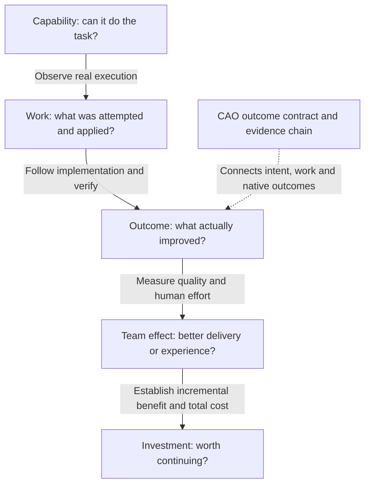

**An agent can pass a test, open a useful PR and still fail to save the team time.**
It can also help deliver useful work without making the whole repository
healthier yet. These are different questions, not contradictory measurements.

This page connects the [File Diet how-to](operational-value-how-to.md) to primary
research and technical guidance reviewed on **October 20, 2026**. The framework
below is our synthesis, not a new research finding or a claim that CAO already
collects every kind of evidence.
You do not need to prove financial return before recognizing a useful repair.
You do need additional evidence before making a stronger claim.

## Five questions, not one score

| Question | Evidence to look for | What it does not establish |
|---|---|---|
| **Can the agent do the task?** | Representative evaluations, repeat trials, independent tests and a pinned model/harness. | That the task was needed, accepted or useful in your repository. |
| **Did useful work actually land?** | Applied output, downstream implementation, verified native change and required safeguards. | That the workflow alone caused it, or that the result lasts. |
| **Is the repository or service better?** | Comparable measures of the real problem, including changes by people and other systems. | Which actor deserves credit or how much human time was saved. |
| **Is the whole team more effective?** | Review and rework effort, delivery performance, developer experience and quality over time. | A dollar saving or a causal effect from a before/after chart alone. |
| **Was the investment worthwhile?** | Credible incremental benefit, matched total costs, a time horizon and an agreed decision rule. | A universal return inferred from tokens, PR counts or estimated hours. |

**CAO's operational-value method connects intent to observable repository
outcomes.** Output lineage helps explain contribution. It complements agent
evaluations, team-productivity research and financial analysis; it does not
replace them.

## What the research contributes

### Evaluate the environment, not the agent's claim

[Anthropic's agent-evaluation guidance](https://www.anthropic.com/engineering/demystifying-evals-for-ai-agents)
distinguishes the **transcript** of what an agent said and did from the
**outcome**, the resulting state in its environment. A claim that a reservation
was booked is not the same as a reservation in the database. It also distinguishes
capability testing from regression testing and recommends combining evaluation
with production monitoring, experiments and user research.

For CAO, this means an issue saying "fixed" or a green run cannot substitute
for the repository fact that proves the intended fix. Traces explain attempts;
independent checks establish the named outcome. This is engineering guidance,
not evidence of a particular financial return.

[OpenAI's SWE-bench Verified work](https://openai.com/index/introducing-swe-bench-verified/)
also shows that the test itself needs scrutiny: underspecified issues,
over-specific tests and broken environments can incorrectly reject solutions.
Its human-screened benchmark improves a particular capability evaluation; it
does not measure adoption, maintenance burden or business impact in your team.
For a value contract, test both false acceptance and false rejection. Do not
assume a checker is valid merely because it is deterministic.

### Productivity effects depend on the setting

Two controlled studies illustrate why importing one headline number is unsafe:

| Study | Finding in its setting | Boundary |
|---|---|---|
| [Peng et al., GitHub Copilot experiment, 2023](https://arxiv.org/abs/2302.06590) | The treatment group completed a JavaScript HTTP-server task 55.8% faster. | One specified coding task, not a measurement of autonomous workflow value, long-term maintenance or organization-wide savings. |
| [METR, experienced open-source developers, early 2025](https://metr.org/blog/2025-07-10-early-2025-ai-experienced-os-dev-study/) | In 246 randomized real tasks from 16 developers, allowing AI increased completion time by 19%, despite perceived speedup. | Experienced contributors in familiar, mature repositories using the studied tools; not a claim about all developers, tasks or future systems. |

**Do not freeze the 2025 conclusion in time.**
[METR's February 2026 update](https://metr.org/blog/2026-02-24-uplift-update/)
reports later estimates pointing toward speedup but warns that selection effects
and time accounting with concurrent agents make the signal unreliable.
Developers and tasks that are withheld from the experiment can change the
population being measured. This is not a clean, quantified reversal or a
general estimate of today's productivity.

The implication for an operator is practical: record the task population,
model/harness version, quality requirement and human work. A before/after shift
may reflect a different task mix or another intervention, not improved agent
performance. Report people working with agents as the system being studied,
not agents in isolation when humans complete the handoffs.

### Measure the delivery system, not just code production

The [SPACE framework](https://www.microsoft.com/en-us/research/publication/the-space-of-developer-productivity-theres-more-to-it-than-you-think/)
rejects measuring developer productivity through a single metric or activity
dimension. [DORA's measurement-framework guidance](https://dora.dev/research/2025/measurement-frameworks/)
recommends starting with the decision and goal, then combining appropriate
logs-based and self-reported evidence. It cautions that logs are not
automatically objective and that developer experience cannot all be inferred
from tool telemetry.

[DORA's delivery metrics](https://dora.dev/guides/dora-metrics/) examine throughput
and instability for an application or service. They are useful complementary
checks when faster code generation shifts the bottleneck into review, deployment
or recovery. They are not scores for ranking individual agents or developers.
The [2025 DORA report](https://dora.dev/research/2025/dora-report/) frames AI as an
amplifier of existing organizational strengths and weaknesses, rather than a
tool that automatically fixes the delivery system.

For File Diet, counting smaller files is an honest structural measure.
Calling that "improved maintainability" needs further evidence: for example,
reviewer experience, future change effort, defects or other independently
defined indicators. These are additional questions, not permission to silently
replace the frozen structural measure.

### Cost and quality must be considered together

[AI Agents That Matter](https://arxiv.org/abs/2407.01502) analyzes agent benchmarks,
showing why accuracy-only comparisons can reward costly retries and why
reproducibility, holdouts and cost-controlled baselines matter. Its benchmark
analysis supports evaluating cost alongside task performance; it does not
establish production ROI for CAO.

[DORA's 2026 ROI guidance](https://dora.dev/ai/roi/report/) and its
[report overview](https://cloud.google.com/resources/content/dora-roi-of-ai-assisted-software-development)
make a related investment distinction: coding speed does not automatically
reach the bottom line. Learning costs and rework matter; reclaimed capacity
can be reinvested rather than treated as cash or headcount savings.
That is a planning framework, not proof of realized savings for a particular
deployment.

## Where CAO fits today

The [pinned File Diet instruments](operational-value-evidence-reference.md)
join natural-language intent, output identity, dated issue/PR links and immutable
Git inventories. The result is narrower and more useful than "the agent ran":
**48 linked structural reductions are observed; 13 have stronger creation
receipts; full behavior-preserving acceptance and costs remain unknown.**

Repository health remains separate: the oversized-file count grows from 16 to
53. That does not erase useful repairs or prove the workflow caused the growth.
This example closes an evidence gap between "suggestion produced" and
"independently checked change delivered." It does not close every gap to
productivity or financial return.

The newer portable report and research helpers remain source-branch
prerequisites, not features introduced into main by these docs. See the
[version boundary](operational-value-evidence-reference.md#prerequisites-and-version-boundary).
The existing [CAO collection path](operational-value.md) is a separate integration.

## The missing pieces, and how they connect

The following is a measurement checklist, **not a list of implemented CAO
features or a committed roadmap**. The status describes this worked example,
not every possible custom value module.

| Gap | Evidence needed to close it | File Diet boundary |
|---|---|---|
| **Goal to valid check** | Reviewable acceptance rule; real positive, negative and unknown cases; independent checks that match the goal. | File-size checking exists; it is not a complete behavioral-equivalence check. |
| **Attempt to applied output** | Exact safe-output result, durable object ID, producing run/revision and failure evidence. | Retained creation receipts strengthen a subset. Missing receipts do not erase independently measured changes. |
| **Output to delivered change** | Dated explicit implementation links, actual merge parents and stable identities to avoid duplicate credit. | The surviving linked cohort is measured; deleted outputs and every possible informal handoff are not covered. |
| **Delivery to lasting quality** | Required tests and checks, reversions, later defects and repeat observations after a defined maturation period. | Smaller-file delivery is established; full acceptance and long-term maintainability are not. |
| **Merge to production or user benefit** | For goals about a running service: deployed revision, independent service or user-outcome telemetry and a defined observation period. | A Git merge is not a deployment or proof of user benefit. File Diet's measured facet concerns repository structure. |
| **Delivery to team benefit** | Active human review/rework time, waiting time separately, workflow bottlenecks and developer feedback. | A merge timestamp or agent runtime does not measure human effort saved. |
| **Observed movement to incremental effect** | A credible comparison design, stable eligibility and recorded concurrent interventions. | Linked contribution and adoption-timed movement are not a counterfactual. |
| **Incremental benefit to investment decision** | Matched total costs, an explicit valuation, time horizon and owner-approved review bar. | Costs are not measured; no keep/retire bar is agreed. |

**Identity and time are the connecting tissue.** Keep the producing repository,
workflow revision, run, output, implementing PR, merge revisions, delivery time,
observation window and evaluator version distinct. Another agent may implement
the detector's suggestion. Preserve shared contribution and do not count that
single delivery once for every participant as separate repository improvements.

Capture outcome evidence after the required maturation period, but keep its
actual delivery time. Preserve coverage and failure reasons. A missing interval
is not a quiet period, and newly recovered evidence must not create a second
delivery event.

## How to make a stronger decision

### First, establish that useful work is being delivered

Choose one repository problem and a native measure that would count a person's
improvement too. Freeze the rule before examining results. Publish the result,
evidence links, coverage and unknowns. Separate full acceptance from a named
partial improvement. This is the [beginner how-to](operational-value-how-to.md).

### Then, investigate the limiting handoff

If suggestions accumulate without implementations, inspect assignment and review.
If changes land but quality evidence is absent, improve the acceptance checks.
If local successes coexist with a growing backlog, inspect incoming work and
scope. Do not immediately optimize the model or issue volume when the missing
link is elsewhere in the system.

### Use a comparison design for causal claims

Randomized eligible tasks or a carefully planned staged rollout can support
stronger inference than a chart before and after adoption. Define success,
population, quality safeguards and analysis before treatment; record
noncompliance and missing tasks. Choose a unit that limits spillovers: one
agent's finding can help work in another group.

Where randomization is inappropriate, an observational comparison may still be
useful, but state its assumptions, task-mix differences and concurrent changes.
No graph of linked PRs by itself proves how much work would have happened
without the workflow. This is research-design advice, not an experiment
automatically supplied by CAO.

### Only then discuss efficiency or financial return

Match cost and accepted outcomes to the same scope and period. Include failed
attempts and retries, model/tool charges, relevant infrastructure and
**human review, correction and rework**. Keep measured active effort separate
from elapsed waiting time, especially with concurrent agents. Report setup and
training costs explicitly rather than hiding them in a favorable period.
AI Credits and token counts are usage measures, not dollar savings; monetary
claims need actual rates and an explicit accounting boundary.

Cost per accepted outcome is an efficiency measure, not ROI. With zero accepted
outcomes it is undefined; with unknown acceptance or costs it is unavailable.
Do not drop failed attempts from cost or divide one workflow's cost by unrelated
repository improvements.

Financial return additionally needs a defensible value for the incremental
benefit. Capacity freed for other work is not automatically cash saved.
Keep observed facts, owner-supplied valuations and assumptions separate; use
ranges when uncertainty matters. Without those inputs, say **not measured**.

Finally, agree on a native keep/change bar and required safeguards. A weak signal
is a reason to investigate, not authority to disable a workflow or change policy.
There is no honest single score that fills in unknown quality, costs and
causality for you.
