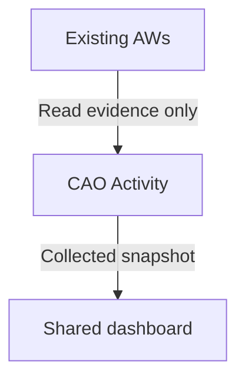

**Central Agentic Ops (CAO)** is a system for monitoring and governing GitHub
Agentic Workflows across repositories. It brings collected activity, cost, and
outcome evidence into a shared dashboard and supports policy-governed execution
and rollout of participating shared workflows.

## What is CAO?

**GitHub Agentic Workflows (AWs)** are AI-powered workflows that run in GitHub
Actions. You describe a task in Markdown, and an agent carries it out with
configured tools and permissions. They can respond to events, run on a schedule,
or be requested on demand. CAO monitors these workflows, not every ordinary
Actions job. [Learn about GitHub Agentic Workflows](https://github.github.com/gh-aw/introduction/overview/).

**AWs are the building blocks; CAO is the larger operational system.**
GitHub Agentic Workflows controls how each workflow executes and which
capabilities it has. CAO brings evidence from those workflows together and
governs whether and where participating shared workflows may run. Monitoring
an AW does not automatically bring it under CAO governance.

You might have workflows triaging issues in one repository and investigating
failures in another. Rather than checking each repository separately, CAO helps
you understand and operate this work across repositories:

- **Observe activity**: See collected activity across configured repositories,
  inspect recorded runs, and follow them back to GitHub.
- **Evaluate results**: Inspect costs, outputs, and outcomes where evidence is
  available. Investigate what the work produced, not just whether it ran.
- **Scale and roll out shared work**: Opt participating workflows into admission
  and bounded rollout across explicitly allowed repositories.

Workflows can stay repository-local, be shared across projects, or run centrally.
Existing workflows stay with their owners; shared work does not require moving
every workflow into one central repository.

## Agentic workflows, operated across repositories

A **control repository** is an ordinary GitHub repository that stores your CAO
configuration, holds credentials in Actions secrets, and runs collection and
participating shared workflows. You configure which repositories CAO may
observe; enabling shared automation is a separate decision.

You can start with read-only monitoring of workflows that already run.
**Campaigns are one opinionated way to package, scale, and roll out shared work,
not the only operating pattern.** Integrated review and rollout controls also
support [standalone agentic workflows](configuration.md#standalone-agentic-workflows),
but do not apply automatically to every observed workflow.

### A simple example

An issue-triage workflow runs in one of your configured repositories.
CAO Activity collects evidence of the run, and the dashboard lets you inspect
the recorded activity alongside work from other repositories. Follow the
retained outputs back to GitHub to investigate what the workflow produced.

<figure aria-labelledby="intro-dashboard-caption">

1
2
3

<figcaption id="intro-dashboard-caption">

Public sample, 19 October 2026, after import completed. Not a live feed. <a href="https://github.com/user-attachments/assets/1c408552-1a2d-45cc-967e-b46d8811798d">Open full-size capture</a>.

<ol>
<li><strong>Start with your repositories.</strong> See configured projects in one place.</li>
<li><strong>Read activity.</strong> Ranked bars compare distinct retained runs. Zero means no retained runs, not confirmed inactivity.</li>
<li><strong>Follow outputs.</strong> Inspect retained issue outputs; output counts alone do not prove successful outcomes.</li>
</ol>
</figcaption>
</figure>

[Explore the public Repositories view](https://githubnext.github.io/gh-cao/cao/#page-repositories).
Wait for import to finish before reading the charts.
See the [dashboard guide](dashboard.md) for more.

### How evidence reaches the dashboard

CAO Activity collects read-only evidence from the repositories you configure
and publishes a snapshot for the dashboard. Existing workflows continue to run
under their owners' permissions and review requirements:

The dashboard shows collected evidence, not a live feed. Collection can be
partial or stale; an empty chart does not establish that no workflows ran.
**A successful run is not automatically a successful outcome.** Missing cost or
outcome evidence is not proof of zero cost or success.
See [CAO Activity](activity.md) for collection and data-quality details and
[Define and measure workflow value](operational-value-how-to.md) for evaluating
usefulness against acceptance and independent repository evidence.

## Essential safety boundaries

- **Seeing is not authorizing.** Observing a workflow grants no write authority.
  Collecting evidence does not change its permissions or authorize writes.
- **Local owners keep control.** Project workflows and review requirements stay
  with their owners. A shared dashboard does not transfer credentials or
  authority.
- **Shared execution is explicitly governed.** Reviewed
  `.github/workflows/cao.json` policy at the exact workflow revision controls
  whether and where participating shared workflows may run. In `review` mode,
  proposals go to a review destination; target repositories stay unchanged
  until live output is explicitly authorized. GitHub Agentic Workflows controls
  how an authorized workflow executes; repository writes use its declared
  safe-output capabilities. Missing policy or required access fails closed.
- **Public means public-safe.** Use a public control repository only when its
  configuration, run metadata, dashboard data, evidence, and review outputs can
  be public. A private repository does not by itself guarantee private Pages;
  [setup](setup-quickstarts.md) checks publication visibility.

## Get started

Connect one repository to start with read-only evidence collection, then choose
whether to enable shared automation.

- [How does CAO work?](how-cao-works.md)
- [Architecture](architecture.md)
- [Set up CAO and monitor your workflows](setup-quickstarts.md)
- [Workflow operating patterns and ownership](deployment-and-governance.md)
- [Browse campaigns](catalog.md)
