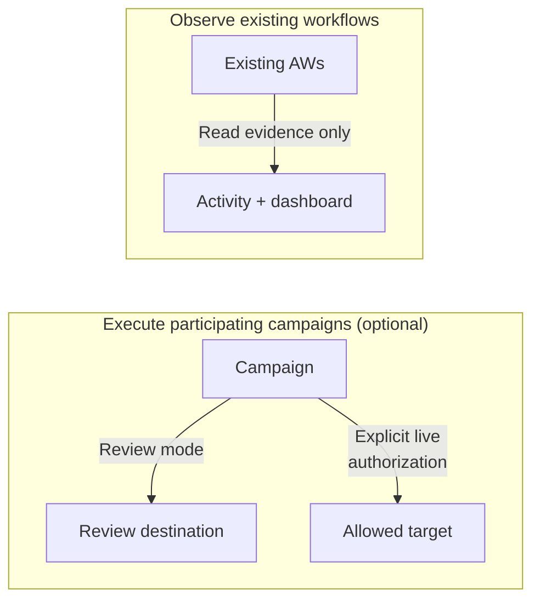

You have workflows triaging issues in one repository and investigating failures
in another. Instead of checking each repository separately, **Central Agentic
Ops (CAO)** gives you one place to see their activity and available cost and
outcome evidence. You can start by monitoring existing workflows, without adding
new agentic work.

**GitHub Agentic Workflows (AWs)** are AI-powered workflows that run in GitHub
Actions. You describe a task in Markdown, and an agent carries it out with
configured tools and permissions. They can respond to events, run on a schedule,
or be requested on demand. CAO monitors these workflows, not every ordinary
Actions job. [Learn about GitHub Agentic Workflows](https://github.github.com/gh-aw/).

**[Set up CAO and monitor your workflows](setup-quickstarts.md)**.
Start with one repository; adding a campaign is optional.

## What you can do today

| Capability | What it gives you |
| --- | --- |
| **Observe existing workflows** | Bring collected runs across the repositories you configure into a shared dashboard. Inspect activity, costs, outputs, and outcomes where evidence is available. Workflows stay with their existing owners. |
| **Run participating campaigns (optional)** | Add a reusable package of workflows for a shared task, such as investigating dependency updates. Run it from a control repository against explicitly allowed repositories, rather than copying it into each project. |
| **Review campaign proposals** | Start participating campaigns in `review` mode. Proposed outputs go to a review destination; target repositories stay unchanged until live output is explicitly authorized. |

For example, after an issue-triage workflow runs, you can inspect its run and
follow the collected evidence to see what it produced. The dashboard helps you
investigate whether the work was useful; a green run alone does not answer that.
**A successful run is not automatically a successful outcome.** Missing cost or
outcome evidence is not proof of zero cost or success.

## See the product

<figure aria-labelledby="intro-dashboard-caption">

1
2
3

<figcaption id="intro-dashboard-caption">

Public sample, 19 October 2026, after import completed. Not a live feed. <a href="https://github.com/user-attachments/assets/1c408552-1a2d-45cc-967e-b46d8811798d">Open full-size capture</a>.

<ol>
<li><strong>Start with your repositories.</strong> See configured projects in one place.</li>
<li><strong>Read activity.</strong> Ranked bars compare distinct retained runs. Zero means no retained runs, not confirmed inactivity.</li>
<li><strong>Follow outputs.</strong> Inspect retained issue outputs; output counts alone do not prove successful outcomes.</li>
</ol>
</figcaption>
</figure>

[Explore the public Repositories view](https://githubnext.github.io/gh-aw-cao/cao/#page-repositories).
Wait for import to finish before reading the charts.
See the [dashboard guide](dashboard.md) for more.

## Observe first, add campaigns when ready

A **control repository** is an ordinary GitHub repository that stores your CAO
configuration, holds credentials in Actions secrets, and runs collection.
If you later add campaigns, it also owns their workflows and rollout policy.

These are two separate paths, not an automatic progression from observation to
permission to write:

Campaigns use AW's declared **safe outputs**, such as issues or pull requests,
to send results to permitted destinations. The dashboard itself does not start
campaigns, approve outputs, or change policy.

## Essential safety boundaries

- **Seeing is not authorizing.** Observing a workflow grants no write authority.
  Merely hosting it in the control repository does not apply CAO rollout policy.
  Today's integrated governance applies to participating campaigns, not every
  workflow CAO observes or every workflow in a target repository.
- **Local owners keep control.** Project workflows and review requirements stay
  with their owners. Reusing a campaign shares implementation, not credentials
  or authority; each control repository decides its own scope and adoption.
- **Public means public-safe.** Use a public control repository only when its
  policy, run metadata, dashboard data, evidence, and review outputs can be
  public. A private repository does not by itself guarantee private Pages;
  [setup](setup-quickstarts.md) checks publication visibility.

Where do shared workflows live as you grow?

Workflows should live with the people responsible for maintaining their
behavior, watching costs and results, and deciding when to stop. Work for one
project naturally belongs with that project. Shared work can belong in an
organization-owned control repository; cross-organization work can belong in
an enterprise-operated control repository hosted in a designated organization.
"Central" means an operating point for its owner's scope, not one global
installation. These levels can coexist without moving everything upward.

Location alone neither limits nor authorizes repository access. Reach depends
on explicit policy, credentials, and workflow capabilities. Read
[Deployment and Governance](deployment-and-governance.md) for topology and
ownership, and the
[MultiRepoOps](https://github.github.com/gh-aw/patterns/multi-repo-ops/) and
[CentralRepoOps](https://github.github.com/gh-aw/patterns/central-repo-ops/)
patterns for shared-work arrangements.

How do campaigns coordinate work, and what is still future?

A campaign's **orchestrator** selects and prioritizes targets within policy,
then dispatches **workers**, each handling one repository. Their workflows run
in the control repository; targets receive declared outputs, not workflow
copies. Campaigns can be maintained directly or installed from a catalog.
See [How the Control Plane Works](architecture.md) and
[Orchestrators and Workers](orchestrators-and-workers.md).

Not every task needs orchestration: a known target and task may need only one
worker or standalone AW. Extending CAO's scope, enablement, and review controls
to directly invoked workers and standalone scheduled or event-driven AWs is a
**future direction, not an available governance integration today**. AW remains
responsible for execution capabilities and safe outputs.

## Get started

**[Set up CAO and monitor your workflows](setup-quickstarts.md)**.
Connect one repository and explore its existing evidence first.

When you want CAO to perform shared work, [browse campaigns](catalog.md) or
[build your own](author-your-first-operation.md). Adding a campaign is optional;
installation is not execution, and review is not live authorization.
