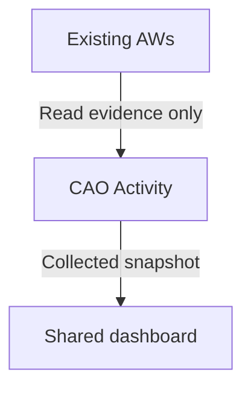

You have workflows triaging issues in one repository and investigating failures
in another. Instead of checking each repository separately, **Central Agentic
Ops (CAO)** gives you one place to see their activity and available cost and
outcome evidence. You can start by monitoring existing workflows, without adding
new agentic work.

**GitHub Agentic Workflows (AWs)** are AI-powered workflows that run in GitHub
Actions. You describe a task in Markdown, and an agent carries it out with
configured tools and permissions. They can respond to events, run on a schedule,
or be requested on demand. CAO monitors these workflows, not every ordinary
Actions job. [Learn about GitHub Agentic Workflows](https://github.github.com/gh-aw/).

**[Set up CAO and monitor your workflows](setup-quickstarts.md)**.
Start with one repository and inspect the evidence you already have.

## What you can do today

| Capability | What it gives you |
| --- | --- |
| **See repository activity** | Bring collected runs across the repositories you configure into a shared dashboard. Compare retained activity without checking each project separately. |
| **Inspect workflow runs** | Find recorded runs, inspect their status, and follow links to the original workflow and run on GitHub. |
| **Follow available evidence** | Inspect costs, outputs, and outcomes where evidence is available. Use them to investigate what the work produced, not just whether it ran. |

For example, after an issue-triage workflow runs, you can inspect its run and
follow the collected evidence to see what it produced. The dashboard helps you
investigate whether the work was useful; a green run alone does not answer that.
**A successful run is not automatically a successful outcome.** Missing cost or
outcome evidence is not proof of zero cost or success.

## See the product

<figure aria-labelledby="intro-dashboard-caption">

1
2
3

<figcaption id="intro-dashboard-caption">

Public sample, 19 October 2026, after import completed. Not a live feed. <a href="https://github.com/user-attachments/assets/1c408552-1a2d-45cc-967e-b46d8811798d">Open full-size capture</a>.

<ol>
<li><strong>Start with your repositories.</strong> See configured projects in one place.</li>
<li><strong>Read activity.</strong> Ranked bars compare distinct retained runs. Zero means no retained runs, not confirmed inactivity.</li>
<li><strong>Follow outputs.</strong> Inspect retained issue outputs; output counts alone do not prove successful outcomes.</li>
</ol>
</figcaption>
</figure>

[Explore the public Repositories view](https://githubnext.github.io/gh-aw-cao/cao/#page-repositories).
Wait for import to finish before reading the charts.
See the [dashboard guide](dashboard.md) for more.

## How monitoring works

A **control repository** is an ordinary GitHub repository that stores your CAO
configuration, holds credentials in Actions secrets, and runs collection.

CAO Activity collects read-only evidence from the repositories you configure
and publishes a snapshot for the dashboard:

The dashboard shows collected evidence, not a live feed. Collection can be
partial or stale; an empty chart does not establish that no workflows ran.
See [CAO Activity](activity.md) for collection and data-quality details.

## Essential safety boundaries

- **Seeing is not authorizing.** Observing a workflow grants no write authority.
  Collecting evidence does not change its permissions or authorize writes.
- **Local owners keep control.** Project workflows and review requirements stay
  with their owners. A shared dashboard does not transfer credentials or
  authority.
- **Public means public-safe.** Use a public control repository only when its
  configuration, run metadata, dashboard data, and collected evidence can be
  public. A private repository does not by itself guarantee private Pages;
  [setup](setup-quickstarts.md) checks publication visibility.

## Get started

**[Set up CAO and monitor your workflows](setup-quickstarts.md)**.
Connect one repository and explore its existing evidence first.

When you are ready to add new shared automation,
[explore optional campaigns](catalog.md).
