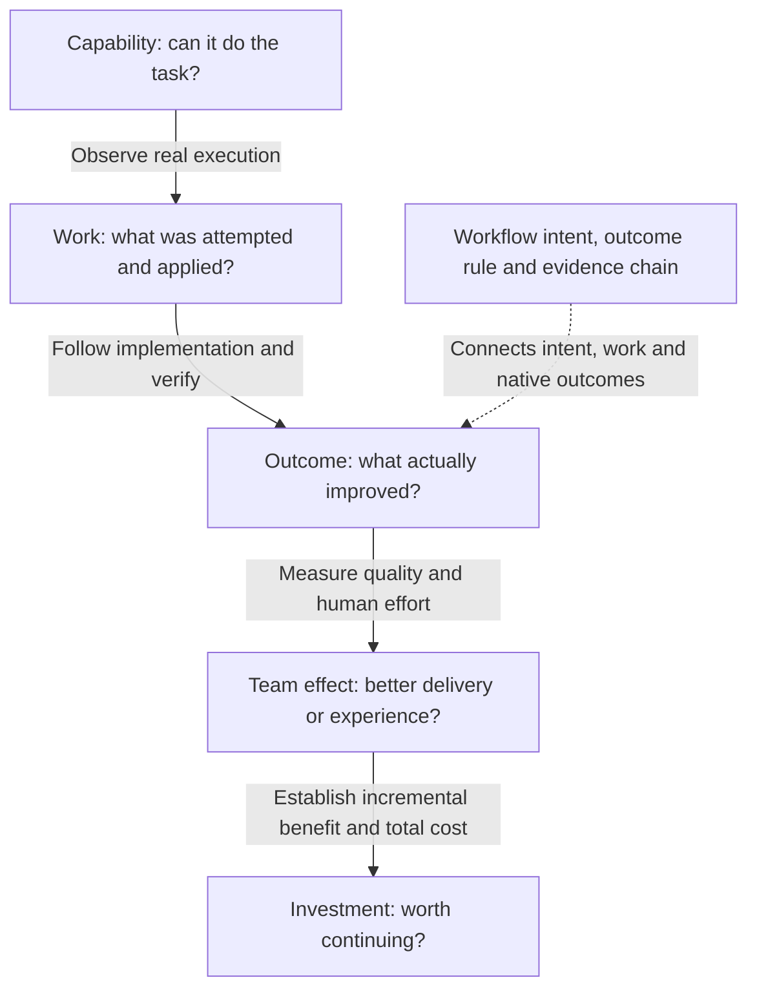

**An agentic workflow already carries a description of success.** Its Markdown
instructions, imported rules and deterministic precomputes tell us what problem
it targets, which opportunities it selects and what checks it expects.
The missing connection is from that known intent, through applied outputs,
to independently verified changes in repository history. That is a property of
agentic workflows, not something that requires CAO.

**Intent defines what to measure; a fixed cadence tracks repository state;
acceptance anchors linked contribution.**
Translate the declared outcome and checks into a fixed value function before
examining results. Follow each applied output to its final acceptance state,
including a linked downstream implementation when the output is a proposal.
For a merged code change, evaluate the function at the actual merge parent and
merge revision, or after the contract's required maturation period.
Explicit lineage and aligned timestamps connect the output to the measured
postcondition; nearby timestamps alone do not. Rejected and pending outputs
remain visible without being counted as delivery.

This event-anchored check explains contribution. Keep the primary repository
measure independent: it must also record improvements by people or other tools,
without requiring a workflow output or merge event. Observe it regularly,
including quiet periods, adverse changes and later reversals. Sampling only
at accepted changes would condition observation on delivery and conceal what
happens while work is pending.

There are distinct clocks: the opportunity or repository change that starts
the work, delivery/acceptance, evidence observation, and any maturation or
durability follow-up. Acceptance may take minutes or months. A delivery-date
chart describes throughput, not response speed. Compare opportunity cohorts at
the same elapsed follow-up; unresolved cases are **right-censored** at the
cutoff, not automatically failed or zero-valued. Keep pending counts and ages
alongside completed outcomes, and freeze any response-time rule or follow-up
horizon before examining results. Neither a reaction in time nor acceptance
alone demonstrates causation.

An agent can pass a test, open a useful PR and still fail to save the team time.
It can also help deliver useful work without making the whole repository
healthier yet. These are different questions, not contradictory measurements.

This article connects the [File Diet how-to](/gh-cao/operational-value-how-to/) to primary
research and technical guidance reviewed on **October 20, 2026**. The framework
below is our synthesis, not a new research finding or a claim that CAO already
collects every kind of evidence.
You do not need to prove financial return before recognizing a useful repair.
You do need additional evidence before making a stronger claim.

## Five questions, not one score

| Question | Evidence to look for | What it does not establish |
|---|---|---|
| **Can the agent do the task?** | Representative evaluations, repeat trials, independent tests and a pinned model/harness. | That the task was needed, accepted or useful in your repository. |
| **Did useful work actually land?** | Applied output, downstream implementation, verified native change and required safeguards. | That the workflow alone caused it, or that the result lasts. |
| **Is the repository or service better?** | Comparable measures of the real problem, including changes by people and other systems. | Which actor deserves credit or how much human time was saved. |
| **Is the whole team more effective?** | Review and rework effort, delivery performance, developer experience and quality over time. | A dollar saving or a causal effect from a before/after chart alone. |
| **Was the investment worthwhile?** | Credible incremental benefit, matched total costs, a time horizon and an agreed decision rule. | A universal return inferred from tokens, PR counts or estimated hours. |

**The operational-value method connects workflow intent to observable repository
outcomes.** Output lineage helps explain contribution. CAO is one integration
for collecting and reporting those measurements. The method complements agent
evaluations, team-productivity research and financial analysis; it does not
replace them.



## What the research contributes

### Evaluate the environment, not the agent's claim

[Anthropic's agent-evaluation guidance](https://www.anthropic.com/engineering/demystifying-evals-for-ai-agents)
distinguishes the **transcript** of what an agent said and did from the
**outcome**, the resulting state in its environment. A claim that a reservation
was booked is not the same as a reservation in the database. It also distinguishes
capability testing from regression testing and recommends combining evaluation
with production monitoring, experiments and user research.

For an agentic workflow, this means an issue saying "fixed" or a green run cannot substitute
for the repository fact that proves the intended fix. Traces explain attempts;
independent checks establish the named outcome. This is engineering guidance,
not evidence of a particular financial return.

[OpenAI's SWE-bench Verified work](https://openai.com/index/introducing-swe-bench-verified/)
also shows that the test itself needs scrutiny: underspecified issues,
over-specific tests and broken environments can incorrectly reject solutions.
Its human-screened benchmark improves a particular capability evaluation; it
does not measure adoption, maintenance burden or business impact in your team.
For a value contract, test both false acceptance and false rejection. Do not
assume a checker is valid merely because it is deterministic.

### Productivity effects depend on the setting

Two controlled studies illustrate why importing one headline number is unsafe:

| Study | Finding in its setting | Boundary |
|---|---|---|
| [Peng et al., GitHub Copilot experiment, 2023](https://arxiv.org/abs/2302.06590) | The treatment group completed a JavaScript HTTP-server task 55.8% faster. | One specified coding task, not a measurement of autonomous workflow value, long-term maintenance or organization-wide savings. |
| [METR, experienced open-source developers, early 2025](https://metr.org/blog/2025-07-10-early-2025-ai-experienced-os-dev-study/) | In 246 randomized real tasks from 16 developers, allowing AI increased completion time by 19%, despite perceived speedup. | Experienced contributors in familiar, mature repositories using the studied tools; not a claim about all developers, tasks or future systems. |

**Do not freeze the 2025 conclusion in time.**
[METR's February 2026 update](https://metr.org/blog/2026-02-24-uplift-update/)
reports later estimates pointing toward speedup but warns that selection effects
and time accounting with concurrent agents make the signal unreliable.
Developers and tasks that are withheld from the experiment can change the
population being measured. This is not a clean, quantified reversal or a
general estimate of today's productivity.

The implication for an operator is practical: record the task population,
model/harness version, quality requirement and human work. A before/after shift
may reflect a different task mix or another intervention, not improved agent
performance. Report people working with agents as the system being studied,
not agents in isolation when humans complete the handoffs.

### Measure the delivery system, not just code production

The [SPACE framework](https://www.microsoft.com/en-us/research/publication/the-space-of-developer-productivity-theres-more-to-it-than-you-think/)
rejects measuring developer productivity through a single metric or activity
dimension. [DORA's measurement-framework guidance](https://dora.dev/research/2025/measurement-frameworks/)
recommends starting with the decision and goal, then combining appropriate
logs-based and self-reported evidence. It cautions that logs are not
automatically objective and that developer experience cannot all be inferred
from tool telemetry.

[DORA's delivery metrics](https://dora.dev/guides/dora-metrics/) examine throughput
and instability for an application or service. They are useful complementary
checks when faster code generation shifts the bottleneck into review, deployment
or recovery. They are not scores for ranking individual agents or developers.
The [2025 DORA report](https://dora.dev/research/2025/dora-report/) frames AI as an
amplifier of existing organizational strengths and weaknesses, rather than a
tool that automatically fixes the delivery system.

For File Diet, counting smaller files is an honest structural measure.
Calling that "improved maintainability" needs further evidence: for example,
reviewer experience, future change effort, defects or other independently
defined indicators. These are additional questions, not permission to silently
replace the frozen structural measure.

### Cost and quality must be considered together

[AI Agents That Matter](https://arxiv.org/abs/2407.01502) analyzes agent benchmarks,
showing why accuracy-only comparisons can reward costly retries and why
reproducibility, holdouts and cost-controlled baselines matter. Its benchmark
analysis supports evaluating cost alongside task performance; it does not
establish production ROI for CAO.

[DORA's 2026 ROI guidance](https://dora.dev/ai/roi/report/) and its
[report overview](https://cloud.google.com/resources/content/dora-roi-of-ai-assisted-software-development)
make a related investment distinction: coding speed does not automatically
reach the bottom line. Learning costs and rework matter; reclaimed capacity
can be reinvested rather than treated as cash or headcount savings.
That is a planning framework, not proof of realized savings for a particular
deployment.

## Worked example: Daily File Diet

The [pinned File Diet instruments](https://github.com/githubnext/gh-cao/blob/0782148c0af21f4f1d10b7cb5e81b571ed58c463/docs/operational-value.md#file-diet-since-actual-adoption)
join natural-language intent, output identity, dated issue/PR links and immutable
Git inventories. The result is narrower and more useful than "the agent ran":
**48 linked structural reductions are observed; 13 have stronger creation
receipts; full behavior-preserving acceptance and costs remain unknown.**

Repository health remains separate: the oversized-file count grows from 16 to
53. That does not erase useful repairs or prove the workflow caused the growth.
This example closes an evidence gap between "suggestion produced" and
"independently checked change delivered." It does not close every gap to
productivity or financial return.

The updated skill includes a shared HTML/JSON renderer, tracking and Git
evidence helpers, and File Diet acquisition and replay entry points. The
historical input proof remains on the experimental branch; its executable
tools do not need to be copied.
See the
[replay prerequisites](#replay-the-file-diet-report).
The existing [CAO collection path](/gh-cao/operational-value/) is a separate integration.

## The missing pieces, and how they connect

The following is a measurement checklist, **not a list of implemented CAO
features or a committed roadmap**. The status describes this worked example,
not every possible custom value module.

| Gap | Evidence needed to close it | File Diet boundary |
|---|---|---|
| **Goal to valid check** | Reviewable acceptance rule; real positive, negative and unknown cases; independent checks that match the goal. | File-size checking exists; it is not a complete behavioral-equivalence check. |
| **Attempt to applied output** | Exact safe-output result, durable object ID, producing run/revision and failure evidence. | Retained creation receipts strengthen a subset. Missing receipts do not erase independently measured changes. |
| **Output to delivered change** | Dated explicit implementation links, actual merge parents and stable identities to avoid duplicate credit. | The surviving linked cohort is measured; deleted outputs and every possible informal handoff are not covered. |
| **Delivery to lasting quality** | Required tests and checks, reversions, later defects and repeat observations after a defined maturation period. | Smaller-file delivery is established; full acceptance and long-term maintainability are not. |
| **Merge to production or user benefit** | For goals about a running service: deployed revision, independent service or user-outcome telemetry and a defined observation period. | A Git merge is not a deployment or proof of user benefit. File Diet's measured facet concerns repository structure. |
| **Delivery to team benefit** | Active human review/rework time, waiting time separately, workflow bottlenecks and developer feedback. | A merge timestamp or agent runtime does not measure human effort saved. |
| **Observed movement to incremental effect** | A credible comparison design, stable eligibility and recorded concurrent interventions. | Linked contribution and adoption-timed movement are not a counterfactual. |
| **Incremental benefit to investment decision** | Matched total costs, an explicit valuation, time horizon and owner-approved review bar. | Costs are not measured; no keep/retire bar is agreed. |

**Identity and time are the connecting tissue.** Keep the producing repository,
workflow revision, run, output, implementing PR, merge revisions, delivery time,
observation window and evaluator version distinct. Another agent may implement
the detector's suggestion. Preserve shared contribution and do not count that
single delivery once for every participant as separate repository improvements.

Capture outcome evidence after the required maturation period, but keep its
actual delivery time. Preserve coverage and failure reasons. A missing interval
is not a quiet period, and newly recovered evidence must not create a second
delivery event.

## How to make a stronger decision

### First, establish that useful work is being delivered

Recover the intended outcome and required checks from the workflow's Markdown,
imports and precomputes. Use a native measure that would count a person's
improvement too. Freeze the rule before examining results. Publish the result,
evidence links, coverage and unknowns. Separate full acceptance from a named
partial improvement. This is the [short how-to](/gh-cao/operational-value-how-to/).

### Then, investigate the limiting handoff

If suggestions accumulate without implementations, inspect assignment and review.
If changes land but quality evidence is absent, improve the acceptance checks.
If local successes coexist with a growing backlog, inspect incoming work and
scope. Do not immediately optimize the model or issue volume when the missing
link is elsewhere in the system.

### Use a comparison design for causal claims

Randomized eligible tasks or a carefully planned staged rollout can support
stronger inference than a chart before and after adoption. Define success,
population, quality safeguards and analysis before treatment; record
noncompliance and missing tasks. Choose a unit that limits spillovers: one
agent's finding can help work in another group.

Where randomization is inappropriate, an observational comparison may still be
useful, but state its assumptions, task-mix differences and concurrent changes.
No graph of linked PRs by itself proves how much work would have happened
without the workflow. This is research-design advice, not an experiment
automatically supplied by CAO.

### Only then discuss efficiency or financial return

Match cost and accepted outcomes to the same scope and period. Include failed
attempts and retries, model/tool charges, relevant infrastructure and
**human review, correction and rework**. Keep measured active effort separate
from elapsed waiting time, especially with concurrent agents. Report setup and
training costs explicitly rather than hiding them in a favorable period.
AI Credits and token counts are usage measures, not dollar savings; monetary
claims need actual rates and an explicit accounting boundary.

Cost per accepted outcome is an efficiency measure, not ROI. With zero accepted
outcomes it is undefined; with unknown acceptance or costs it is unavailable.
Do not drop failed attempts from cost or divide one workflow's cost by unrelated
repository improvements.

Financial return additionally needs a defensible value for the incremental
benefit. Capacity freed for other work is not automatically cash saved.
Keep observed facts, owner-supplied valuations and assumptions separate; use
ranges when uncertainty matters. Without those inputs, say **not measured**.

Finally, agree on a native keep/change bar and required safeguards. A weak signal
is a reason to investigate, not authority to disable a workflow or change policy.
There is no honest single score that fills in unknown quality, costs and
causality for you.

## Replay the File Diet report

For a **fresh report**, authenticate `gh` with repository and Actions artifact
read access, and run the skill's collector. Git and `unzip` are also required:

```sh
END_AT=$(date -u '+%Y-%m-%dT%H:%M:%SZ')
node .github/skills/add-operational-value/examples/acquire-file-diet.mjs \
  "$END_AT" .tmp/file-diet-today
```

Use an unused output directory. Supply an earlier report's `proof/` directory
as the optional third argument to reuse verified immutable inventories and
preserved receipts. The collector refreshes tracking-ID, execution-marker and
legacy-footer discovery, producer identity and issue/PR lifecycle evidence,
then measures native Git facts and generates the report. Tracking is not
acceptance; merge is not proof of all quality checks. The command is read-only
against GitHub, bounded, and cleans up its temporary Git/request data.

Its `proof/` directory makes the new collection replayable. The report states
the actual measurement endpoint and evidence-capture date. **Replaying old
evidence does not refresh it.**

For a **historical replay**, follow the commands below.

Use this checkout's updated skill to replay the **preserved evidence** from
experimental revision `0782148c0af21f4f1d10b7cb5e81b571ed58c463`.
No experimental executable code needs to be copied into the skill.

You need Node.js 24+ and Git. Offline replay needs no npm installation,
GitHub credentials, campaign or dashboard. The report URL uses the former
repository name `githubnext/gh-aw-cao`; use `githubnext/gh-cao` for checkout.
The repository being measured is **`github/gh-aw`**.

From this checkout's root, obtain the evidence in a separate directory:

```sh
git clone --single-branch --branch mnkiefer-workflow-operational-value \
  https://github.com/githubnext/gh-cao.git cao-value-example
git -C cao-value-example checkout --detach 0782148c0af21f4f1d10b7cb5e81b571ed58c463
node .github/skills/add-operational-value/examples/daily-file-diet.mjs \
  cao-value-example/docs/operational-value/proof/file-diet-lifetime \
  .tmp/file-diet/daily-file-diet-pulse.html
```

Open `.tmp/file-diet/daily-file-diet-pulse.html`. Its adjacent JSON contains
the same computed facts; `daily-file-diet-pulse-events.json` preserves the
accepted-event ledger. The shared renderer can independently regenerate the
HTML and pulse JSON from that ledger:

```sh
node .github/skills/add-operational-value/scripts/render-pulse.mjs \
  .tmp/file-diet/daily-file-diet-pulse-events.json \
  .tmp/file-diet/daily-file-diet-pulse.html
```

Replay verifies retained digests and inventories;
it does not reacquire Git blobs or prove that every historical output survived.

The saved report covers November 15, 2025 through October 18, 2026, with
exclusive endpoint `2026-10-18T11:54:09Z`:

| Reading | Interpretation |
|---|---|
| 95 discovered issue outputs; 51 explicitly linked merged PRs | Surviving cohort, not all possible historical work. |
| 48 net oversized-file reductions; 13 in the receipt-backed subset | Structural contribution; the 13 are included in the 48, not extra work. |
| Repository oversized-file count: 16 to 53 | Useful linked repairs coexist with a worsening overall condition. |
| Latest 28 days: 0 files/week; preceding 28 days: 0.5 files/week | Worsening/review signal from adjacent, non-overlapping periods. |
| Trailing 91 days: 1 file/week | Overlapping post-adoption context, not a pre-adoption baseline. |
| Decision: not rated; costs: not measured | No agreed keep/retire bar or financial conclusion. |

The last positive linked merge is August 25. Lifetime usefulness is not current
delivery. The workflow originally used a 1,000-line threshold before moving to
800 in December 2025; the instrument preserves separate fixed-threshold
reference curves rather than splicing unlike populations into one trend.

## How the Git evidence is checked

The structural rule counts regular, non-test `.go` files under `pkg/` with at
least **800 newline characters**, using `wc -l` semantics; generated Go files
are not silently excluded. For each explicitly linked merged PR, compare the
complete eligible inventories at its **actual first parent** and merge revision.
Subtract the after-count from the before-count, including oversized replacement
files. A rename is not itself a reduction. Deduplicate by stable PR identity and
record delivery at merge time, not again at every later observation.

For [github/gh-aw#55785](https://github.com/github/gh-aw/pull/55785), linked to
[github/gh-aw#55776](https://github.com/github/gh-aw/issues/55776), compare
[parent `27092a4`](https://github.com/github/gh-aw/tree/27092a4090300be16379f12fa5d60b36c04da832)
with [merge `50f4e1b`](https://github.com/github/gh-aw/tree/50f4e1baafb070f8426566f5bfcdc0f5bf476011).
`pkg/cli/add_command.go` shrinks from 1,129 to 248 lines; four new files contain
250, 280, 86 and 328 lines.

That is a narrower claim than the frozen full-acceptance diagnostic, which also
requires completion, merge, new files under 500 lines, tests, lint, build,
at least 80% new-file coverage and unchanged public API. Missing quality
evidence remains unknown; do not weaken that contract to fit available results.

A safe-output request is only an attempt. Where retained, an applied
`create_issue` receipt identifies the output, repository, producing run and
revision; editable tracking text is not a receipt. Follow dated implementation
links. A closed issue need not be rejected, a cross-reference need not establish
acceptance, and even a green run can hide a failed assignment handoff.
Do not equate a missing `connected` event with missing dated lineage. In the
preserved evidence, 26 keyword-linked cases have a pre-merge cross-reference
and a GraphQL `ClosedEvent.closer` naming the PR, without a separate `connected`
event. Their issue closures are recorded 1–2 seconds after the merge. For
example, [github/gh-aw#4059](https://github.com/github/gh-aw/pull/4059) references
[github/gh-aw#4058](https://github.com/github/gh-aw/issues/4058) at
`2025-11-15T13:42:56Z`, merges at `17:16:12Z`, and closes the issue at
`17:16:13Z`. The replay joins the preserved graph and timeline evidence and
keeps those distinct timestamps. GitHub documents both
[keyword and manual linking](https://docs.github.com/en/issues/tracking-your-work-with-issues/using-issues/linking-a-pull-request-to-an-issue).

The [pinned skill](https://github.com/githubnext/gh-cao/blob/0782148c0af21f4f1d10b7cb5e81b571ed58c463/.github/skills/add-operational-value/SKILL.md),
[module contract](https://github.com/githubnext/gh-cao/blob/0782148c0af21f4f1d10b7cb5e81b571ed58c463/.github/skills/add-operational-value/references/module-contract.md)
and [worked operator guide](https://github.com/githubnext/gh-cao/blob/0782148c0af21f4f1d10b7cb5e81b571ed58c463/docs/operational-value.md#file-diet-since-actual-adoption)
retain the full authoring, acquisition and evaluation procedures. Discovery is
not a universal collector: another workflow needs its own reviewed evidence
collector and independent acceptance checks. Freeze the rule before evaluating;
label outcome-informed retrospective assessments honestly.
