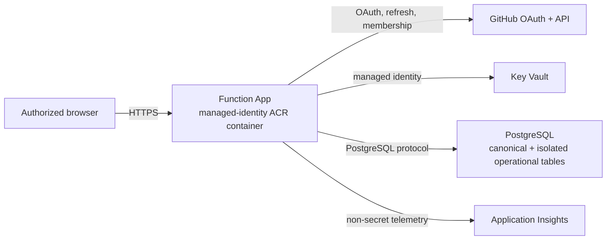

> [!WARNING]
> **Experimental:** The Azure deployment is an experimental baseline, not a turnkey or certified production service. Parameters, app settings, and resources can change between releases. Treat `server/azure/main.bicep`, the OAuth policy, the PostgreSQL topology, and the Key Vault access model as a starting point for your own review. Don't use the deployment with real users until your organization completes security, compliance, privacy, network, load, cost, monitoring, incident-response, backup, and rollback reviews.

## About the Azure deployment

The Azure deployment runs the Go dashboard server from the `server/` directory as a custom Linux container on Azure Functions. Browsers connect only to the Function App, over HTTPS on the same origin. The Function App:

- Signs users in with GitHub OAuth.
- Authorizes explicitly allowed GitHub users or members of organizations or teams that you allow.
- Reads secrets through Key Vault references.
- Runs bounded [Dashboard Language](dashboard-language.md) queries against dashboard data in PostgreSQL.
- Uses a separate PostgreSQL operational adapter for sessions, rate limits, queues, deduplication, coordination, and bounded caches.



## Prerequisites

### Native fresh-deployment command

`gh cao deploy azure` supports **fresh deployments only**. Review the non-secret
deployment config, run `--plan`, then apply that exact plan. Apply repeats
preflight and what-if and refuses any change-set drift before writing to Azure.
Updates, resuming a partially created deployment, and upgrades are follow-up
work; a subsequent `--plan` against a successfully deployed instance must fail
closed as an existing instance.

For a development build, supply the compiled `server/azure/main.json` with
`--template` and a gh-cao checkout with `--source-dir`. Supply the operator's
repository with `--repo-dir` (default `.`); its reviewed
`.github/workflows/cao.json` and `.github/workflows/cao.azure.json` are layered
into an owner-only temporary build context. Only allowlisted product files,
those two policy files, and explicitly selected evidence are uploaded to ACR,
not the operator's working directory or its credentials.

Development and release builds share the product-input allowlist in
`internal/cli/deploy_azure_assets.json`. The Azure Dockerfile targets precede
catalog inventory and collection stages so ACR's legacy builder needs only
those minimal inputs.

`resources.functionApp` is also the Container Apps job prefix: use 2-19
lowercase letters, digits, or hyphens, starting with a letter, ending with a
letter or digit, and without consecutive hyphens. The longest derived name,
`PREFIX-db-provision`, must fit Azure's 32-character job-name limit.

```bash
gh cao deploy azure --plan --config /private/operator/deploy-azure.json \
  --template /src/gh-cao/server/azure/main.json --out /private/operator/plan.json

gh cao deploy azure --apply --config /private/operator/deploy-azure.json \
  --template /src/gh-cao/server/azure/main.json \
  --plan-file /private/operator/plan.json \
  --source-dir /src/gh-cao --repo-dir /private/operator \
  --empty-evidence --receipt /private/operator/deploy-azure-receipt.json
```

Evidence is mandatory and explicit: choose either `--empty-evidence` or
`--snapshot-dir DIR`. Snapshot mode checks the `payload-hashes.json` SHA-256
manifest and copies only allowlisted, verified payloads and
`inventory-sources.json`. Empty mode builds `azure-empty-ingest-runtime`;
it never silently substitutes for a missing or invalid snapshot.

Apply creates the resource group if necessary, deploys the exact template ACR
resource, builds the Functions, database-provisioning, and ingestion Dockerfile targets, records their
digests, and locks the version-plus-config-hash tags against writes and deletes.
It then deploys the full template.
New managed-identity Key Vault grants can take time to propagate. Apply retries
the exact reviewed ARM request at most three times only when every nested
failure is the recognized job secret-fetch error in the ingestion or
database-provisioning module. Each attempt has the same 45-minute bound as the
initial full deployment; the command's overall timeout also applies. Retries use
cancellation-aware backoff, never change access grants, and fail closed on mixed,
unknown, authorization, or policy errors. An interrupted attempt issues an
explicit cancellation of that exact ARM deployment using a separate, two-minute
bounded context before returning. Cancellation failures are reported rather than
assuming ARM stopped.
After the full deployment succeeds, it refuses an overlapping ingestion
execution and waits on the exact execution it starts. The separate
`<app>-db-provision` execution must succeed before runtime-only ingestion starts;
bootstrap container failures stop the deployment before verification.
Configure environment or Key Vault references for
`secrets.postgresAdministratorPassword`, `secrets.postgresOwnerPassword`,
`secrets.postgresRuntimePassword`, `secrets.githubClientSecret`, and
`secrets.sessionSecret`. The owner and runtime passwords each require at least
32 characters and must be different from each other and the administrator
password.

Verification checks health, readiness, signed-out API denial, both GitHub OAuth
redirects, and independent SCM denial. Main-site HTTP 403 triggers an ingress
read-back and a distinct diagnostic if tenant automation changed the settings;
the command never fights or repairs such changes. `--timeout` bounds the overall
apply (default 45 minutes). The secret-free receipt defaults to
`.cao/deploy-azure-receipt.json` and records the reviewed plan digest, deployment
identity, source/context identity, immutable image references, exact job
execution, verification results, and timestamps. Existing receipts are not
overwritten.

Key Vault purge protection remains enabled by default. Only explicitly
disposable environments should set `"keyVault": {"purgeProtection": false}` in
the reviewed deployment config. This cannot downgrade an already protected
vault. Deleting a disposable resource group still requires separately purging
its soft-deleted vault; production vaults must retain purge protection.

### Azure resources

The `server/azure/main.bicep` template creates the following resources in one resource group.

| Service | Configuration | Purpose |
| --- | --- | --- |
| Azure Functions | Linux custom-container Function App on runtime `~4`. HTTPS only, TLS 1.2 or later, FTPS off, always on, at least one instance, and a system-assigned managed identity. | Hosts the Go HTTP handler |
| Azure Container Registry | Basic SKU with the admin account disabled | Stores the Functions and bootstrap-ingestion images; the Function App pulls with managed identity |
| App Service plan | Elastic Premium `EP1` | Keeps the Function App always on |
| Key Vault | Role-based access control, 90-day soft delete, and purge protection | Stores the OAuth client secret, session secrets, PostgreSQL URL, and optional collection secrets |
| Storage account | `Standard_LRS`, HTTPS only, TLS 1.2, and no public blob access | Stores Azure Functions runtime state only |
| PostgreSQL Flexible Server | PostgreSQL 16, private delegated subnet, TLS certificate verification, seven-day backups | Stores canonical data and isolated operational tables without Redis |
| Virtual network and private DNS | Separate Functions, PostgreSQL, and Container Apps subnets | Provides private database access for all roles |
| Container Apps environment and manual provisioning/ingestion jobs | Internal environment, separate identities, secret-scoped Key Vault access, managed-identity ACR pulls | Provisions database authority separately from runtime-only snapshot ingestion |
| Application Insights and Log Analytics | Exactly one workspace-backed component and one shared workspace | Receives container logs and configured application telemetry |

### Other requirements

- An Azure subscription and resource group where you can create these resources and assign the **Key Vault Secrets User** role.
- The Azure CLI with Bicep support.
- Go 1.27.3 or newer and Node.js 24, to build the deployment package.
- Register the subscription resource providers before deploying. Container Apps
  requires both `Microsoft.App` and `Microsoft.ContainerService`, even though
  this template does not create an AKS cluster. A subscription administrator may
  need to perform registration:

  ```bash
  for provider in Microsoft.App Microsoft.ContainerService Microsoft.Web \
    Microsoft.DBforPostgreSQL Microsoft.Network Microsoft.Storage \
    Microsoft.ContainerRegistry Microsoft.KeyVault Microsoft.ManagedIdentity \
    Microsoft.Insights Microsoft.OperationalInsights; do
    az provider register --namespace "$provider" --wait
  done
  ```

- Docker, or an Azure Container Registry build agent.
- A GitHub OAuth app, or a GitHub App configured for the user authorization-code flow. For membership authorization, the GitHub App needs organization **Members: read** and an approved installation in each allowed organization. PATs and pasted user tokens aren't supported.
- At least one allowed GitHub user, organization, or team in `ORGANIZATION/TEAM-SLUG` format.
- An adopter-owned reviewed `cao.json` and a verified local dashboard snapshot, or an explicit choice to initialize an empty dashboard. Neither campaigns nor public Pages are required for empty initialization. Private repository snapshots must be collected with credentials authorized for those repositories and kept private.
- An ingress choice. The template defaults to the public-main model: the
  Function App's `publicNetworkAccess` is `Enabled`, unmatched main-site traffic
  is `Allow` with no custom rules, and GitHub OAuth sign-in plus the allowed
  user, organization, or team list is the access control. No VPN, proxy, or
  corporate-network rule is required. SCM/Kudu remains independently
  default-deny. For a deliberately private deployment, set
  `functionPublicNetworkAccess=Disabled` or `functionAccessRestrictionsDefaultAction=Deny`
  with explicit rules.
- After deployment, confirm that tenant automation has not rewritten ingress
  (for example, `publicNetworkAccess=Disabled` or corporate-network-only service
  tag rules). Such out-of-band changes aren't Azure Policy denials and aren't
  prevented by the template; restore the public-main settings described in
  [Explicit public-main access](#explicit-public-main-access-with-independently-restricted-scm)
  and ask the automation owner for an exemption if it recurs.

### Ingress changes on an existing app

The public-main default does not override a subscription that genuinely requires
private-only ingress. Establish the applicable subscription and inherited policy requirements
before changing the deployed access mode.

If the applicable requirements permit restricted public access, the smallest
repair may be an app access-mode change retaining the existing approved rules,
default-deny behavior, HTTPS, and OAuth authorization. Full-template deployment
must carry main-site rules in `functionAccessRestrictions`, SCM/Kudu rules in
`functionScmAccessRestrictions`, and the existing SCM reuse setting in
`functionScmAccessRestrictionsUseMain`. The reuse setting defaults to `false`;
set it to `true` only to preserve an approved shared-rule configuration. Keep
distinct SCM rules out of the main-site array so deployment access does not
widen application access. Omitting either rule array uses an empty list, not
the deployed rules. Main-site unmatched requests use
`functionAccessRestrictionsDefaultAction`, which defaults to `Allow` and accepts
only `Allow` or `Deny`. SCM's independent default remains `Deny`.
`functionPublicNetworkAccess=Enabled`
does not itself grant permission, and allow rules cannot override `Disabled`.

Do not redeploy the full bootstrap for an ingress-only repair or image update.
Preserve the hostname and OAuth callback, review only the intended settings
delta, and verify authorized and unauthorized access afterward. The template
does not provision private endpoints or new client connectivity. Its Functions
VNet integration is outbound connectivity to PostgreSQL, not browser access.

#### Explicit public-main access with independently restricted SCM

For an explicitly authorized public-main deployment, use `Enabled`, main-site
default action `Allow`, and an empty main-site custom-rule list. Do not model
public access as a terminal `Allow`/`Any` rule under default `Deny`: the platform
can normalize that rule, so an accepted update is not evidence of actual access.
The following generic ARM parameter fragment can be merged into the adopter's
protected deployment parameters for a new deployment or reviewed redeployment:

```json
{
  "functionPublicNetworkAccess": { "value": "Enabled" },
  "functionAccessRestrictionsDefaultAction": { "value": "Allow" },
  "functionAccessRestrictions": { "value": [] },
  "functionScmAccessRestrictionsUseMain": { "value": false },
  "functionScmAccessRestrictions": {
    "value": [
      {
        "name": "approved-admin-network",
        "ipAddress": "192.0.2.0/24",
        "action": "Allow",
        "priority": 100
      }
    ]
  }
}
```

The documentation-only address above must be replaced with the independently
approved SCM restrictions; preserve the complete existing SCM rule list.
Keep SCM reuse `false` for this model so public main-site access is not inherited
by SCM/Kudu. Unmatched SCM requests remain denied. This changes network admission
only: HTTPS, GitHub OAuth authorization, and application administrator permissions
remain required and unchanged. It does not make administrative operations public.

For a from-scratch deployment, record the reviewed source revision and parameter
set, supply all other required bootstrap inputs, and verify the resulting
main-site `Allow`/empty-rule configuration and independent SCM rules after
provisioning. From a public client, confirm health/readiness and the authorized
GitHub sign-in flow; verify unauthorized users and non-admin users cannot access
protected data or administrative operations. From outside the approved admin
network, verify SCM is denied, and verify approved SCM access separately.
Repeat these checks after redeployment. Neither template tests nor a successful
deployment/PATCH response prove live reachability or authorization.

The optional collection profile also needs a container image of the collector, a GitHub App, and Azure Container Apps. For more information, see [Using the optional collection profile](#using-the-optional-collection-profile).

## Deploying the dashboard

In the following steps, replace `FUNCTION-APP-NAME` with a globally unique name for your Function App.
Use a **new resource group and globally unique names** to create a separate instance.
Never repoint an existing instance's OAuth callback. Reusing the same names and
secret inputs makes redeployment update this instance rather than create duplicate
telemetry resources.

Keep instance configuration and private snapshots outside the public source tree.
Prepare an isolated build context from the reviewed source revision, replace
`.github/workflows/cao.json` there with your own reviewed policy, and leave
`cao.azure.json` as the generic PostgreSQL host overlay. For a zero-campaign
instance, disable campaigns in your own policy; do not reuse the catalog's
dogfood policy. Do not commit this build context or its data.

### Retention for existing deployments

Before deployment, upgrade, secret rotation, rollback, or job start, read
the existing effective `CAO_POSTGRES_RUN_RETENTION_DAYS` and
`CAO_POSTGRES_LINKED_RETENTION_DAYS` on the Function App, ingestion job, and
every enabled collector/backfill role. Include stopped jobs and active revisions
that can still open the same database. When a setting is absent, determine its
effective fallback from that role's deployed source revision, not this
template's default. If the effective value cannot be established, stop the
rollout rather than guessing.

Pass an explicit `postgresRunRetentionDays` value **no lower than the greatest
existing effective run or linked retention across those roles and the complete
snapshot window**. For a new empty database, choose an explicit reviewed window.
The generic 45-day template default is not evidence of an installation's current
retention and is not an upgrade recommendation. Keep the reviewed value in
adopter-owned parameters for full-template, ingestion, or collector deployments.

Before any new role starts, verify that both retention settings on **all**
database-owning roles carry that value. For settings/image-only updates, carry
both settings forward explicitly without replaying the full bootstrap.
Initialization performs partition maintenance even without ingestion: omitting
or reducing retention can irreversibly delete history at startup. Increasing it
later does not restore dropped partitions.

### PostgreSQL authority

Fresh deployments use the [PostgreSQL authority model](https://github.com/githubnext/gh-cao/blob/main/server/POSTGRES.md):
`cao_owner`, `cao_runtime`, `cao_retention`, and `cao_evidence` are non-login
group roles. Only `cao_bootstrap_login` and `cao_runtime_login` authenticate;
both are non-superusers without database/role creation, replication, or RLS
bypass. Each login belongs only to its corresponding group. The `cao` schema
belongs to `cao_owner`. PUBLIC loses database CONNECT/TEMPORARY and schema CREATE;
runtime receives explicit CONNECT and TEMPORARY for ingestion staging.

The separate manual `FUNCTION-APP-NAME-db-provision` job alone can read the
administrator URL and bootstrap password. It creates/verifies roles and the
schema, then authenticates as the bootstrap login with
`PGOPTIONS='-c role=cao_owner -c search_path=cao'`, bootstraps both stores, and
applies the checked-in `server/postgres/operational-grants.sql` and
`canonical-grants.sql`. These files are copied into the `azure-db-provision`
Dockerfile target, not duplicated in ARM. Its PostgreSQL 16 client base is
digest-pinned; the built image must be pushed to this deployment's ACR before
starting the job. No deployed container pulls from Docker Hub.

Generate distinct administrator, owner, and runtime passwords in your secret
manager and preserve them across redeployments. Supply the latter two as
`postgresOwnerPassword` and `postgresRuntimePassword` **secure** Bicep inputs.
Secure parameters and Key Vault secret values are not exposed in deployment
history or outputs; do not pass plaintext secrets as command-line arguments or
write them to ordinary parameter files, logs, source, or build arguments.
This approach avoids giving the provisioning identity Key Vault write authority
or generating passwords whose recovery depends on a job execution. The job
rejects reused authority passwords and role-password line breaks; `psql` hashes password
changes client-side without putting plaintext in SQL or process arguments.

The Function App, ingestion, collector, and backfill receive only the
runtime-login URL, with `search_path=cao` and certificate-verified TLS. Their
identities have only explicitly listed secret-level **Key Vault Secrets User**
assignments, never vault-wide read access. Only the provisioning identity gets
the administrator secret. For an existing deployment, remove its previous
vault-wide role assignments as a separately reviewed prerequisite: incremental
ARM deployment does **not** remove old RBAC grants or revoke distributed
administrator credentials.

No Azure audit-retention job currently exists. The retention/evidence group
roles and their explicit grants are provisioned, but there are deliberately no
retention/evidence logins or mounted credentials. Audit retention is not run by
web, ingestion, collector, or bootstrap. Before enabling retention or evidence
export, separately provision a restricted login and job following
`server/POSTGRES.md`; do not use the owner for routine audit retention.
Canonical partition maintenance must run at least daily as a short-lived owner
operation with the same retention settings, not as runtime. Until a dedicated
owner-only maintenance job is configured, schedule this manual provisioning
job at least daily with the unchanged passwords and reviewed configuration.
Monitor failures; runtime does not repair missing partitions.

### Bootstrap steps

1. Register a GitHub OAuth app, or use a GitHub App's user authorization flow. Set its **Authorization callback URL** to `https://FUNCTION-APP-NAME.azurewebsites.net/auth/callback`. Store the client secret in your secret manager for use in a later step. For more information, see [Creating an OAuth app](https://docs.github.com/en/apps/oauth-apps/building-oauth-apps/creating-an-oauth-app) or [Authenticating with a GitHub App on behalf of a user](https://docs.github.com/apps/creating-github-apps/authenticating-with-a-github-app/authenticating-with-a-github-app-on-behalf-of-a-user) in the GitHub documentation.

   Alternatively, reuse a GitHub App with the same callback URL and organization
   **Members: read**. With its `Iv...` client ID, CAO requests `offline_access`
   for expiring user tokens and refresh tokens without changing expiration for
   other clients of that App. This requires GitHub.com or GHES 3.23 or later.
   Manage client secrets and key pairs in the App's **Credentials** tab on
   current GitHub versions; no App private key is needed for browser sign-in.

   > [!CAUTION]
   > Never commit the client secret to a repository.

   A GitHub App used for organization or team authorization must have
   **Organization members: Read-only**, and its organization installation must
   accept that permission. A classic OAuth App must be granted organization
   access when the organization restricts third-party OAuth applications.
   Without the applicable grant, GitHub withholds organization and team
   membership even for active members, and CAO correctly denies access.

1. Generate a session secret of at least 32 random characters.

   ```bash
   openssl rand -base64 48
   ```

1. Create the resource group and registry. The Bicep template subsequently manages the same registry declaratively.

   ```bash
   az group create --name cao-dashboard --location REGION
   az acr create \
     --resource-group cao-dashboard \
     --name CONTAINER-REGISTRY-NAME \
     --sku Basic \
     --admin-enabled false
   ```

1. Build the Function App image from a trusted checkout. Use an immutable release or commit tag in production instead of `DEPLOYMENT-TAG`.

   ```bash
   az acr login --name CONTAINER-REGISTRY-NAME
   docker build \
     --platform linux/amd64 \
     --build-arg CAO_PROFILE=cao.azure.json \
     --target azure-functions-runtime \
     --file server/Dockerfile \
     --tag CONTAINER-REGISTRY-NAME.azurecr.io/cao-functions:DEPLOYMENT-TAG \
     .
   docker push CONTAINER-REGISTRY-NAME.azurecr.io/cao-functions:DEPLOYMENT-TAG
   ```

1. Build and push the short-lived provisioning image to the same ACR:

   ```bash
   docker build --platform linux/amd64 \
     --target azure-db-provision --file server/Dockerfile \
     --tag CONTAINER-REGISTRY-NAME.azurecr.io/cao-db-provision:DEPLOYMENT-TAG .
   docker push CONTAINER-REGISTRY-NAME.azurecr.io/cao-db-provision:DEPLOYMENT-TAG
   ```

1. Build and push **one** ingestion image with the same deployment tag.
   For an empty instance, the ACR task builds and pushes only; it does not ingest:

   ```bash
   az acr run --registry CONTAINER-REGISTRY-NAME \
     --file server/azure/empty-ingest-task.yaml \
     --set tag=DEPLOYMENT-TAG .
   ```

   For your own verified snapshot, copy it into an `adopter-snapshot/` directory
   in the isolated build context and use the explicit source argument:

   ```bash
   docker build --platform linux/amd64 \
     --target azure-ingest-runtime --file server/Dockerfile \
     --build-arg CAO_PROFILE=cao.azure.json \
     --build-arg CAO_INGEST_SOURCE=adopter-snapshot \
     --tag CONTAINER-REGISTRY-NAME.azurecr.io/cao-ingest:DEPLOYMENT-TAG .
   docker push CONTAINER-REGISTRY-NAME.azurecr.io/cao-ingest:DEPLOYMENT-TAG
   ```

   The image never downloads upstream data automatically. Missing source input
   fails the build. Both images are private artifacts: restrict registry access
   and retention appropriately.

   **Building from a release asset bundle.** Operators without a full catalog
   checkout can use the attested `cao-azure-REVISION.tgz` attached to each
   release beside the runtime archive. It contains only the Docker build inputs
   for `azure-functions-runtime`, `azure-ingest-runtime`,
   `azure-empty-ingest-runtime`, and `azure-db-provision`, the compiled `server/azure/main.json`
   template, and a `cao-azure.json` manifest with the source revision and the
   SHA-256 digest of every file. It never contains adopter policy
   (`cao.json`, `cao.azure.json`), credentials, tests, or documentation. Verify
   and extract it, then supply your policy and snapshot as named build
   contexts:

   ```bash
   gh release download RELEASE-TAG --repo OWNER/REPOSITORY --pattern 'cao-azure-*'
   sha256sum --check cao-azure-REVISION.tgz.sha256
   gh attestation verify cao-azure-REVISION.tgz --repo OWNER/REPOSITORY \
     --signer-workflow OWNER/REPOSITORY/.github/workflows/cao-runtime.yml \
     --source-digest REVISION --signer-digest REVISION --deny-self-hosted-runners
   mkdir cao-azure && tar -xzf cao-azure-REVISION.tgz -C cao-azure
   docker build --platform linux/amd64 \
     --target azure-functions-runtime --file cao-azure/server/Dockerfile \
     --build-arg CAO_PROFILE=cao.azure.json \
     --build-context cao-policy=POLICY-DIRECTORY \
     --tag CONTAINER-REGISTRY-NAME.azurecr.io/cao-functions:DEPLOYMENT-TAG \
     cao-azure
   docker build --platform linux/amd64 \
     --target azure-ingest-runtime --file cao-azure/server/Dockerfile \
     --build-arg CAO_PROFILE=cao.azure.json \
     --build-context cao-policy=POLICY-DIRECTORY \
     --build-context cao-ingest-source=SNAPSHOT-DIRECTORY \
     --tag CONTAINER-REGISTRY-NAME.azurecr.io/cao-ingest:DEPLOYMENT-TAG \
     cao-azure
   ```

   `POLICY-DIRECTORY` must contain your reviewed `cao.json` and
   `cao.azure.json` at its root. `SNAPSHOT-DIRECTORY` holds your verified
   ingestion snapshot. Use `--target azure-empty-ingest-runtime` without the
   `cao-ingest-source` context for an empty instance. Deploy the bundled
   `cao-azure/server/azure/main.json` with `--template-file`. When those
   contexts are omitted, the build reads `.github/workflows/cao.json`,
   `.github/workflows/cao.azure.json`, and `CAO_INGEST_SOURCE` from the main
   build context, so builds from a checkout behave as before.

1. Review the template with `az deployment group what-if` before using
   `az deployment group create`. Replace the placeholders with your own values.
   The example below uses the public-main default: the dashboard is reachable
   over public HTTPS, GitHub OAuth and the allowed user, organization, or team
   list control access, and SCM/Kudu stays default-deny. No VPN or proxy is
   required. If tenant automation has attached a network security group to the
   subnets, pass its resource ID as `subnetNetworkSecurityGroupId` so
   redeployment keeps it attached.
   Do not use it to overwrite an existing app's access rules; follow
   [the ingress guidance](#ingress-changes-on-an-existing-app) for an existing app.

   ```bash
   az deployment group create \
     --resource-group cao-dashboard \
     --template-file server/azure/main.bicep \
     --parameters \
       functionAppName=FUNCTION-APP-NAME \
       storageAccountName=STORAGE-ACCOUNT-NAME \
       containerRegistryName=CONTAINER-REGISTRY-NAME \
       functionImageTag=DEPLOYMENT-TAG \
       keyVaultName=KEY-VAULT-NAME \
       postgresServerName=POSTGRES-SERVER-NAME \
       postgresRunRetentionDays=REVIEWED-RETENTION-DAYS \
       allowedHosts='["FUNCTION-APP-NAME.azurewebsites.net"]' \
       githubAllowedOrganizations='["ORGANIZATION"]' \
       githubClientId=OAUTH-CLIENT-ID
   ```

   The Azure CLI prompts you for `githubClientSecret`, `sessionSecret`, and
   `postgresAdministratorPassword`, `postgresOwnerPassword`, and
   `postgresRuntimePassword`. Enter them at the secure prompts or supply secure
   Key Vault parameter references from your operator secret manager.
   Preserve all three passwords across deployments. The template stores separate
   administrator and runtime TLS URLs and provisioning passwords in Key Vault
   without outputting them.

1. Review the non-secret outputs, especially `githubOAuthRedirectUri`,
   `provisioningJobName`, `ingestionJobName`, `logAnalyticsWorkspaceId`, and `applicationInsightsId`.
   Confirm the OAuth callback matches the **new** app registration.
1. Start the private provisioning job and wait for `Succeeded` before starting
   ingestion or collection:

   ```bash
   az containerapp job start --resource-group cao-dashboard \
     --name FUNCTION-APP-NAME-db-provision
   az containerapp job execution list --resource-group cao-dashboard \
     --name FUNCTION-APP-NAME-db-provision --output table
   ```

   It runs `database bootstrap --store canonical --namespace azure-dashboard`
   with reviewed retention and
   `database bootstrap --store operational --namespace azure-dashboard-operational`
   with the shared operational capacities, followed by both explicit grant
   scripts. Repeating the job with identical configuration is idempotent.
   Unexpected privileged role memberships or schema ownership fail closed.
   Do not overlap provisioning executions or rotate passwords during active use.
1. Load the dashboard data by starting the private ingestion job. Unlike a public
   ACR build agent, this job has a network path to private PostgreSQL. Its managed
   identity resolves the URL from Key Vault and pulls the image from private ACR.
   Confirm the [existing retention](#retention-for-existing-deployments)
   was checked before deployment and the job carries the reviewed value,
   no lower than existing effective retention or the snapshot window.
   Azure sets both `CAO_POSTGRES_RUN_RETENTION_DAYS` and
   `CAO_POSTGRES_LINKED_RETENTION_DAYS` to that value on the app, ingestion job,
   and optional collection/backfill roles. This preserves the earlier shared
   window only when that existing effective value was carried forward explicitly.

   Runtime roles only open storage; they never create it. The ingestion job
   has no bootstrap init containers, administrator secret, or owner credential.
   Missing provisioning or grants fails ingestion rather than elevating authority.

   ```bash
   az containerapp job start --resource-group cao-dashboard \
     --name FUNCTION-APP-NAME-ingest
   az containerapp job execution list --resource-group cao-dashboard \
     --name FUNCTION-APP-NAME-ingest --output table
   ```

   Wait for that execution to report `Succeeded`; starting a job is not success.
   On failure, inspect the job logs in the shared workspace and correct the
   cause before retrying. Do not run overlapping ingestion jobs or run snapshot
   ingestion while the optional collector is projecting.
   Every successful ingestion replaces the active canonical namespace. Empty
   ingestion deliberately publishes no repositories, organizations, runs, or
   campaigns. An uninitialized namespace returns `503` readiness; a valid empty
   publication returns `200`.

1. Verify the deployment from a client using the approved ingress path.

   1. Confirm that `GET /api/health` succeeds.
   1. Confirm that `GET /api/readiness` returns `200`. It returns `503` until data is loaded.
   1. Sign in with GitHub and open a dashboard view.
   1. Confirm that the dashboard refuses a user who isn't in an allowed organization or team.

> [!TIP]
> To test the Functions HTTP interface on Linux without Azure credentials, run `./scripts/azure-local/azure-local.sh run`. The script starts Azure Functions Core Tools, Azurite, and PostgreSQL.

### Infrastructure-only bootstrap

If registration of the new OAuth app is pending, deploy
`server/azure/network.bicep` independently with `location`, `namePrefix` (the
future Function App name), `postgresServerName`, `postgresAdministratorLogin`,
and secure `postgresAdministratorPassword`. This creates only the private
network, DNS, and PostgreSQL database, not an unauthenticated dashboard.
The full template adopts the same resources when supplied the same values.
Do not use placeholder OAuth values to bypass application startup requirements.

### Updating an existing runtime

**Moving from the old administrator-backed Azure topology requires a new
database**, following [Moving to a new database](#moving-to-a-new-database).
Do not apply these grants as a privilege scrubber to an existing overgranted
database. Stop/drain existing processes, preserve pending work and audit anchors,
back up operational state, and plan recovery before switching. Creating a new
database does not migrate operational audit, queues, sessions, or revocations;
retain the previous database and independent evidence. Remove old vault-wide
RBAC and retire the previously distributed administrator credential after the
reviewed cutover. A template redeployment alone does neither.

Compare the deployed source's generated `server/internal/postgresx/schema.sql`
with the release. A changed physical contract requires a new database and
explicit re-ingestion; there is no automatic compatibility migration. An
unchanged contract can still change maintenance behavior. Releases supporting
independent linked retention default to seven days when the setting is absent.
Before starting such a release, check the
[existing retention](#retention-for-existing-deployments)
and explicitly set **both** retention settings on every database-owning role to
the reviewed value. Never replace a larger existing run or linked window with
the generic 45-day template default; otherwise owner bootstrap/maintenance can
drop older partitions even without ingestion.

Validate old-to-new startup, representative historical records, new ingestion,
and rollback against an isolated local database. With retention preserved,
normal aging and existing curation still run; owner partition maintenance must
be scheduled separately as described above;
"no schema migration" does not mean "no database writes." Never use production
startup as a read-only compatibility probe. Preserve the current image/settings
receipt and verified recovery evidence, review a minimal settings/image delta,
and do not start the ingestion job or replay a bootstrap deployment for an
image-only update.

### Moving to a new database

Use a new database when a release changes the physical contract, or when you
deliberately want to start from empty canonical and operational state. Do this
with a reviewed redeployment, not by editing app settings by hand.

1. Choose a new `postgresDatabaseName` and a new runtime `postgresUrlSecretName`,
   for example `cao2` and `cao-postgres-runtime-url-cao2`. The administrator and
   provisioning-password secret names derive from this prefix. A new prefix
   retains the previous secrets. Role names are server-wide: this topology uses
   one role set per dedicated server, not mutually distrusting databases on one
   server. Keep role passwords unchanged when adding a database to that server.
1. Run `az deployment group what-if` with both new names and every other
   parameter unchanged, including the reviewed `postgresRunRetentionDays`.
   Expect a new database, new Key Vault secrets and secret-level RBAC, and changed PostgreSQL URL
   references on the Function App, the ingestion job, and any enabled
   collection roles. Stop if anything else changes.
1. Deploy. Incremental deployment does not delete the previous database or its
   secret. Every role now points at the new, empty database, so the dashboard
   reports `503` readiness until the next step succeeds.
1. Start the provisioning job and wait for `Succeeded`, then run ingestion
   and wait for `Succeeded`, as in [Bootstrap steps](#bootstrap-steps).
   Never restore administrator-backed runtime access for rollback; use a
   reviewed recovery procedure that preserves unfinished work and audit evidence.
   Then restart the Function App and any
   collection roles and verify health, readiness, and sign-in.
1. After the new database is verified and no longer needs rollback, delete the
   previous database and disable or delete its Key Vault secret as a separate,
   reviewed change.

## Configuration reference

### App settings

The template creates the following app settings.

| App setting | Source | Description |
| --- | --- | --- |
| `CAO_DASHBOARD_HOSTING` | Fixed value `azure-functions` | Selects Azure hosting mode. |
| `CAO_AZURE_ALLOWED_HOSTS` | `allowedHosts` parameter | Exact public host names that the server trusts in forwarded `Host` headers. |
| `CAO_AZURE_REQUIRE_HTTPS` | Fixed value `true` | Requires `X-Forwarded-Proto: https`. |
| `CAO_POLICY_PATH` | Fixed value `.github/workflows/cao.azure.json` | Selects the reviewed Azure deployment profile. |
| `CAO_POSTGRES_URL` | Key Vault secret named by `postgresUrlSecretName` (default `cao-postgres-runtime-url`) | Restricted runtime-login TLS URL shared by canonical and operational adapters, never the administrator URL. |
| `CAO_POSTGRES_RUN_RETENTION_DAYS` | Explicit reviewed `postgresRunRetentionDays`; template default `45` is not upgrade-safe | Canonical run-history window and partition-retention horizon. Preserve existing effective retention and the snapshot window before startup. |
| `CAO_POSTGRES_LINKED_RETENTION_DAYS` | Same explicit `postgresRunRetentionDays` | Linked-evidence horizon shared by all database-owning roles. Never shorten an existing linked window during redeployment. |
| `REDIS_NAMESPACE` | Fixed value `azure-dashboard` | Legacy name for the canonical PostgreSQL dataset identity; no Redis service is used. |
| `CAO_OPERATIONAL_NAMESPACE` | Fixed value `azure-dashboard-operational` | Isolated namespace for operational PostgreSQL tables. |
| `CAO_OPERATIONAL_CACHE_MAX_*` | Template capacity parameters | Bounds disposable operational cache entries and bytes. |
| `CAO_OPERATIONAL_PROTECTED_MAX_*` | Template capacity parameters | Bounds protected operational records and bytes. |
| `CAO_GITHUB_CLIENT_ID` | `githubClientId` parameter | Client ID of the OAuth app. |
| `CAO_GITHUB_CLIENT_SECRET` | Key Vault secret `github-oauth-client-secret` | Client secret of the OAuth app. |
| `CAO_GITHUB_REDIRECT_URL` | Derived from `functionAppName` | `https://FUNCTION-APP-NAME.azurewebsites.net/auth/callback` |
| `CAO_GITHUB_ALLOWED_ORGS` | `githubAllowedOrganizations` parameter | Organizations whose active members can sign in. |
| `CAO_GITHUB_ALLOWED_TEAMS` | `githubAllowedTeams` parameter | Teams, in `ORGANIZATION/TEAM-SLUG` format, whose active members can sign in. |
| `CAO_GITHUB_ALLOWED_USERS` | `githubAllowedUsers` parameter | Exact GitHub logins authorized directly. Use this for narrow access that must not depend on organization OAuth visibility. |
| `CAO_SESSION_SECRET` | Key Vault secret `cao-session-secret` | Current session encryption key. At least 32 characters. |
| `CAO_SESSION_SECRET_PREVIOUS` | Key Vault, only when `previousSessionSecret` is set | Previous session key, used during rotation. |
| `APPLICATIONINSIGHTS_CONNECTION_STRING` | Application Insights | Where the Functions host sends telemetry. |
| `AzureWebJobsStorage__accountName` | `storageAccountName` parameter | Storage account used by the Functions runtime. |
| `AzureWebJobsStorage__credential` | Fixed value `managedidentity` | Requires the Function App identity and assigned blob, queue, and table data roles; shared-key access is disabled. |
| `WEBSITES_PORT` | Fixed value `8080` | Port exposed by the CAO Functions container. |
| `WEBSITES_ENABLE_APP_SERVICE_STORAGE` | Fixed value `false` | Keeps the immutable container filesystem authoritative. |

The operational capacity parameters are shared by the Function App and optional
collection roles. Update the template parameters rather than changing only one
role's app settings. PostgreSQL cache pressure never evicts sessions, accepted
collection work, enrollment, checkpoints, leases, or pending revocations.

The `cao-functions` handler also reads these optional settings.

| App setting | Default | Description |
| --- | --- | --- |
| `CAO_AZURE_SITE_DIRECTORY` | `site` | Directory of the built site. |
| `CAO_AZURE_DASHBOARD_QUERIES` | `SITE-DIRECTORY/dashboard.json` | Path to the Dashboard Language document. |

### Template parameters

Besides the parameters in the deployment command, the template accepts:

- `location`, `hostingPlanName`, `applicationInsightsName`, `containerRegistryName`, `functionImageRepository`, and `functionImageTag`.
- `postgresRunRetentionDays`; explicitly preserve the greatest existing effective
  run or linked window across all database-owning roles and the complete snapshot
  window. Do not rely on the generic default during redeployment.
- `operationalCacheMaxBytes`, `operationalCacheMaxValueBytes`, `operationalCacheMaxEntries`, `operationalProtectedMaxBytes`, and `operationalProtectedMaxEntries`.
- `logAnalyticsWorkspaceName`, `postgresServerName`, `postgresAdministratorLogin`,
  `postgresAdministratorPassword`, `postgresOwnerPassword`,
  `postgresRuntimePassword`, `postgresSkuName`, and `postgresSkuTier`.
- `postgresDatabaseName` (default `cao`) and `postgresUrlSecretName` (default
  `cao-postgres-runtime-url`). The secret name is a prefix for provisioning
  secrets too; reserve space for the `-runtime-password` suffix (110 characters
  maximum for the prefix). Use lowercase letters, digits, and hyphens.
  The new runtime-secret default intentionally does not reuse the old admin URL.
  For an existing administrator-backed installation, see
  [Moving to a new database](#moving-to-a-new-database).
- `ingestionImageRepository` and `ingestionImageTag` (defaulting to `cao-ingest`
  and the Function App image tag).
- `provisioningImageRepository` and `provisioningImageTag` (defaulting to
  `cao-db-provision` and the Function App image tag).
- The collection parameters. For more information, see [Using the optional collection profile](#using-the-optional-collection-profile).

### Startup checks

In Azure mode, the server doesn't start unless all of the following are configured:

- A TLS PostgreSQL URL and the reviewed `cao.azure.json` profile.
- Allowed hosts and HTTPS enforcement.
- The OAuth client ID, client secret, and redirect URL.
- A session secret of at least 32 characters.
- At least one allowed user, organization, or team.

Azure mode never accepts PATs or the local bearer capability.

## Monitoring the deployment

### Functions host telemetry

The template provisions one workspace-backed Application Insights component and
one shared Log Analytics workspace, and sets `APPLICATIONINSIGHTS_CONNECTION_STRING`
on the Function App. The direct Go container does not run the Functions host or
an Azure Monitor SDK: setting this variable alone does **not** export Go traces.
Configure the OpenTelemetry exporter described below. Container Apps console and
system logs are routed to the same workspace through a diagnostic setting.

### OpenTelemetry traces

The Go server uses vendor-neutral OpenTelemetry and doesn't include the Azure Monitor SDK. It emits the following spans, which contain only counts, revisions, and durations:

- A span for every HTTP request, through `otelhttp`.
- A dedicated `GET /auth/callback` span and `cao_dashboard.auth.callback.count` metric for OAuth callbacks, which are excluded from the generic `otelhttp` instrumentation and carry only a fixed outcome (`success` or `failure`) and, on failure, a bounded `error.type`. No OAuth code, state, cookie, token, or provider message is recorded.
- `cao_dashboard.query.execute` for each query.
- `cao_dashboard.ingest.run` for each ingestion.

To send the spans to Application Insights:

1. Run an OpenTelemetry Collector with the `azuremonitorexporter`, configured with your Application Insights connection string.
1. Add the following app settings to the Function App.

   | App setting | Description |
   | --- | --- |
   | `OTEL_EXPORTER_OTLP_ENDPOINT` or `OTEL_EXPORTER_OTLP_TRACES_ENDPOINT` | Turns on the OTLP/HTTP trace exporter. If neither is set, the server doesn't export spans. |
   | `OTEL_EXPORTER_OTLP_HEADERS` | Authentication headers for the collector. Store the value as a Key Vault reference. |
   | `OTEL_SERVICE_NAME` | Service name. Defaults to `cao-dashboard`. |
   | `OTEL_SDK_DISABLED` | Set to `true` to turn off tracing even when an endpoint is set. |

If a client sends a `traceparent` header, the server continues that trace. Every API response includes `X-Trace-Id` and `X-Span-Id` headers so that you can correlate requests.

### Debug logs

To turn on debug logs, set `DEBUG` to a namespace or pattern:

- Namespaces: `cao:server`, `cao:query`, `cao:ingest`, `cao:postgresx`, and `cao:cli`.
- Patterns: for example, `cao:*,-cao:query` for everything except query diagnostics.

The `cao:functions:startup` namespace logs the site directory, query path, and listen address of `cao-functions`.

Logs go to standard error. They include operation names, counts, timings, and fixed identifiers such as `oauth branch=OPERATION.OUTCOME`. They never include tokens, credentials, query payloads, or source records. To see matching sign-in events in the browser, add `?debug=auth` to the dashboard URL.

### Health checks and diagnostics

| Check | Description |
| --- | --- |
| `GET /api/health` | Liveness check. |
| `GET /api/readiness` | Readiness check. Returns `503` until data is loaded. |
| `GET /api/v1/health` | Versioned health check. |
| `CAO_POLICY_PATH=.github/workflows/cao.azure.json cao-dashboard doctor --postgres-url "$CAO_POSTGRES_URL"` | Read-only check of PostgreSQL dashboard data and operational state. Add `--deep` to read every active source, `--format json` for automation, or `--strict` to fail on warnings. |

Hosted health and readiness probes (including HEAD requests on the `GET` routes) share a 600-requests-per-minute bucket keyed by client address. The loopback local profile leaves these probes unmetered.

### Agentic workflow traces

You configure traces for orchestrators and workers separately, in the control repository. For more information, see [Optional observability](configuration.md#optional-observability).

## Using the optional collection profile

By default, the server serves the data that the Activity workflow publishes and doesn't collect anything itself. To have Azure collect the data instead, set the `collectorImage` parameter. The `server/azure/collector.bicep` template then adds:

- Workers and backfill in the same private Container Apps environment as ingestion.
- A fixed number of collection workers sharing the PostgreSQL operational queue. Set `collectorWorkerReplicas` to the required replica count; the default is `1`.
- A backfill job.
- A user-assigned managed identity with access to Key Vault and `AcrPull` on this deployment's registry. Build the collector image into that registry.
- An Azure Files share for collected evidence. The SKU is set by `collectorLakeStorageSku` (default `Premium_LRS`).

The optional evidence lake requires a separate file-storage account with shared
access across workers and evidence-retention settings; Functions runtime storage
has different access requirements. With collection disabled, the baseline
creates only one storage account. It never creates a second Insights component
or workspace.

The collection profile requires these parameters: `collectorGithubAppId`, `collectorPrivateKey`, `githubWebhookSecret`, `githubAdminUsers`, and `collectorControlRepository`.

In this profile, the Function App only admits webhooks (`CAO_COLLECT_ADMIT_ONLY=true`). It verifies and deduplicates deliveries to `POST /api/github/webhook`, then queues the work. It never holds the app's private key.

The approved ingress path must also permit GitHub webhook delivery. Disabled
public access or client-only allow rules can block it; do not widen access just
to make delivery work.

1. Point the GitHub App webhook at `https://HOST/api/github/webhook`.
1. Install the GitHub App on the repositories to collect from. Enrollment follows app installations. If you uninstall the app from a repository, CAO stops collecting from it and deletes its evidence.
1. Monitor collection with `GET /api/admin/collection/status` and with the Container Apps logs in Log Analytics.

> [!NOTE]
> Use either the default profile or the collection profile, not both. If both `CAO_SOURCE_DIRECTORY` and `CAO_COLLECT_APP_ID` are set, the server doesn't start.

## What this deployment guarantees

- **No secrets in the browser.** The browser never receives PostgreSQL credentials, GitHub access or refresh tokens, or Key Vault secret values.
- **Secrets in Key Vault.** Every app setting that holds a secret is a versionless Key Vault reference, resolved by managed identity. Template outputs contain no secrets.
- **Authorized access.** Users must sign in with GitHub OAuth and match an allowed user, organization, or team. Authorization is checked again on every token refresh.
- **Protected sessions.** Session cookies are `Secure`, `HttpOnly`, and `SameSite=Lax`. Requests that change state need a CSRF token bound to the session.
- **Encrypted PostgreSQL traffic.** Non-loopback PostgreSQL connections and every fallback require TLS.
- **Bounded queries.** Queries have limits on definitions, joins, predicates, rows, and operations. A query never returns a partial result without reporting it.
- **Consistent rate limits.** Rate limits are enforced atomically in PostgreSQL across all instances. If operational storage can't enforce them, requests fail with `503`.
- **Safe ingestion.** Ingestion transactionally replaces the complete PostgreSQL dataset. If ingestion or a rebuild fails, the previous committed data remains active.

## What this deployment does not guarantee

- **Production readiness.** This deployment is experimental. CAO offers no support commitment or SLA. Availability depends on your Azure resources.
- **Complete ingress connectivity.** The database has private VNet access and the Function App defaults to public main-site access behind GitHub OAuth, with SCM/Kudu denied. The template does not establish the subscription's permitted ingress model or provide new client connectivity, a web application firewall, or Azure Front Door. Review the applicable requirements before changing access. OAuth authorization remains required.
- **Automatic data loading.** In the default profile, nothing loads new data into PostgreSQL. Schedule ingestion yourself, or use the collection profile.
- **Live updates.** Server-sent events at `GET /api/v1/events` are best effort. Cold starts, scale-in, idle timeouts, and plan limits can end them. Clients then fall back to `POST /api/v1/refresh`. WebSockets aren't supported.
- **Disaster recovery.** PostgreSQL holds rebuildable dashboard data and restart-persistent operational state in separate tables, with seven-day local backups but no high availability or geo-redundancy in this baseline. Rehearse restore and credential recovery. Rebuild canonical data from the retained artifact or collected evidence. For long-term retention, see [Create a historical archive](dashboard-data-ingestion.md#create-a-historical-archive).
- **Per-repository authorization.** Authorized users can read all of the active data. There's no filtering by repository or source.
- **Low idle cost.** The EP1 plan and PostgreSQL cost money even when no one uses the dashboard.
- **Credential rollback.** Rolling back the package doesn't roll back OAuth, session, or PostgreSQL credentials.

## Rotating secrets and rolling back

Every redeployment, restart, and rollback below must preserve
[existing retention](#retention-for-existing-deployments).
Carry the reviewed `postgresRunRetentionDays` in deployment parameters, and keep
both effective retention settings at least that large across every role before
startup. Restoring an older package or parameters file must not restore a shorter
retention window.

| Task | Procedure |
| --- | --- |
| Rotate the session secret | Redeploy with the old key as `previousSessionSecret` and the new key as `sessionSecret`. Wait for active sessions and queued revocations to finish, then redeploy without `previousSessionSecret`. |
| Rotate the PostgreSQL credential | Redeploy with the new `postgresAdministratorPassword` so the database and Key Vault URL change together, then restart the Function App and collection roles. |
| Rotate the OAuth client secret | Generate a new secret in GitHub, add a new version of the Key Vault secret, and restart the Function App. |
| Roll back the application | Redeploy the last known-good package. If PostgreSQL dashboard data is unusable, ingest the retained artifact again. Use a new operational namespace only when intentionally invalidating operational state and active sessions. |

If you suspect an incident, see [Incident response](operations.md#incident-response). For the complete threat model and list of controls, see the [hosted Azure architecture](https://github.com/githubnext/gh-cao/blob/main/server/README.md#hosted-azure-architecture) in `server/README.md` and the [Azure Functions profile](https://github.com/githubnext/gh-cao/blob/main/server/SECURITY.md#azure-functions-profile) in `server/SECURITY.md`.

## Further reading

- [About deployment options](deployment.md)
- [Deploying the dashboard with GitHub Actions](deployment-actions.md)
- [Data ingestion](dashboard-data-ingestion.md)
- [Data model](dashboard-data-model.md)
- [`server/README.md`](https://github.com/githubnext/gh-cao/blob/main/server/README.md)
- [`server/SECURITY.md`](https://github.com/githubnext/gh-cao/blob/main/server/SECURITY.md)
- [`scripts/azure-local/README.md`](https://github.com/githubnext/gh-cao/blob/main/scripts/azure-local/README.md)
