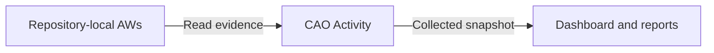

Central Agentic Ops (CAO) connects three activities: observing agentic workflows,
evaluating their results, and controlling shared work when you choose to enable
it. You can start with workflows that already run in their own repositories.
Monitoring them does not move them into a central repository or change their
permissions.

For CAO's purpose and capabilities, start with
[What is Central Agentic Ops (CAO)?](architecture-at-a-glance.md). For the
execution and authority boundaries behind this flow, read the
[Architecture](architecture.md).

## Connect repositories and collect evidence

A **control repository** stores CAO configuration, keeps credentials in Actions
secrets, and runs the CAO Activity collector. Configure the repositories whose
agentic workflow evidence it may read. Existing repository-local workflows
continue to run under their owners' permissions and review requirements.

Activity collects bounded workflow and run evidence for dashboards and reports.
Collection is read-only: observing a workflow grants no authority to modify its
repository.

The dashboard is a view of collected evidence, not proof of current GitHub
state. Collection can be partial or stale. An empty chart does not establish
that no workflows ran. See [CAO Activity](activity.md) for collection limits and
data-quality behavior.

## Evaluate what the work produced

Use the [dashboard](dashboard.md) to inspect recorded runs, available cost
evidence, and retained outputs, then follow links back to GitHub to investigate
what happened. A completed run or an output count alone does not show that the
work was useful or accepted.

**A successful run is not automatically a successful outcome.** Missing cost or
outcome evidence is not proof of zero cost or success. When you need to measure
usefulness, define the intended result and evaluate it against acceptance and
independent repository evidence. See [Define and measure workflow
value](operational-value-how-to.md).

## Opt shared work into controlled execution

Monitoring is useful on its own; enabling shared automation is a separate
decision. Participating workflows run from the control repository, where
reviewed `.github/workflows/cao.json` policy defines whether and where they may
operate. Policy is resolved at the exact workflow revision. Credentials and
compiled workflow capabilities can further restrict that authority, never
expand it.

CAO supports two explicit integration patterns:

- **Standalone agentic workflows** import shared control and have their own
  policy entry. They perform their mission directly against a precomputed,
  bounded set of admitted repositories without dispatching workers.
- **Campaigns** package an orchestrator and workers. The orchestrator selects
  targets within policy and dispatches one worker per selected repository.
  Each worker revalidates its authority, analyzes only its assigned target,
  and emits only declared safe outputs.

Campaigns are one opinionated way to package, scale, and roll out shared work,
not a requirement for observing workflows or governing a standalone workflow.
Merely hosting or observing a workflow does not opt it into CAO policy.

`review` is the default mode: proposals go to a review destination rather than
changing target repositories. Live output requires explicit authorization in
the control repository's reviewed policy. GitHub tools exposed to agents are
read-only; repository writes use the workflow's declared safe-output
capabilities. Missing policy, required evidence, or access fails closed.
GitHub Agentic Workflows remains responsible for how an authorized workflow
executes and which capabilities it has.

See [standalone workflow configuration](configuration.md#standalone-agentic-workflows),
[Orchestrators and Workers](orchestrators-and-workers.md), and
[Rollout and Routing](rollout-and-routing.md) for the integration details.

## Choose your next step

[Set up CAO and monitor your workflows](setup-quickstarts.md) to start with
read-only evidence collection. Read the [Architecture](architecture.md) for
the control plane's execution boundary and safety properties, or
[Deployment and Governance](deployment-and-governance.md) for operating
patterns and ownership.
