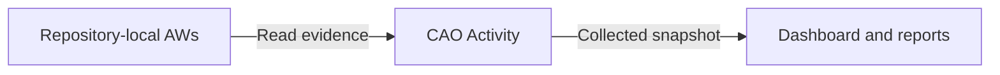

Central Agentic Ops (CAO) connects three activities: observing agentic workflows,
evaluating their results, and controlling shared work when you choose to enable
it. You can start with workflows that already run in their own repositories.
Monitoring them does not move them into a central repository or change their
permissions.

For CAO's purpose and capabilities, start with
[What is Central Agentic Ops?](architecture-at-a-glance.md). For the
execution and authority boundaries behind this flow, read the
[Architecture](architecture.md).

## Connect repositories and collect evidence

A **control repository** stores CAO configuration, keeps credentials in Actions
secrets, and runs the CAO Activity collector. Configure the repositories whose
agentic workflow evidence it may read. Existing repository-local workflows
continue to run under their owners' permissions and review requirements.

Activity collects bounded workflow and run evidence for dashboards and reports.
Collection is read-only: observing a workflow grants no authority to modify its
repository.

Activity collects once so dashboards, reports, local tools, and agents can reuse
the same bounded snapshot instead of independently fetching workflow history.
The cache is evictable, not a historical authority. Consumers must check their
own freshness, completeness, and scope requirements. See [CAO Activity](activity.md)
for collection limits and the cache contract.

## Read activity and follow outputs

In the [Repositories view](https://githubnext.github.io/gh-cao/cao/#page-repositories),
start with the configured repositories, compare their retained runs, then
inspect the available issue outputs and follow links back to GitHub. Wait for
the initial import to finish before interpreting record-dependent charts.

A central workflow can run in the control repository, analyze a different
repository, and create its proposal in a review repository. Keep those three
identities separate: **where the workflow ran**, **which repository it
analyzed**, and **where its output was delivered**. Campaign membership is
another dimension, not a requirement for evidence to appear in a repository
view. See [repository outcome projection](deployment-and-governance.md#repository-outcome-projection).

The dashboard is a view of collected evidence, not proof of current GitHub
state. Check the evidence quality before acting:

- **Empty** means available evidence has no matching records, not that no work
  ever ran.
- **Unavailable** means required evidence could not be obtained.
- **Partial** means some relevant evidence is missing or still importing.
- **Stale** means newer activity may not be represented yet.

An empty chart does not establish inactivity, and missing cost evidence is not
zero cost. The [dashboard guide](dashboard.md#read-a-result) explains how to
read these states.

## Evaluate what the work produced

Use the [dashboard](dashboard.md) to inspect recorded runs, available cost
evidence, and retained outputs, then follow links back to GitHub to investigate
what happened. A completed run or an output count alone does not show that the
work was useful or accepted.

**A successful run is not automatically a successful outcome.** Missing cost or
outcome evidence is not proof of zero cost or success. When you need to measure
usefulness, define the intended result and evaluate it against acceptance and
independent repository evidence. See [Define and measure workflow
value](operational-value-how-to.md).

For example, an issue proposing a change is not the delivered improvement.
Follow an explicit link to its accepted implementation and check the intended
repository outcome. Repository state and the contribution of one accepted
change are separate measurements; timing alone does not prove causation.
[Intelligence](intelligence.md) can highlight conditions for review, but its
recommendations do not authorize execution.

## Opt shared work into controlled execution

Monitoring is useful on its own; enabling shared automation is a separate
decision. Participating workflows run from the control repository, where
reviewed `.github/workflows/cao.json` policy defines whether and where they may
operate. The [Architecture](architecture.md#authority-and-admission) explains
how policy, credentials, and compiled capabilities bound that authority.

Before an agent starts, admission checks the workflow identity and requested
limits. Authorized-run precompute then resolves the bounded repository set,
output routing, access, and worker availability where applicable. A denied
request or missing required fact stops or skips execution rather than widening
scope. See [Admission Gates](admission.md) for the individual checks.

An **operation** is the work being governed; its **pattern** describes how the
execution is organized. CAO supports three explicit integration patterns:

- **Direct operations** request an explicit target set and execute one mission
  without fleet discovery, campaign records or downstream dispatch.
- **Standalone agentic workflows** import shared control and have their own
  policy entry. They perform their mission directly against a precomputed,
  bounded set of admitted repositories without dispatching workers.
- **Campaigns** package an orchestrator and workers. The orchestrator selects
  targets within policy and dispatches one worker per selected repository.
  Each worker revalidates its authority, analyzes only its assigned target,
  and emits only declared safe outputs.

Campaigns are one opinionated way to package, scale, and roll out shared work,
not a requirement for observing workflows or governing a standalone workflow.
Merely hosting or observing a workflow does not opt it into CAO policy.

`review` is the default mode: proposals go to a review destination rather than
changing target repositories. Live output requires explicit authorization in
the control repository's reviewed policy. GitHub tools exposed to agents are
read-only; repository writes use the workflow's declared safe-output
capabilities. Missing policy, required evidence, or access fails closed.
GitHub Agentic Workflows remains responsible for how an authorized workflow
executes and which capabilities it has.

See [standalone workflow configuration](configuration.md#standalone-agentic-workflows),
[Orchestrators and Workers](orchestrators-and-workers.md), and
[Rollout and Routing](rollout-and-routing.md) for the integration details.
Describe the outcome, target scope, and execution requirements;
[From Outcome to Execution](operation-patterns.md) shows how guidance and
authoring agents derive the structure rather than asking you to pick a pattern.

## Review, promote, and recover

Start with one explicit target in `review`. Inspect the proposal and verify that
the review destination changed while the target did not. Review is real agent
execution and may create review outputs; it is not a no-write simulation.

When ready, explicitly authorize one low-risk target for `live` output in
reviewed control-repository policy. Verify the delivered output and downstream
checks before increasing scope or enabling scheduled live work. Promote from
observed evidence, not elapsed time; each standalone workflow or campaign keeps
its own rollout decision.

If scope, routing, quality, cost, or credentials become uncertain, disable the
affected work and cancel active runs as needed. Correct the issue and resume
in review. Changing policy alone does not cancel work already in flight.
Follow [Roll Out a Campaign Safely](rollout-and-routing.md) for promotion
procedures and [Emergency stop](operations.md#emergency-stop) for incident actions.

## Choose your next step

[Set up CAO and monitor your workflows](setup-quickstarts.md) to start with
read-only evidence collection. Read the [Architecture](architecture.md) for
the control plane's execution boundary and safety properties, or
[Deployment and Governance](deployment-and-governance.md) for operating
patterns and ownership.
