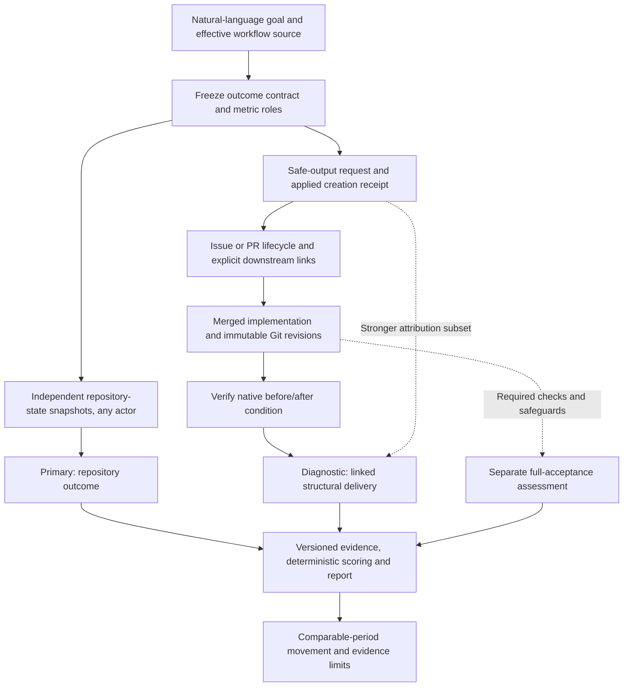

**New to operational value?** Start with
[Trace workflow goals to measured value](operational-value-how-to.md).
This reference keeps the detailed contracts, commands and caveats in one place.

Use this how-to to answer two different questions: **Did the repository condition
improve?** and **What useful improvement is demonstrably linked to this workflow?**
The Daily File Diet example connects a natural-language goal to safe-output
lifecycle evidence, downstream implementation and independently measured Git
changes. It does not equate a successful run, an opened issue or a merged PR with
the full intended outcome.

Start with the [saved Daily File Diet pulse](https://raw.githack.com/githubnext/gh-aw-cao/refs/heads/mnkiefer-workflow-operational-value/docs/operational-value/gh-aw-workflows/daily-file-diet-pulse.html).
It is a report captured on October 18, 2026, not a live monitor.
For the existing CAO collection and publication path, see
[Operational Value](operational-value.md).

## Prerequisites and version boundary

> [!IMPORTANT]
> The portable discovery, event-pulse reporting and File Diet research instruments
> used here are from `mnkiefer-workflow-operational-value`, pinned below at
> `0782148c0af21f4f1d10b7cb5e81b571ed58c463`. They are not installed by this
> documentation change. Main has an earlier `add-operational-value` skill and
> evaluator; do not assume the newer flags, paths or helpers exist there.

The supplied report URL uses the repository's former name,
`githubnext/gh-aw-cao`. GitHub resolves that name to **`githubnext/gh-cao`**.
Use the canonical name for checkout and the pinned revision for replay.
The measured repository is **`github/gh-aw`**, not the CAO repository containing
the instrument.

You need Node.js 24+ and Git. Offline replay needs the source files and retained
proof, but no npm installation, GitHub authentication, dashboard or campaign.
Fresh GitHub acquisition additionally needs authenticated `gh`, explicit
repository scope and access to the relevant evidence. Optional campaign discovery
uses the source skill's locked YAML dependency; only that path needs `npm ci`
inside the skill directory.

The versioned sources for this procedure are the
[skill](https://github.com/githubnext/gh-cao/blob/0782148c0af21f4f1d10b7cb5e81b571ed58c463/.github/skills/add-operational-value/SKILL.md),
[module contract](https://github.com/githubnext/gh-cao/blob/0782148c0af21f4f1d10b7cb5e81b571ed58c463/.github/skills/add-operational-value/references/module-contract.md)
and [worked operator guide](https://github.com/githubnext/gh-cao/blob/0782148c0af21f4f1d10b7cb5e81b571ed58c463/docs/operational-value.md#file-diet-since-actual-adoption).
Keep that source checkout separate from a checkout used for authoring a new
measurement.

## Follow the evidence flow



The arrows are evidence relationships, not proof of causation. Repository
outcomes can occur without a workflow output. A downstream implementer may be a
person or another agent; retain that shared contribution rather than attributing
the whole repository's movement to the original detector.

### 1. Translate the goal into a frozen contract

For File Diet, the goal is to identify oversized production Go files and promote
behavior-preserving decomposition. The source's structural measure counts
regular, non-test `.go` files under `pkg/` with **at least 800 newline characters**
using `wc -l` semantics. Generated Go files are not silently excluded.

Write the outcome in this form before selecting metrics:

> For [eligible opportunities], improve [repository condition], verified by
> [independent evidence], measured as [native quantity] every [period].

Freeze scope, eligibility, acceptance, units, direction, cadence, maturation,
missing-data rules and evidence interfaces. Inspect the effective executor as
well as the Markdown prompt: a different runner may not execute those
instructions. For adoption comparisons, recover adoption-time intent and test
whether the same repository-native measure can be reconstructed before adoption.
A newly authored measurement contract is not a newly adopted workflow.

The [File Diet research module](https://github.com/githubnext/gh-cao/blob/0782148c0af21f4f1d10b7cb5e81b571ed58c463/tests/fixtures/operational-value-proof/file-diet.mjs)
and its later lifetime event projection answer different questions:

| Measure | Role and interpretation |
|---|---|
| Number of production Go files at or above 800 lines | Actor-independent **primary** repository-state measure; lower is better. A maintainer's improvement counts too. |
| New, fully accepted receipt-linked refactors | **Diagnostic** under the stricter frozen rule: completion, merge, new files under 500 lines, tests, lint, build, at least 80% new-file coverage and unchanged public API. Required unknown facts stay unknown. |
| Correctly targeted receipt-linked issues | **Diagnostic precursor**, not delivered refactoring. |
| Net oversized-file reductions at explicitly linked merges | Separately named structural-progress **contribution** facet. Higher is better; it does not replace the strict full-acceptance rule. The lifetime pulse focuses on this facet. |

Do not choose or tune a contract to make observed results look better. When
authoring after inspecting outcomes, label it **outcome-informed retrospective
assessment**, preserve previous contracts and give material changes explicit
versions. The worked case is not evidence of automatic, blind goal translation.

### 2. Trace applied outputs, not just workflow conclusions

Treat a safe-output request as an attempt. Where retained, verify the applied
`create_issue` result against the exact issue identity, repository, producing run,
head revision and artifact digests. Tracking footers help discover candidates;
editable text is not an authoritative creation receipt.

Follow the actual issue/PR graph and its dated connections to the downstream
implementation. Distinguish accepted, rejected, pending, ignored and normal
lifecycle closure under the contract's maturation rule. Do not infer rejection
from closure alone, or acceptance from a cross-reference or merge alone.

The source guide's recent File Diet cohort illustrates why this matters:
selection comments and assignment requests did not establish successful agent
assignment; audited assignment jobs failed despite green workflow conclusions.
The linked proposal [github/gh-aw#64854](https://github.com/github/gh-aw/pull/64854)
closed without merging. Automatic-expiry explanations were not documented human
rejections. Those facts explain a handoff gap, not a delivered refactor.

### 3. Verify the downstream native change

For each explicitly linked merged PR, the lifetime instrument compares complete
eligible-file inventories at the merge commit's **actual first parent** and at
the merge revision. It subtracts the after-count of oversized files from the
before-count, including replacement oversized files. A rename is not itself a
reduction. Stable PR identities deduplicate deliveries; the improvement is
recorded at merge time, not credited again in each later snapshot.

For example, [github/gh-aw#55785](https://github.com/github/gh-aw/pull/55785)
links back to [github/gh-aw#55776](https://github.com/github/gh-aw/issues/55776).
Its event retains a
[before revision](https://github.com/github/gh-aw/tree/27092a4090300be16379f12fa5d60b36c04da832)
and [merge revision](https://github.com/github/gh-aw/tree/50f4e1baafb070f8426566f5bfcdc0f5bf476011):
`pkg/cli/add_command.go` goes from 1,129 to 248 lines, with four new files
of 250, 280, 86 and 328 lines. This is inspectable structural progress.
It does not, by itself, prove unchanged behavior or all required safeguards.

Keep the original full-acceptance measure intact when a narrower facet can be
proved. Missing quality evidence qualifies the claim; missing receipts qualify
attribution. Neither erases an independently verified structural improvement,
but missing evidence defining that improvement prevents accepting it.

## Replay the File Diet report

Use a new directory for the source checkout. These commands retrieve the
source-branch prerequisites without merging them into main:

```sh
git clone --single-branch --branch mnkiefer-workflow-operational-value \
  https://github.com/githubnext/gh-cao.git cao-value-example
cd cao-value-example
git checkout --detach 0782148c0af21f4f1d10b7cb5e81b571ed58c463
```

After checkout, the following replay is offline. It validates the retained proof
and inventories, rebuilds lifetime measurements, projects deduplicated delivery
events and uses the generic pulse renderer:

```sh
mkdir -p .tmp/file-diet
node scripts/measure-file-diet-lifetime.mjs --replay \
  docs/operational-value/proof/file-diet-lifetime .tmp/file-diet/lifetime.json
node scripts/build-file-diet-value-events.mjs \
  docs/operational-value/proof/file-diet-lifetime .tmp/file-diet/events.json
node .github/skills/add-operational-value/scripts/render-pulse.mjs \
  .tmp/file-diet/events.json .tmp/file-diet/daily-file-diet-pulse.html
node --test tests/unit/cao-operational-value-file-diet-lifetime.test.mjs
```

Open `.tmp/file-diet/daily-file-diet-pulse.html` locally. Its adjacent `.json`
contains the same computed facts. Replay validates preserved digests and
reaggregates measurements; it does not reacquire Git blobs or establish that
every historical output survived discovery.

The saved report covers **November 15, 2025 through October 18, 2026**, with an
exclusive endpoint of `2026-10-18T11:54:09Z`. Expected readings are:

| Reading | What it establishes |
|---|---|
| 95 discovered issue outputs and 51 explicitly linked merged PRs | The surviving lifetime cohort, not all conceivable historical work. |
| 48 net oversized-file reductions | Measured linked structural delivery, shared with downstream implementers. |
| 13 reductions in the receipt-backed subset | Stronger attribution within the 48, not 13 additional reductions or a cap on useful progress. |
| Repository oversized-file count: 16 to 53 | Worsening repository condition can coexist with useful linked delivery; growth is not attributed to File Diet. |
| Latest 28 days: 0 files/week; preceding 28 days: 0.5 files/week | Descriptive **worsening / review** signal from adjacent, non-overlapping periods. |
| Trailing 91 days: 1 file/week | Overlapping post-adoption context, **not a pre-adoption baseline** or an independent comparison. |
| Decision: not rated; costs: not measured | No agreed keep/retire bar or matched financial evidence. |

The last positive linked merge is August 25. Lifetime delivery is not current
delivery, and neither is full behavior-preserving acceptance. The original
workflow used 1,000 lines before transitioning to 800 in December 2025; the
lifetime instrument retains separate fixed-threshold reference curves rather
than splicing a mixed-threshold trend.

## Apply the method to another workflow

The following interfaces require the **pinned source skill**, not main's earlier
version. In a separate target checkout with that skill available, invoke
`/add-operational-value OWNER/REPO WORKFLOW`. The newer skill also accepts a
document or `--goal "GOAL"`; campaign scope is optional and explicit.
To make it available, copy the entire pinned
`.github/skills/add-operational-value/` directory into the target checkout's
skill location, reviewing any existing version rather than overwriting it blindly.

From that checkout's root, deterministic discovery supplies intent candidates:

```sh
node .github/skills/add-operational-value/scripts/discover-intent.mjs \
  --root . --source .github/workflows/WORKFLOW.md
node .github/skills/add-operational-value/scripts/list-repository-workflows.mjs \
  OWNER/REPO WORKFLOW
```

Replace `OWNER/REPO`, `WORKFLOW` and the source path with the actual target.
Discovery does **not** generate a universal native collector. The authoring step
must implement a reviewed `.github/operational-value/WORKFLOW.mjs` with
`definition`, `collectBatch` and `scoreMetric`, independent acceptance checks and
positive, negative, missing and malformed examples. Exactly one metric is
primary; linked contribution remains a separately identified diagnostic.
Use **baseline-comparable** only when the same native measure has a valid
pre-adoption observation. Otherwise document why the contract is
**attainment-only**, without inventing a baseline. Comparable complete
post-adoption periods can still show observed change.

Acquire the required originals in a separately authorized, bounded step. Prefer
canonical CAO facts where authoritative and retained; use immutable target Git
facts or preserved evidence for missing native postconditions. Share issue/PR
discovery with the source skill's
`collect-output-history.mjs --until UTC OWNER/REPO ARCHIVE`, but do not mistake its
inventory for accepted outcomes or complete coverage of comments and Discussions.
Do not make API requests per historical evaluation window.

Once the module and its actual evidence inputs exist:

```sh
node .github/skills/add-operational-value/scripts/verify-value-function.mjs \
  .github/operational-value/WORKFLOW.mjs
node .github/skills/add-operational-value/scripts/verify-value-function.mjs \
  --collector .github/operational-value/WORKFLOW.mjs
END_AT=$(date -u '+%Y-%m-%dT%H:%M:%SZ')
node .github/skills/add-operational-value/scripts/evaluate.mjs \
  --root . --end "$END_AT" OWNER/REPO WORKFLOW
```

Evaluation writes `WORKFLOW-timeline.json`, `WORKFLOW-definitions.md`,
`WORKFLOW-pulse.html`, `WORKFLOW-pulse.json` and a version-keyed evidence archive
under `docs/operational-value/reports/OWNER-REPO/`. `--function PATH` selects an
explicit module and `--output-dir DIR` changes the output root. Normal reruns
reuse matching preserved observations and collect missing requests;
`--refresh` explicitly recollects them, not redesigns the metric.

Authoring interprets the goal once per contract version. Subsequent acquisition,
verification, scoring, comparison and rendering run deterministically without
model judgments. Pin helper, oracle and input identities too: the archive's
module-file SHA-256 is not an automatic hash of transitive dependencies.
An interface check or all-unknown report is not evidence of production value.

## Interpret and publish without overstating

Keep native quantities, provenance, completeness and unknowns visible. The
surviving issue cohort and explicit links cannot establish deleted outputs,
edited-away markers or exclusive causal credit. Current mutable GitHub state
must not be backdated to a historical cutoff. Expired run artifacts without
preserved receipts remain an attribution gap.

Use the same formula, population and unit across comparable complete periods.
Missing, partial, interim or stale evidence is not zero or a current all-clear.
Do not add overlapping windows, sum backlog snapshots or repeatedly count a
surviving fix. A valid pre-adoption reference permits an adoption-relative
association; neither that comparison nor linked delivery establishes a causal
effect, statistical significance or financial return.

The pulse is a saved local report. It installs no scheduler, enrolls no campaign,
publishes nothing to the target and grants no authority to disable a workflow.
An agreed native review bar is needed for a keep/change verdict. CAO publication
through an adapter and Activity is a separate, authorized integration described
in [Operational Value](operational-value.md); browser retention is not the durable
evidence archive. Do not treat the portable report's event projection as a new
canonical dashboard collection.
