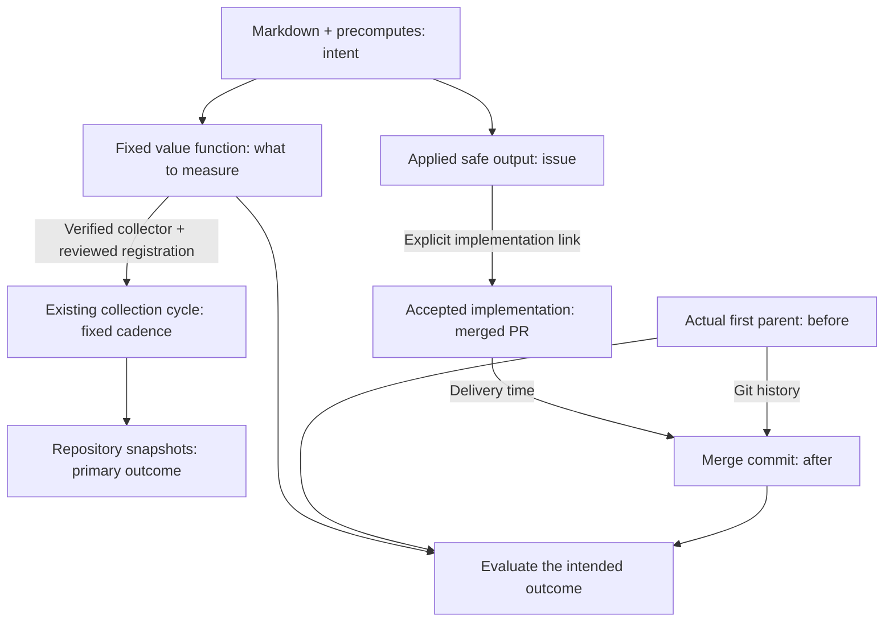

We measure **operational value** by checking whether a workflow's intended
repository outcome was attained—not whether a run succeeded or produced output.
This guide assumes you know workflow Markdown, precomputes and safe outputs.

**Intent defines what we measure. A fixed cadence tracks the repository;
acceptance anchors each linked contribution.**

## Define the value function

Read the workflow's Markdown, imports and precomputes for its goal, selection
rules and acceptance checks. Turn these into a **value function: a fixed rule
that measures the intended repository outcome**. Agree on scope, units and
missing-evidence rules before examining results.

For Daily File Diet, the goal is smaller production files without broken
behavior. The saved retrospective measure counts non-test Go files under `pkg/`
with at least 800 lines; lower is better. This is distinct from the original
1,000-line issue-creation trigger. Tests and other quality checks remain required
for full acceptance.

## Measure regularly, and at acceptance

Measure the primary repository state at a fixed cadence, including periods
with no accepted output. This reveals growth, recovery and reversals regardless
of who changes the repo. Measuring only at merges would select for completed
work and miss what happens between them.

Track the safe output's actual issue or PR through its lifecycle. For a proposal,
follow explicit links to the accepted implementation. Its merge time
locates the **actual first parent** and **merge commit** for before/after checks.
Apply the fixed function to all eligible files, including replacements; count
each PR once. If acceptance requires later evidence, wait for that maturation
period. Pending or rejected outputs are not delivered improvements.
Acceptance times vary: keep each opportunity's start and acceptance times,
report pending work and its age, and compare cohorts with equal follow-up.
Unresolved work is not automatically zero or failure. Retain zero and negative
changes at accepted merges, too.

For example, [github/gh-aw#55785](https://github.com/github/gh-aw/pull/55785)
links to [github/gh-aw#55776](https://github.com/github/gh-aw/issues/55776).
Between its [parent](https://github.com/github/gh-aw/tree/27092a4090300be16379f12fa5d60b36c04da832)
and [merge](https://github.com/github/gh-aw/tree/50f4e1baafb070f8426566f5bfcdc0f5bf476011),
`pkg/cli/add_command.go` shrinks from **1,129 to 248 lines**, with four smaller
files added. This proves a structural change, not unchanged behavior.

## Interpret the measurement

In the [saved File Diet report](https://raw.githack.com/githubnext/gh-aw-cao/refs/heads/mnkiefer-workflow-operational-value/docs/operational-value/gh-aw-workflows/daily-file-diet-pulse.html)
(October 18, 2026), select an event to inspect its issue, PR and Git revisions.

- **Primary measure:** the repository's oversized-file count, regardless of who
  changes it. It grows from 16 to 53.
- **Diagnostic:** verified reductions at linked merges. There are 48 over the
  workflow's lifetime. Useful repairs can coexist with a growing problem.

The skill's report follows **workflow intent → safe outputs → accepted changes
→ measured result**, with source links for the consolidated intent. It separates
retained proposals from receipt-confirmed creation and linked implementations:
closing an issue alone is not acceptance. Repository state includes everyone's
work; recent results remain separate from historical contribution. Unverified
quality checks stay visible. Select a headline number for its exact evidence;
chart points reveal the counted files with links at the measured Git revision.
Dashed lines guide the eye between snapshots, not continuous observations.
The plot states which direction is better; signed change shows whether the
repository problem improved or worsened since the first snapshot.
**Explore evidence** links each result to its issue, merged change, before/after
files and measurement rules. Historical reductions
do not mean that many fewer files remain today.

**Review results** asks for inspection, not retirement. **Check evidence** means
the comparison is not established; **No review triggered** is not an all-clear.
Future alerts must distinguish worsening outcomes, overdue acceptance and
missing evidence rather than treating every quiet period as failure.

**Lineage plus time-aligned measurements connect outputs to observed outcomes;
timing alone does not prove causation.** A merge is not proof of every quality
requirement. Missing evidence is unknown, not zero.

Use `/add-operational-value OWNER/REPO WORKFLOW` to design and verify a measure
with the skill. It gathers tracked outputs, verifies available producer
evidence, follows dated implementation links and measures the accepted Git
revisions. Reuse that fixed definition for subsequent evaluations.

To keep it current, the skill automatically stages its exact registration after the frozen function
and bounded collector pass verification; no separate enable step is needed.
Review, commit and deploy the policy and collector together. The existing collection cycle
refreshes only opted-in, in-scope workflows at their fixed cadence. Failures
keep the last capture; disabling collection keeps history. For a one-time
hosted upload, use `gh cao value publish ... --server URL --input REPORT-evidence.jsonl`;
uploading alone does not enable collection.
See [publication and recurring collection](operational-value.md#recurring-collection-after-opt-in).

> [!IMPORTANT]
> A current report requires fresh evidence collection, not just rerendering.
> The skill includes File Diet acquisition and offline replay commands.
> The linked October 18 example remains a saved historical report.

For research, limitations and exact replay commands, read the
[long-form blog article](/gh-cao/blog/measuring-agent-work-value/).
