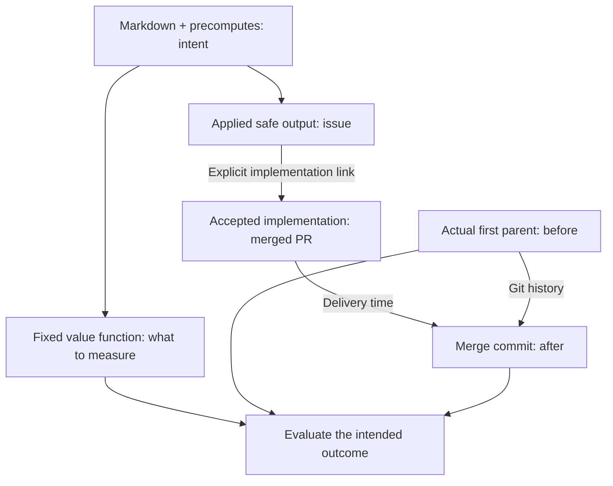

**An agentic workflow already tells us what it is trying to achieve.**
Its Markdown, imports and precomputes define the intended outcome and checks.
These define the **value function: a fixed rule for measuring that outcome**.
The output's acceptance state tells us when to check for delivery.
This method works with or without CAO.

Daily File Diet suggests splitting oversized Go files. Its evidence chain is:

<ol class="cao-value-trail" aria-label="Five steps from a goal to evidence">
<li><svg class="cao-value-icon" viewBox="0 0 16 16" aria-hidden="true" focusable="false"><path d="M8 1.5a6.5 6.5 0 1 0 6.016 4.035.75.75 0 0 1 1.388-.57 8 8 0 1 1-4.37-4.37.75.75 0 1 1-.569 1.389A6.473 6.473 0 0 0 8 1.5Zm6.28.22a.75.75 0 0 1 0 1.06l-4.063 4.064a2.5 2.5 0 1 1-1.06-1.06L13.22 1.72a.75.75 0 0 1 1.06 0ZM7 8a1 1 0 1 0 2 0 1 1 0 0 0-2 0Z"></path></svg><strong>1. Define value</strong>Translate the workflow's goal and checks into a fixed measurement rule.</li>
<li><svg class="cao-value-icon" viewBox="0 0 16 16" aria-hidden="true" focusable="false"><path d="M8 9.5a1.5 1.5 0 1 0 0-3 1.5 1.5 0 0 0 0 3Z"></path><path d="M8 0a8 8 0 1 1 0 16A8 8 0 0 1 8 0ZM1.5 8a6.5 6.5 0 1 0 13 0 6.5 6.5 0 0 0-13 0Z"></path></svg><strong>2. Follow the output</strong>The workflow opens an issue suggesting a change.</li>
<li><svg class="cao-value-icon" viewBox="0 0 16 16" aria-hidden="true" focusable="false"><path d="M5.45 5.154A4.25 4.25 0 0 0 9.25 7.5h1.378a2.251 2.251 0 1 1 0 1.5H9.25A5.734 5.734 0 0 1 5 7.123v3.505a2.25 2.25 0 1 1-1.5 0V5.372a2.25 2.25 0 1 1 1.95-.218ZM4.25 13.5a.75.75 0 1 0 0-1.5.75.75 0 0 0 0 1.5Zm8.5-4.5a.75.75 0 1 0 0-1.5.75.75 0 0 0 0 1.5ZM5 3.25a.75.75 0 1 0 0 .005V3.25Z"></path></svg><strong>3. Locate acceptance</strong>A linked implementation merges. Its delivery time anchors the measurement.</li>
<li><svg class="cao-value-icon" viewBox="0 0 16 16" aria-hidden="true" focusable="false"><path d="M1.5 1.75V13.5h13.75a.75.75 0 0 1 0 1.5H.75a.75.75 0 0 1-.75-.75V1.75a.75.75 0 0 1 1.5 0Zm14.28 2.53-5.25 5.25a.75.75 0 0 1-1.06 0L7 7.06 4.28 9.78a.751.751 0 0 1-1.042-.018.751.751 0 0 1-.018-1.042l3.25-3.25a.75.75 0 0 1 1.06 0L10 7.94l4.72-4.72a.751.751 0 0 1 1.042.018.751.751 0 0 1 .018 1.042Z"></path></svg><strong>4. Measure it</strong>Compare the actual files before and after the merged change.</li>
<li><svg class="cao-value-icon" viewBox="0 0 16 16" aria-hidden="true" focusable="false"><path d="M0 8a8 8 0 1 1 16 0A8 8 0 0 1 0 8Zm8-6.5a6.5 6.5 0 1 0 0 13 6.5 6.5 0 0 0 0-13ZM6.92 6.085h.001a.749.749 0 1 1-1.342-.67c.169-.339.436-.701.849-.977C6.845 4.16 7.369 4 8 4a2.756 2.756 0 0 1 1.637.525c.503.377.863.965.863 1.725 0 .448-.115.83-.329 1.15-.205.307-.47.513-.692.662-.109.072-.22.138-.313.195l-.006.004a6.24 6.24 0 0 0-.26.16.952.952 0 0 0-.276.245.75.75 0 0 1-1.248-.832c.184-.264.42-.489.692-.661.103-.067.207-.132.313-.195l.007-.004c.1-.061.182-.11.258-.161a.969.969 0 0 0 .277-.245C8.96 6.514 9 6.427 9 6.25a.612.612 0 0 0-.262-.525A1.27 1.27 0 0 0 8 5.5c-.369 0-.595.09-.74.187a1.01 1.01 0 0 0-.34.398ZM9 11a1 1 0 1 1-2 0 1 1 0 0 1 2 0Z"></path></svg><strong>5. State the limits</strong>Smaller files are proved. Unchanged behavior still needs its own evidence.</li>
</ol>

## Intent defines what; acceptance anchors when

Follow explicit issue/PR links to the accepted implementation. Its merge time
locates the **actual first parent** and **merge commit** for before/after checks.
Apply the fixed function to all eligible files, including replacements; count
each PR once. If acceptance requires later evidence, wait for that maturation
period. Pending or rejected outputs are not delivered improvements.

For example, [github/gh-aw#55785](https://github.com/github/gh-aw/pull/55785)
links to [github/gh-aw#55776](https://github.com/github/gh-aw/issues/55776).
Between its [parent](https://github.com/github/gh-aw/tree/27092a4090300be16379f12fa5d60b36c04da832)
and [merge](https://github.com/github/gh-aw/tree/50f4e1baafb070f8426566f5bfcdc0f5bf476011),
`pkg/cli/add_command.go` shrinks from **1,129 to 248 lines**, with four smaller
files added. This proves a structural change, not unchanged behavior.

## Read the result

In the [saved File Diet report](https://raw.githack.com/githubnext/gh-aw-cao/refs/heads/mnkiefer-workflow-operational-value/docs/operational-value/gh-aw-workflows/daily-file-diet-pulse.html)
(October 18, 2026), select an event to inspect its issue, PR and Git revisions.

- **Primary measure:** the repository's oversized-file count, regardless of who
  changes it. It grows from 16 to 53.
- **Diagnostic:** verified reductions at linked merges. There are 48 over the
  workflow's lifetime. Useful repairs can coexist with a growing problem.

**Lineage plus time-aligned measurements connect outputs to observed outcomes;
timing alone does not prove causation.** A merge is not proof of every quality
requirement. Missing evidence is unknown, not zero.

To apply this elsewhere, derive a fixed evidence rule from the workflow's intent
before inspecting results. The `/add-operational-value OWNER/REPO WORKFLOW`
skill can help; CAO is optional.

> [!IMPORTANT]
> The example's portable report and replay tools require the pinned
> `mnkiefer-workflow-operational-value` source branch, not main.

For research, limitations and exact replay commands, read the
[long-form blog article](/gh-cao/blog/measuring-agent-work-value/).
